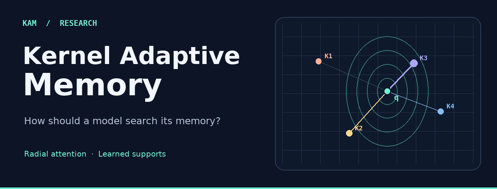
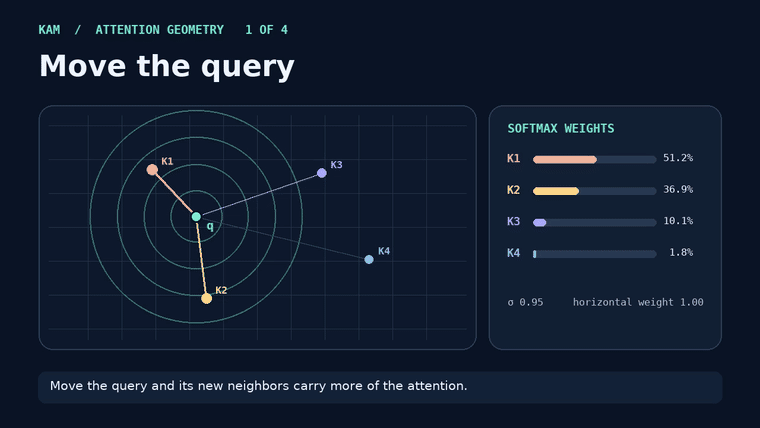
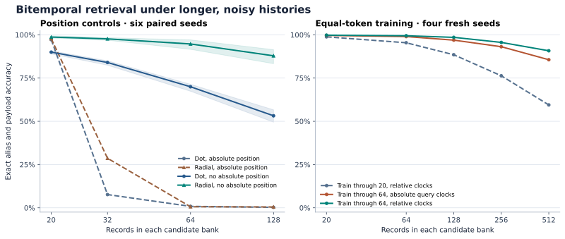

# Kernel Adaptive Memory

[](https://jibby2k1.github.io/KAM/)

[**Try the interactive demos**](https://jibby2k1.github.io/KAM/) · [**Watch the 30-second explainer**](https://jibby2k1.github.io/KAM/#explainer) · [Results and evidence](docs/research/RESULTS.md)

Kernel Adaptive Memory (KAM) studies how attention reads from the current context and from persistent learned supports. The research repository also contains separate experiments on one-pass evidence retrieval and temporal revision memory.

[Research specification](Kernel_Adaptive_Memory_Research_Specification.pdf) · [Dataset portfolio](docs/research/DATASET_PORTFOLIO.md) · [Citation](CITATION.cff)

## See how the method works

[](https://jibby2k1.github.io/KAM/#radial)

Move the query, narrow the bandwidth, or change the learned metric in the [attention demo](https://jibby2k1.github.io/KAM/#radial). The [revision lookup demo](https://jibby2k1.github.io/KAM/#revision) lets you move a release cutoff and see which version was available that day. The [method guide](docs/research/METHOD.md) explains both memory reads and connects the diagram to the implementation.

## Research at a glance

| Area | Question | Evidence |
| --- | --- | --- |
| Attention and memory | How do radial context attention and persistent learned supports behave under matched controls? | [Implementation](kam/) and [experimental guide](EXPERIMENTS.md) |
| Multi-hop retrieval | Can a one-pass pair scorer distinguish useful title mentions from linked distractors? | [HotpotQA study](reports/nonlinear_retrieval_natural/SUPPORT_LINKS.md) |
| Retrieval systems | How do corpus retrieval and serving choices affect latency and evidence recall? | [Corpus and serving findings](docs/research/RESULTS.md#corpus-retrieval-and-serving) |
| Revision memory | Can a router resolve ambiguous aliases and abstain on unseen identities? | [Revision-memory findings](docs/research/RESULTS.md#revision-memory) |

The [dataset breadth and temporal memory report](reports/nonlinear_retrieval_natural/DATASET_BREADTH_2026-11-26.md) compares frozen transfer across domains, archived revisions, controlled noise, and the KAM decoder’s length generalization.

The HotpotQA and MuSiQue experiments use frozen pretrained encoders and readers with separate routing heads. Their results concern retrieval and evidence selection. The KAM decoder has its own controlled experiments.

[](reports/nonlinear_retrieval_natural/BITEMPORAL_MODEL.md#position-and-scoring-geometry)

## Quick start

Use Python 3.10 or newer.

```bash
python -m venv .venv
source .venv/bin/activate
python -m pip install -e ".[dev]"
python -m pytest -q tests/test_attention.py tests/test_data.py tests/test_model.py
kam-train --task copy --model kam --steps 1000 --output outputs/copy_kam
```

For a matched baseline, repeat the command with `--model dot-transformer --output outputs/copy_dot`. Each run writes its checkpoint and validation metrics under the output directory. See the [original experiment guide](https://github.com/Jibby2k1/KAM/blob/5de33fe54c10b248c5de54b40a11e09115c06493/README.md) for model variants, additional tasks, and Phase IV–VI records.

## Repository map

| Path | Contents |
| --- | --- |
| [`kam/`](kam/) | Model, training, and benchmark code |
| [`configs/`](configs/) | Experiment and benchmark settings |
| [`scripts/`](scripts/) and [`slurm/`](slurm/) | Data preparation, analysis, and cluster jobs |
| [`reports/`](reports/) and [`results/`](results/) | Research reports and machine-readable evidence |
| [`tests/`](tests/) | Implementation and regression checks |

The HotpotQA study links its fixed split and per-question evaluations. Start with its [reproduction instructions](reports/nonlinear_retrieval_natural/SUPPORT_LINKS.md#reproduction) to audit the reported metrics or run the GPU experiment.
