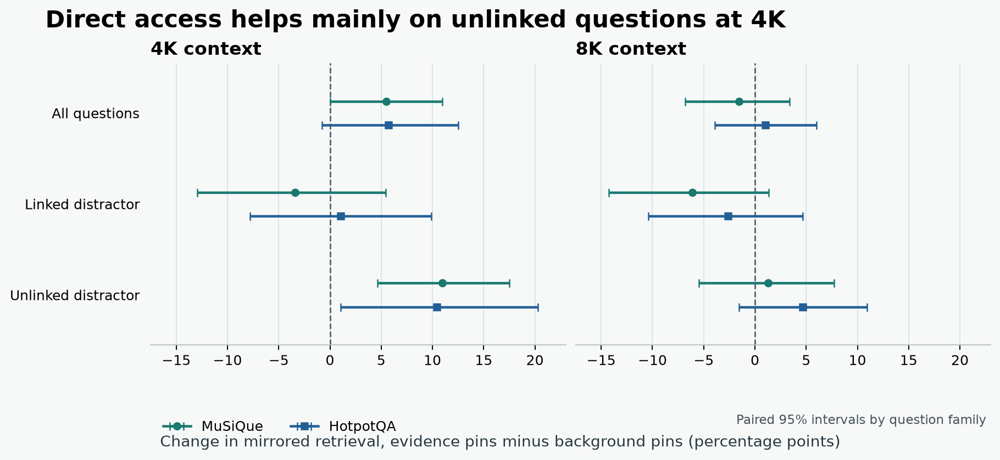

# Does direct access to earlier evidence improve the shortlist?

At 4K, directly pinning the earlier passage improved mirrored retrieval on unlinked questions by 10.97 points on MuSiQue and 10.42 on HotpotQA relative to pinning equally many background blocks. Both corpora saw higher average gold-endpoint margins. Overall mirrored accuracy remained below Flash at 4K, and the 8K accuracy intervals included zero.

Keep the same eight-block compute budget and frozen heads. Give the shortlist blocks intersecting the marked earlier passage, or the same number of complete blocks of nearby background. The known passage boundaries make this a supplied-evidence diagnostic. They are available from the prompt construction and provide no method for discovering evidence in an unmarked corpus.

## Fixed protocol

- Reuse the independent 128-question MuSiQue panel and the 128-question HotpotQA panel at both 4K and 8K. Preserve the inputs, ordering, endpoints, distractors and three trained checkpoints.
- Keep block zero, the current block and the preceding block. Reserve up to five of the remaining slots for every block intersecting the earlier passage. The matched control reserves an equally long contiguous run immediately after the evidence blocks. Preserve the existing proxy ranking for other slots. Exclude future blocks.
- Cross passage versus background with activation at all eligible queries versus only the last 256 queries in each layer. Compare the signed mirrored endpoint margin and mirrored accuracy, by corpus and width. Keep HotpotQA linked and unlinked strata visible in the results. Use the protected shortlist and Flash from the frozen panels as reference anchors.
- Verify that both orders and widths have the same marked ranges, validate route uniqueness and future masking on GPU, verify equality when no new blocks are pinned, and compare the actual sparse outputs with an independently masked Torch attention reference. Interleave full-model wall and CUDA event timing against Flash, protected shortlisting and the existing final-256 Flash window. The timing starts after the recorded span metadata is on the GPU.

## Results on HPG

| Corpus and width | Flash | Protected | Final-256 Flash | Evidence all queries | Background all queries | Evidence final 256 | Background final 256 |
| --- | ---: | ---: | ---: | ---: | ---: | ---: | ---: |
| MuSiQue 4K | 74.48% | 59.64% | 66.41% | 64.32% | 58.85% | 59.38% | 58.85% |
| MuSiQue 8K | 55.47% | 50.78% | 44.53% | 48.70% | 50.26% | 51.04% | 51.04% |
| HotpotQA 4K | 62.24% | 43.49% | 49.48% | 47.66% | 41.93% | 46.35% | 42.45% |
| HotpotQA 8K | 42.71% | 49.22% | 47.14% | 51.04% | 50.00% | 48.18% | 48.96% |

At 4K, pinning evidence in every eligible query raised the average signed mirrored margin by 0.139 logits [0.045, 0.238] on MuSiQue and 0.354 [0.232, 0.479] on HotpotQA, relative to background pins. The mirrored accuracy differences were +5.47 points [0.00, +10.94] and +5.73 [−0.78, +12.50]. On unlinked questions, the paired gains were +10.97 [4.64, 17.52] and +10.42 [1.04, 20.31]. On linked cases, where the earlier passage also supports a plausible distractor link, the gains were −3.40 [−12.93, +5.44] and +1.04 [−7.81, +9.90]. Intervals resample question families conditional on the three seeds. The linked strata and signed margin make the distinction between stronger evidence use and reliable disambiguation visible.

At 8K, the overall evidence-minus-background margin was +0.047 logits [−0.025, +0.119] for MuSiQue and −0.008 [−0.086, +0.069] for HotpotQA. Using pins only on the final 256 positions also gave inconclusive overall 8K results. At 4K, pins on all eligible queries remained 10.16 points behind Flash on MuSiQue [−18.90, −1.55] and 14.58 points behind on HotpotQA [−23.44, −5.47].

Evidence pins on all queries took 184.76 ms at 4K and 405.37 ms at 8K. Protected shortlisting took 184.55 and 405.19 ms, and Flash took 193.12 and 446.51 ms. Each shape used 15 interleaved batch-one trials on an RTX PRO 6000. All policies had the same incremental peak allocation at each width. Token-level parity held within BF16 tolerance, and inactive rows and empty-span outputs matched bitwise.

The intervention strengthens 4K evidence dependence when the earlier passage points uniquely to the answer. It leaves a substantial quality gap on linked cases and no robust accuracy gain at 8K. Future changes should measure whether better use of ambiguous evidence follows from the reader's trained representations or requires additional earlier computation.

[Paired margins, accuracy and profiling](../../results/general_benchmarks_evidence_pins/summary.json) · [Completed HPG jobs](../../results/general_benchmarks_evidence_pins/scheduler.tsv)
