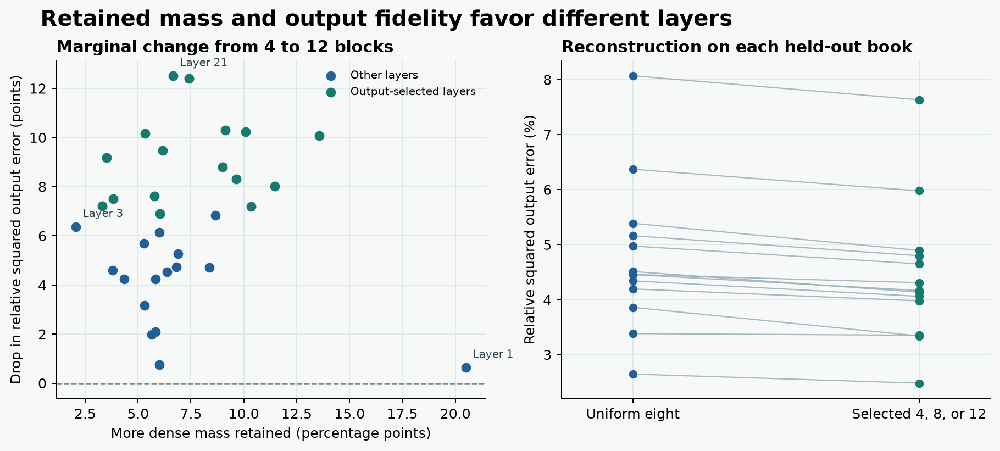

# Why attention mass and reader accuracy can move separately

The earlier evidence audit measures access to annotated keys. The projected output also depends on what those keys write into the residual stream. These are different diagnostics for the same fixed attention state.

## Worked derivation

Let $p_i$ denote a dense head's softmax probability on key $i$, and let $v_i$ denote its value. For retained set $S$, write $m=\sum_{i\in S}p_i$ and $C=S^\complement$. With $0<m<1$, the dense attention output is
$$
o=m\,o_S+(1-m)\,o_C,\qquad
o_S=\frac{\sum_{i\in S}p_iv_i}{m},\quad
o_C=\frac{\sum_{i\in C}p_iv_i}{1-m}.
$$
The head using the shortlist produces $o_S$. Hence for the head's slice $W$ of the output projection,
$$
W(o_S-o)=(1-m)W(o_S-o_C).
$$
The missing mass scales the difference between the retained and discarded mean values. If $\lVert v_i\rVert\le B$, the norm is at most $2B(1-m)\lVert W\rVert$. The error is exactly zero when the two weighted means have the same projection, even with substantial missing mass. Across heads, projected errors can also cancel.

A scalar example shows why adding mass can increase error. Take $p=(1/2,3/10,1/5)$ and $v=(0,2/3,-1)$. The dense mean is zero. Keeping only the first key keeps half the mass and gives zero error. Adding the second key raises retained mass to $4/5$ and moves the sparse mean to $1/4$. The third key counterbalanced the second before pruning. Keeping just the second and third keys gives exactly zero output at half the mass. The analysis script verifies these equalities with rational arithmetic.

The identity is for the same queries, keys and values. Once a sparse layer changes the residual stream, later layers can receive different inputs and choose different routes. The final decision adds another comparison. For mirrored A/B retrieval with output weights $w_A,w_B$ and final states $h_0,h_1$, the margin change obeys
$$
|\Delta M|\le\lVert w_B-w_A\rVert(\lVert\Delta h_0\rVert+\lVert\Delta h_1\rVert).
$$
Small errors can change a decision near zero margin. A large value or projection effect can carry through even when the total omitted attention mass is small.

## Reanalysis with the frozen dense calibration

The published layer study measured actual four-, eight-, and twelve-block routes on 13 PG-19 development books, 48 MuSiQue development questions, and three frozen checkpoint seeds. It retained the full dense reference path while reconstructing each local projected output. Across the 32 shared layers, the marginal gain in retained PG-19 mass from four to twelve blocks had Pearson correlation −0.01 and Spearman correlation +0.25 with the reduction in relative squared projected-output error. The rank correlation between the earlier-span mass gain in MuSiQue and the PG-19 output-error reduction was +0.44.

The table evaluates each candidate with an average of eight block slots per layer. The leave-one-book-out fit selects a fresh schedule using the other 12 development books, pooling the three seeds. Report mean local squared error relative to dense output energy, averaged over layers and held-out books. The joint allocation picks a budget of four, eight, or twelve in each layer using dynamic programming under a sum of 256 slots. The objective adds the independently measured layer errors.

| Allocation objective | Mean retained mass on calibration books | Held-book relative squared output error | Held books with lower error than uniform |
| --- | ---: | ---: | ---: |
| Uniform eight | 90.810% | 4.755% | Reference |
| Alternating four/twelve | 89.736% | 6.183% | 0 / 13 |
| Earlier-evidence gain, four/twelve | 89.556% | 5.552% | 1 / 13 |
| Retained mass, four/twelve | 90.933% | 5.645% | 0 / 13 |
| Output reconstruction, four/twelve | 90.000% | 4.987% | 1 / 13 |
| Retained mass, four/eight/twelve | 91.226% | 5.395% | 0 / 13 |
| Output reconstruction, four/eight/twelve | 90.312% | 4.444% | 13 / 13 |

Allowing eight blocks reduced the held-book reconstruction error by 6.54% relative to uniform and preserved the baseline allocation in 22 of 32 layers on the full calibration fit. The five four-block and five twelve-block layers retain a nominal average of eight. Their calculated causal token-read count is 0.55% lower at 4K and 0.27% lower at 8K than uniform eight. These counts follow from the available prefix at each position. The trained reader's accuracy, perplexity and latency require a matched forward pass with this schedule. [Original layer-budget experiment](LAYER_BLOCK_BUDGET.md)

[Replayable calibration analysis](../../results/general_benchmarks_layer_budget/mass-reconstruction.json)
