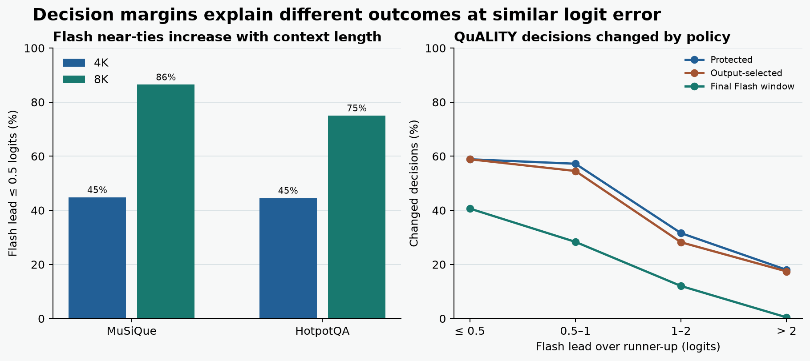

# Why smaller logit changes can flip more long-context answers

The final Flash window perturbed the MuSiQue logits less at 8K than at 4K. It still changed more answers because the 8K Flash reference had many more near-ties. This reanalysis uses completed predictions from the independent MuSiQue and HotpotQA panels and the intact QuALITY panel.

## A decision bound

Let $a$ be the unique winning option under Flash and let $\gamma$ be its lead over the runner-up. A second attention policy changes all option logits by a vector $\delta$. For any competing option $b$, the second policy's gap obeys

$$
\ell_a+\delta_a-\ell_b-\delta_b
\ \ge\ \gamma-(\max_j\delta_j-\min_j\delta_j).
$$

A strictly positive right side preserves the Flash decision. The difference between the maximum and minimum logit change ignores an offset shared by all options. Half this difference is the smallest maximum absolute logit error obtainable by subtracting a single common offset. The replay verifies that every decision meeting the bound agrees with Flash. Flash's chosen label can itself be wrong.

For each frozen checkpoint, first align the answer positions and average the two mirrored scores for binary retrieval. Do the same across four rotated scores on QuALITY. Treat a top-score tie as an undecided prediction. Compute the Flash margin, centered logit error and whether the decision changes. All counts are over the same questions and three seeds. The bound uses observed logits after both policies ran and serves as a decision-stability diagnostic.

## Reanalysis

| Panel | Flash lead at most half a logit | Final-window median centered logit error | Final-window decisions changed |
| --- | ---: | ---: | ---: |
| MuSiQue 4K | 172 / 384 | 0.156 | 20.05% |
| MuSiQue 8K | 332 / 384 | 0.109 | 51.04% |
| HotpotQA 4K | 171 / 384 | 0.156 | 26.04% |
| HotpotQA 8K | 288 / 384 | 0.125 | 44.27% |
| Intact QuALITY | 214 / 1,356 | 0.344 | 12.91% |

On the 8K HotpotQA panel, switching to the reconstruction-selected allocation recovered 124 Flash errors and lost 59 Flash-correct predictions. Forty-seven of the 65 net recoveries occurred on predictions where Flash's margin was at most half a logit. This characterizes the gain on that completed panel. The fresh-shard replication was stopped in the scheduler before evaluation.

On QuALITY, the final Flash window changed 3 of the 689 decisions where Flash led by more than two logits. Protected shortlisting changed 124 and the reconstruction-selected schedule changed 120. The corresponding centered-error medians over the full panel were 0.344, 1.016 and 1.047 logits. This helps explain why the window preserved more accuracy on intact articles.

A local output-reconstruction objective can make the reader more stable, but the effect on an answer depends on its margin. A deployable selector must estimate that risk using first-pass signals. The measured top-two margin rule left a large gap to oracle rescue on this panel. [Output reconstruction](ATTENTION_MASS_AND_RECONSTRUCTION.md) · [Confidence deferral](CONFIDENCE_FLASH_DEFERRAL.md)

[Verified cross-corpus replay](../../results/general_benchmarks_layer_budget/margin-stability.json)
