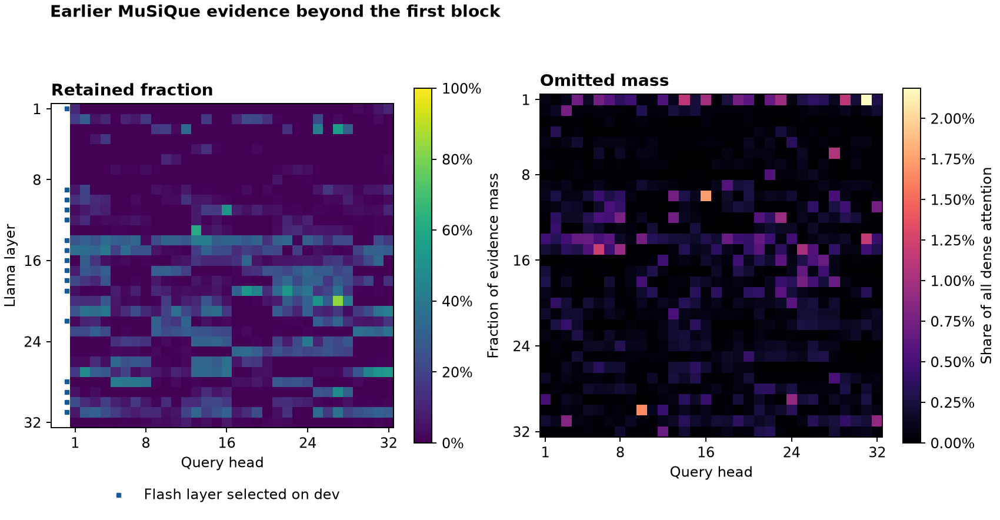

# Distant evidence and selective Flash fallback

Measure what first-block-protected attention keeps from the annotated earlier MuSiQue passage, then select which layers fall back to Flash. Reuse the three frozen top-four Llama checkpoints, all 320 mirrored 4,096-token MuSiQue questions, and 48 PG-19 books. [First-block control](FIRST_BLOCK_ATTENTION.md)

## Fixed comparison

- **Evidence spans.** Reconstruct the earlier support, bridge mention, gold endpoint, and foil from the frozen sources. Map their character offsets to token indices and require the reconstructed prefix and suffix to match each frozen input. Measure the earlier support and bridge mention both in full and outside block zero. The probe uses the final token of the gold passage and the final prompt query.
- **Development separation.** Freeze a 48-question MuSiQue panel with the same prompt format. Exclude the previously reserved question IDs and every candidate ID, relation family, and supporting title from the frozen holdout source. Verify tokenized panel separation before scoring. Neither the holdout attention measurements nor holdout scores are available to the selector.
- **Mass.** Capture the same post-rotary queries and keys used by the Flash backbone. Compute causal weights in FP32. For each layer, query head, query position and span, store the mean dense probability mass and the part covered by the protected route. The retained fraction divides the pooled covered mass by the pooled dense mass. These measurements describe dense-trajectory coverage.
- **Fallback.** Rank layers by mean omitted dense mass on earlier evidence outside block zero in the development panel. Pool heads, both query positions, both answer orders and the three frozen checkpoints. Use Flash in the sixteen highest-ranked layers. Use the protected eight-block shortlist elsewhere. Compare with the evenly spaced sixteen-layer control, all-layer protected, and all-Flash from the same checkpoints and holdout. The chosen mask is static at inference.
- **Quality and timing.** Measure PG-19 perplexity and mirrored MuSiQue accuracy. Pair books for NLL and relation families for retrieval, conditional on the three seeds. Rerun all four latency modes interleaved on the same RTX PRO 6000 with one checkpoint, including shortlist construction and the complete model. Report synchronized batch-one prefill p50 and p95 and incremental peak allocation at 512, 2,048, 4,096 and 8,192 tokens. Quality uses the 4,096-token holdout.

The earlier support spans at least one token outside the first block on all 320 holdout questions. About 90.45% of its tokens lie outside block zero. The first verified bridge mention reaches beyond block zero on 277 questions. The earlier passage ends a median 3,886 tokens before the gold passage ends across the two placements. The development panel contains 48 questions from the publisher's training split and shares no question IDs, relation families, or supporting titles with the frozen candidate pool.

The development rule assigned Flash to layers 1, 9–12, 14–19, 22, and 28–31 in one-based indexing. The periodic control uses Flash in odd-numbered layers. The layer mask and its development receipts were locked before holdout scoring.

## Attention to annotated evidence

The table gives the share of each span's dense attention mass retained on all 320 holdout questions, averaged over both placements and all three checkpoints. The dense mass column uses the complete causal prefix as its denominator. The three policy columns divide covered mass by dense mass on the indicated evidence.

| Query | Span | Dense mass | All layers protected | Periodic Flash | Selected Flash |
| --- | --- | ---: | ---: | ---: | ---: |
| Gold passage end | Earlier passage | 0.4297% | 39.00% | 67.19% | 86.79% |
| Gold passage end | Earlier passage outside first block | 0.3495% | 25.01% | 59.67% | 83.77% |
| Gold passage end | Bridge mention outside first block | 0.0107% | 39.89% | 69.13% | 79.59% |
| Final choice | Earlier passage | 0.1986% | 32.74% | 66.37% | 80.56% |
| Final choice | Earlier passage outside first block | 0.1571% | 14.98% | 57.49% | 75.43% |
| Final choice | Bridge mention outside first block | 0.0048% | 27.24% | 62.93% | 70.20% |
| Final choice | Gold endpoint | 2.1253% | 96.85% | 98.66% | 99.11% |
| Final choice | Foil endpoint | 2.0652% | 96.80% | 98.66% | 99.10% |

The strongest head-level omission on the earlier passage outside block zero at the final choice was layer 1, query head 31. That head omitted 2.19% of full attention probability on average. The heat map shows where omitted mass concentrates. The CSV contains all 32 layers and 32 query heads for both query positions and all six spans. [Layer and head table](../../results/general_benchmarks_evidence_fallback/layer-head.csv)

## Full-model prefill

Times are synchronized wall p50 / p95 in milliseconds. Peak PyTorch allocation above resident model and inputs is the same across modes at each context length.

| Context | Flash | Periodic Flash, 16 layers | Selected Flash, 16 layers | Protected shortlist, all layers | Incremental peak, MiB |
| ---: | ---: | ---: | ---: | ---: | ---: |
| 512 | 34.038 / 34.068 | 33.962 / 33.991 | 33.982 / 33.996 | 33.934 / 33.946 | 61.36 |
| 2,048 | 97.081 / 97.093 | 96.356 / 96.385 | 96.363 / 96.392 | 95.629 / 95.677 | 236.12 |
| 4,096 | 193.631 / 194.084 | 189.266 / 189.727 | 189.271 / 189.612 | 185.124 / 185.495 | 469.14 |
| 8,192 | 446.637 / 447.293 | 425.959 / 426.507 | 425.968 / 426.479 | 405.232 / 405.965 | 935.17 |

The selected mask reduced median full prefill by 2.25% at 4,096 tokens and 4.63% at 8,192. The periodic control had essentially the same latency. The 8,192-token measurement profiles runtime using concatenated book windows.

## Held-out quality and decision

| Policy | PG-19 perplexity ↓ | Mirrored MuSiQue ↑ | 4K prefill p50 ↓ |
| --- | ---: | ---: | ---: |
| Flash | 10.2098 | 68.44% | 193.63 ms |
| Periodic Flash, 16 layers | 10.8030 | 59.58% | 189.27 ms |
| Selected Flash, 16 layers | 10.4835 | 59.38% | 189.27 ms |
| Protected shortlist, all layers | 11.2023 | 53.33% | 185.12 ms |

At the matched sixteen-layer budget, the selected mask lowered paired NLL by 0.03002 nats/token [−0.03285, −0.02726] relative to the periodic mask. Its mirrored retrieval effect was −0.21 points [−4.60, +4.22]. Against Flash, it used 2.25% less 4K prefill time, had 2.68% higher perplexity, and lost 9.06 retrieval points [−13.41, −4.72]. The intervals resample books and relation families with the three adapter seeds held fixed.

The extra earlier-evidence mass preserved on Flash activations did not improve mirrored retrieval at equal layer count. It did predict a better perplexity result for this mask. Treat mass as a diagnostic and use end-to-end intervention to select retrieval routes. The next test isolates the final query positions, which are where the endpoint decision is made. Keep the first-block protection and the frozen scoring comparison.

## Reproduction

Use [the token-span preparer](../../scripts/prepare_kam_evidence_fallback.py) and the same registered Llama tokenizer and previous candidate corpus. The earlier preprocessing replay reproduced the frozen inputs and manifest byte for byte. Run [the evaluator](../../scripts/kam_evidence_fallback.py) in `dev` mode for indices 0–2, then `select`. Run `holdout` and `evaluate` for indices 0–2 and `benchmark` after selection. The [summarizer](../../scripts/summarize_kam_evidence_fallback.py) verifies the ranking from development receipts and reproduces the layer-and-head table and paired scores.

[Span manifest](../../results/general_benchmarks_evidence_fallback/spans.json) · [Locked mask](../../results/general_benchmarks_evidence_fallback/selection.json) · [Numeric summary](../../results/general_benchmarks_evidence_fallback/summary.json) · [Replay archive](../../results/general_benchmarks_evidence_fallback/outcomes.json.gz) · [HPG jobs](../../results/general_benchmarks_evidence_fallback/scheduler.tsv)
