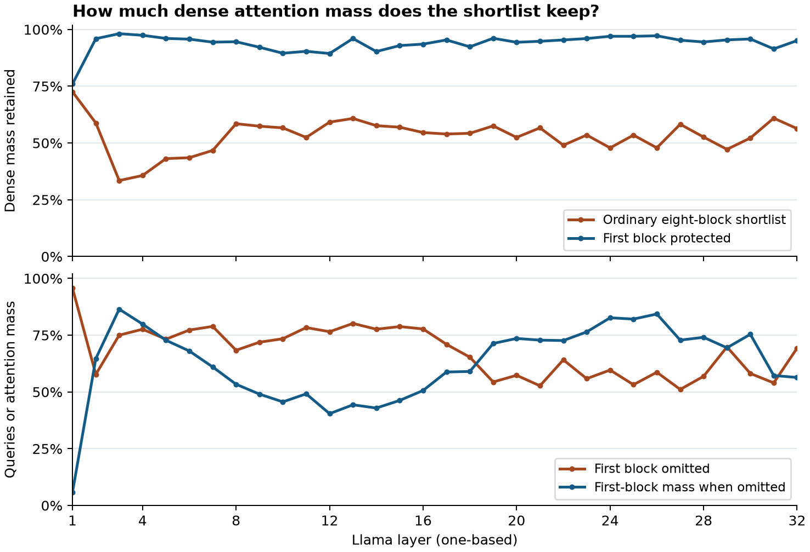

# Retained dense attention mass and first-block protection

Measure the attention mass kept by the eight-block shortlist in all 32 Llama layers. Then reserve the first 64-token block inside the same budget and test the change with frozen weights. Reuse the prior Flash control, ordinary shortlist, three adapter checkpoints, and 4,096-token holdout. [Backbone replacement study](BACKBONE_BLOCK_ATTENTION.md)

## Fixed protocol

- **Mass audit.** Run the complete Flash backbone. On the same post-rotary queries and keys in every layer, calculate causal softmax in FP32 and sum its probability over the blocks that each route would keep. Probe the first window of eight PG-19 books and both answer orders from eight MuSiQue questions per seed. Use one query every 64 tokens starting at index 31, plus the final query. Include all 32 query heads. Report retained mass, missing-first-block frequency, the mass it carries when omitted, and the mass displaced when it is protected. Use query positions beyond 512 as the main audit stratum, where the shortlist can omit a block. Report the final-query and dataset-specific results separately.
- **First-block intervention.** Keep the current and previous blocks as before. When the first block is absent, replace the lowest-ranked selected block by block zero. Preserve the ordinary route exactly when it already includes block zero. Leave the shortlist budget, attention softmax, routing granularity, weights, and residual adapters fixed. Verify causal behavior and verify the output against a Torch sparse-mask reference. [Kernel](../../scripts/kam_backbone_block_attention.py)
- **Quality.** Evaluate the protected operator at 8, 16 and 32 replaced backbone layers. Compare with each corresponding ordinary shortlist and with Flash from the prior run using the same hashes. Score 147,456 PG-19 targets and both-order margins for 320 MuSiQue questions over the same three seeds. Use paired book and relation-family intervals conditional on those seeds.
- **Performance.** Interleave Flash, ordinary and protected shortlists at each depth on the same RTX PRO 6000 and checkpoint. Report batch-one full-reader prefill p50 and p95 at 512, 2,048, 4,096 and 8,192 tokens. Include proxy construction, routing, and the complete model with A/B projection. Measure incremental peak PyTorch allocation above resident inputs and weights. Quality is measured at 4,096 tokens.

The mass audit measures the local intervention on Flash activations. The running sparse model can produce different activations in subsequent layers. The full holdout experiment measures that downstream effect.

## How much dense attention did the route keep?

Once pruning was possible, the ordinary shortlist kept **53.19%** of dense attention mass across 4,202,496 layer–head–query observations. First-block protection raised that to **93.92%** using the same eight slots. The ordinary route omitted the first block on 67.80% of those observations. On omissions, the first block had **60.65%** of dense mass and the displaced block had **0.57%**. The share of observations preserving less than half of the dense mass dropped from 50.52% to 1.25%.

| Audit subset | Ordinary shortlist | First block protected |
| --- | ---: | ---: |
| All prunable samples | 53.19% | 93.92% |
| PG-19, prunable | 49.72% | 90.81% |
| MuSiQue, prunable | 54.92% | 95.48% |
| Final query, both datasets | 47.72% | 90.79% |

Layer 3 gained the most, from 33.45% to 98.14%. Layer 1 gained the least, from 72.57% to 75.96%, and had the lowest mass retained after protection. The first block was frequently omitted even in layer 1, where it carried substantially less mass than in later layers. The plot and numeric summary cover every layer. [Layerwise numeric summary](../../results/general_benchmarks_first_block/summary.json)

Exact values for all 32 layers

| Layer | Ordinary mass | Protected mass | First block omitted |
| ---: | ---: | ---: | ---: |
| 1 | 72.57% | 75.96% | 95.79% |
| 2 | 58.82% | 95.93% | 57.73% |
| 3 | 33.45% | 98.14% | 75.01% |
| 4 | 35.68% | 97.43% | 77.61% |
| 5 | 43.11% | 96.05% | 73.22% |
| 6 | 43.51% | 95.73% | 77.26% |
| 7 | 46.72% | 94.41% | 78.86% |
| 8 | 58.48% | 94.59% | 68.35% |
| 9 | 57.39% | 92.16% | 71.90% |
| 10 | 56.66% | 89.52% | 73.43% |
| 11 | 52.44% | 90.37% | 78.35% |
| 12 | 59.18% | 89.41% | 76.52% |
| 13 | 60.81% | 96.01% | 80.17% |
| 14 | 57.63% | 90.28% | 77.62% |
| 15 | 56.95% | 92.91% | 78.79% |
| 16 | 54.59% | 93.54% | 77.74% |
| 17 | 53.94% | 95.38% | 70.98% |
| 18 | 54.26% | 92.36% | 65.30% |
| 19 | 57.53% | 96.11% | 54.39% |
| 20 | 52.45% | 94.35% | 57.33% |
| 21 | 56.66% | 94.80% | 52.70% |
| 22 | 49.01% | 95.38% | 64.14% |
| 23 | 53.51% | 96.00% | 55.84% |
| 24 | 47.84% | 97.00% | 59.64% |
| 25 | 53.46% | 96.98% | 53.19% |
| 26 | 47.86% | 97.21% | 58.67% |
| 27 | 58.25% | 95.26% | 51.11% |
| 28 | 52.60% | 94.49% | 56.88% |
| 29 | 47.20% | 95.41% | 69.81% |
| 30 | 52.19% | 95.81% | 58.12% |
| 31 | 60.93% | 91.44% | 53.97% |
| 32 | 56.33% | 95.09% | 69.31% |

## Full-reader latency and memory

On an HPG RTX PRO 6000, each pair below gives ordinary / protected synchronized wall p50 in milliseconds. The Flash measurements use the same checkpoint and are interleaved with all six shortlist configurations. Peak allocation was identical across modes at each context length.

| Tokens | Flash | 8 layers | 16 layers | 32 layers | Incremental peak, MiB |
| ---: | ---: | ---: | ---: | ---: | ---: |
| 512 | 34.630 | 34.576 / 34.572 | 34.539 / 34.530 | 34.528 / 34.529 | 61.36 |
| 2,048 | 97.698 | 97.428 / 97.365 | 97.020 / 96.985 | 96.317 / 96.316 | 236.12 |
| 4,096 | 196.877 | 194.425 / 194.507 | 192.163 / 192.484 | 188.264 / 188.258 | 469.14 |
| 8,192 | 449.728 | 439.399 / 439.478 | 429.206 / 429.311 | 408.305 / 408.481 | 935.17 |

Relative to Flash, the protected 8-, 16- and 32-layer variants cut 4K p50 by 1.20%, 2.23% and 4.38%. Their 8K reductions were 2.28%, 4.54% and 9.17%. The 4K p95 times were 197.79 ms for Flash and 195.30, 193.19 and 189.18 ms at the three protected depths. The benchmark used unpadded batch-one prefill, one checkpoint, and no KV cache.

## Quality on the same 4K holdout

The Flash quality reference was 10.2098 PG-19 perplexity and 68.44% mirrored MuSiQue. Each ordinary / protected comparison below uses the same three frozen adapter checkpoints.

| Replaced layers | PG-19 perplexity, ordinary / protected | Excess NLL removed | Mirrored retrieval, ordinary / protected | Protected minus Flash, points [95% CI] |
| ---: | ---: | ---: | ---: | ---: |
| 8 | 33.7581 / 10.4903 | 97.73% | 48.23% / 65.31% | −3.13 [−6.87, +0.78] |
| 16 | 174.3468 / 10.8030 | 98.01% | 52.50% / 59.58% | −8.85 [−13.38, −4.32] |
| 32 | 337.7396 / 11.2023 | 97.35% | 50.31% / 53.33% | −15.10 [−20.23, −9.86] |

First-block protection lowered next-token loss relative to the ordinary shortlist in every seed and depth. Relative to Flash, its paired NLL gaps were +0.02711 [0.02501, 0.02926], +0.05648 [0.05127, 0.06258] and +0.09277 [0.08511, 0.10134] nats/token. These correspond to 2.75%, 5.81% and 9.72% higher perplexity. Mirrored retrieval improved by 17.08 points [+10.34, +24.35] at eight layers relative to the ordinary shortlist. Removing the one question with a detected adapter-training passage overlap left the gap against Flash at −3.13 points [−6.99, +0.76]. The eight-layer interval permits a material retrieval loss. The 16- and 32-layer intervals show a loss.

## Research decision

The omitted first block explains most of the excess language-model loss for this fixed-budget, frozen Llama replacement. Its retention largely preserves the earlier speedups. Retrieval still deteriorates with depth despite high mean retained attention mass on Flash activations. Treat first-block protection as the baseline for the next shortlist study. Test which layers and heads lose task-relevant distant evidence, and compare a selective dense fallback before spending compute on a new fit. Flash remains the quality reference.

## Reproduction

Use the same registered Llama weights, adapter checkpoint directory and prepared input directory as the backbone study. Run [the evaluator](../../scripts/eval_kam_first_block.py) as `ROOT SOURCE WORK smoke`, `audit INDEX` for indices 0–2, `evaluate INDEX` for indices 0–8, and `benchmark`. [The summarizer](../../scripts/summarize_kam_first_block.py) takes the collected outcomes, prior input manifest, prior [backbone outcomes archive](../../results/general_benchmarks_backbone_shortlist/outcomes.json.gz), and the prior source audit. [Plot script](../../scripts/plot_kam_first_block.py) · [Numeric summary](../../results/general_benchmarks_first_block/summary.json) · [Replay archive](../../results/general_benchmarks_first_block/outcomes.json.gz) · [HPG jobs](../../results/general_benchmarks_first_block/scheduler.tsv)
