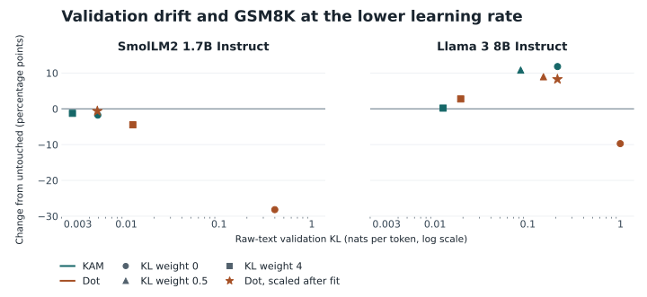
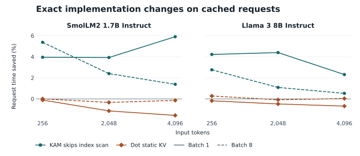

# What changes when pretrained adapters are regularized

These HiPerGator diagnostics use the frozen checkpoints and task fixtures from the [matched five-benchmark factorial](GENERAL_BENCHMARKS_FACTORIAL.md). The benchmark scorecard uses the original evaluation protocol.

## Removing redundant teacher and student computation

The KL teacher has no adapter output. Teacher and student therefore compute identical activations from the input through the base block that receives the first adapter. A prototype computes that eight-layer prefix once for Llama and keeps its final activation for the student. The subsequent layers still run for both branches.

| Llama 3 8B | Original, ms | Shared, ms | Time saved | Peak allocated, GiB |
| --- | ---: | ---: | ---: | ---: |
| RTX PRO 6000, KAM | 599.95 | 554.87 | 7.51% | 35.11 |
| RTX PRO 6000, dot | 598.54 | 553.27 | 7.56% | 35.10 |
| B200, KAM | 227.90 | 211.26 | 7.30% | 35.11 |
| B200, dot | 226.80 | 209.29 | 7.72% | 35.10 |

Each number is the median of 24 timed loss-and-backward measurements per method at 4,096 subword tokens per batch. The methods ran in original–shared–shared–original order on one GPU per arm. The CUDA timings include the gradient computation and omit the optimizer step. Both losses and all adapter gradients matched bitwise on four held-out batches per arm and device in deterministic mode. On RTX PRO 6000 in the standard execution mode, even repeated original gradients differed by 0.55%–0.83% in relative L2. Shared versus original differed by 0.61%–0.80%, and losses matched exactly. [RTX KAM](../../results/general_benchmarks_factorial/diagnostics/kl-prefix-kam.json) · [RTX dot](../../results/general_benchmarks_factorial/diagnostics/kl-prefix-dot.json) · [B200 KAM](../../results/general_benchmarks_factorial/diagnostics/kl-prefix-b200-kam.json) · [B200 dot](../../results/general_benchmarks_factorial/diagnostics/kl-prefix-b200-dot.json) · [Probe](../../scripts/probe_kam_kl_prefix.py)

A deterministic training replay started from the same zero-output adapters and ran the first 64 scheduled AdamW updates. Every CE and KL value and every fingerprint of the adapter weights, update count and moment tensors matched at each step for both arms. Median timed update fell from 621.54 to 577.72 ms for KAM and from 613.39 to 569.11 ms for dot. Timings exclude the CPU copies used to verify the states. [KAM update trace](../../results/general_benchmarks_factorial/diagnostics/kl-prefix-optimizer-kam.json) · [Dot update trace](../../results/general_benchmarks_factorial/diagnostics/kl-prefix-optimizer-dot.json)

The full 256-step RTX replay also matched every recorded loss and parameter or optimizer-state fingerprint. Summed timed updates fell from 160.18 to 148.55 seconds for KAM and from 158.96 to 147.41 for dot. This comparison covers the training updates. Validation, checkpoint writes and the trace hash transfers sit outside the GPU timing. [Full KAM replay](../../results/general_benchmarks_factorial/diagnostics/kl-prefix-optimizer-full-kam.json) · [Full dot replay](../../results/general_benchmarks_factorial/diagnostics/kl-prefix-optimizer-full-dot.json)

### Coarsening teacher distributions

We kept the teacher's top 16, 64, 256 or 1,024 token probabilities and grouped the remaining probability into one class. The coarsened KL was checked against the exact KL on four held-out batches per high-rate KL arm in seed 731221. With 1,024 retained token probabilities, the worst relative L2 difference in the combined cross-entropy plus KL gradient was 12.27% for Llama and 3.61% for SmolLM2. Gradient cosines stayed above 0.992 and 0.999 respectively. The experiment measured gradients at the frozen fitted weights.

Storing 1,024 FP32 values and 32-bit indices plus the tail mass uses 8,196 bytes per teacher position. The Llama teacher's 4,096-dimensional BF16 final state uses 8,192 bytes and can be passed through the unchanged vocabulary head. The gradient discrepancy and the similar storage size motivate testing a cache of final hidden activations. [Per-batch KL, tail mass and gradients](../../results/general_benchmarks_factorial/diagnostics/kl-compression-gradients.json) · [Probe](../../scripts/probe_kam_kl_compression.py)

### Exact frozen-teacher activation caching

We cached the frozen teacher's BF16 final states at the rotating KL positions on the original 256-batch seed-731221 schedule. The cached path reconstructs the original strided view for the vocabulary head, then computes full-vocabulary KL. The original and cached paths produced bitwise-identical teacher logits at four inspected phases. Every optimizer update had identical losses and parameter and AdamW-state fingerprints for both adapters on both backbones.

| Backbone, RTX PRO 6000 | Cache memory | Cached KAM / dot update saving | Two original fits | Two cached fits plus cache build | Total saving |
| --- | ---: | ---: | ---: | ---: | ---: |
| SmolLM2 | 1 GiB | 29.1% / 30.2% | 95.69 s | 81.74 s | 14.6% |
| Llama 3 | 2 GiB | 29.9% / 30.2% | 320.58 s | 272.19 s | 15.1% |

The table sums timed optimizer updates and includes the cache build once. It describes GPU work on the matched pair. Validation, disk transfer and scheduling are outside these timings. Cache reuse requires the same model weights, token windows, KL positions and precision. [Timing summary](../../results/general_benchmarks_factorial/diagnostics/teacher-hidden-cache-summary.json) · [SmolLM2 trace](../../results/general_benchmarks_factorial/diagnostics/smollm2-teacher-hidden-cache.json) · [Llama trace](../../results/general_benchmarks_factorial/diagnostics/llama3-teacher-hidden-cache.json) · [Cache probe](../../scripts/probe_kam_teacher_hidden_cache.py)

The disk-backed replay built one tape per backbone, then loaded it in two independent training jobs. Each job checked the full model and schedule fingerprints and compared four live teacher states before training. The final parameter and AdamW-state fingerprints matched the in-memory reference for all four fits. The measured write was 1.55 s for Llama and 0.73 s for SmolLM2. Loading and live checking took 1.29–2.07 s and 0.49–0.50 s per fit respectively. The training path accepts the cache as an explicit option. [Independent build and training receipts](../../results/general_benchmarks_factorial/diagnostics/persisted-teacher-cache-receipts.json)

Cache construction reduces total GPU work when multiple regularized fits reuse a seed's tape. With two free GPUs and an uncached tape, completion time also includes the build before either fit can start. Using the measured Llama timings, the longer original update stream took 161.00 s, and a new tape plus the longer cached stream took 160.85 s before disk and scheduler costs. A saved tape removes that build from future runs. Shared-prefix computation saves work inside an individual fit with no cache build.

The shared-prefix option was also exercised in four separate training jobs. The final parameter and optimizer fingerprints matched the exact reference for each fit. The table compares both opt-ins using the recorded fit interval, which includes validation. The cold-cache total adds one build and write plus both loads and live checks. It sums work across jobs. Allocating both fits concurrently changes elapsed completion time. [Shared-prefix trainer receipts](../../results/general_benchmarks_factorial/diagnostics/shared-prefix-trainer-receipts.json)

| Backbone | Shared-prefix fit KAM / dot | Saved-cache fit and load KAM / dot | Cold-cache total for both |
| --- | ---: | ---: | ---: |
| SmolLM2 | 47.13 s / 45.16 s | 36.82 s / 34.93 s | 86.65 s |
| Llama 3 | 152.81 s / 151.28 s | 118.99 s / 116.97 s | 285.06 s |

## Scaling residual output after fitting

We multiplied the four output projections by 0, 0.25, 0.50, 0.75 or 1.00 for the high-rate fits from seed 731221. The frozen backbone and the residual's internal computation were held fixed. Scale zero reproduced all predicted choices from the untouched checkpoint on this panel. At scale 0.25, the four unregularized fits already exceeded 0.02 nats per token on held-out raw-text KL. All four KL-trained fits remained within that cap at scale one. A smaller nonzero post-fit scale could also meet the cap, so the five-point grid alone cannot establish the effect of training with KL at equal drift. [Numeric strength curves](../../results/general_benchmarks_factorial/diagnostics/residual-strength-summary.json) · [Probe](../../scripts/probe_kam_adapter_strength.py)

The panel uses all 198 GPQA Diamond items and a fixed 2,048-item MMLU sample. The GPQA predictions at scale zero and one matched the corresponding primary outputs exactly. The sample is packed into fresh length-sorted MMLU batches. Its untouched predictions differed from the corresponding primary items on 15 Llama and 68 SmolLM2 cases. Full-strength endpoint disagreements ranged from 15 to 31 Llama items and 45 to 86 SmolLM2 items. The results below compare only identically packed panel items.

## Drift at the assistant cue

In the Llama MMLU panel, adding high-rate KL reduced teacher-to-student divergence within the four answer letters from 0.238 to 0.013 nats for KAM and from 0.210 to 0.013 for dot. Choices changed from the untouched reference on 342 to 68 of 2,048 items per seed for KAM and 274 to 64 for dot. Across all 24 related Llama fits, the conditional answer-letter divergence tracked the number of changed choices more closely than raw-text validation divergence. Their Spearman correlations were 0.95 versus 0.85 on MMLU and 0.96 versus 0.76 on GPQA.

On GPQA, the same divergence was weakly associated with total correctness (Spearman −0.12). Choices can change from correct to incorrect or the reverse. This comparison concerns fidelity to the untouched model and keeps its accuracy separate. The correlations summarize the 24 measured fits, which share data and seeds. [Assistant-cue audit](../../results/general_benchmarks_factorial/diagnostics/prompt-drift-summary.json) · [Probe](../../scripts/probe_kam_prompt_drift.py)

SmolLM2 showed the same pattern of reduced choice changes after high-rate KL. On the MMLU panel, KAM changed about 515 choices without KL and 132 with KL. Dot changed 753 and 142. Cue divergence was more strongly associated with changes than validation divergence on both MMLU and GPQA. [Both backbones' cue results](../../results/general_benchmarks_factorial/diagnostics/prompt-drift-summary.json)

## GSM8K and the required answer marker

The Llama replay preserved all original strict correctness and marker-parse flags across 25 checkpoints and 1,319 items. When the original scorer found no marked number, the diagnostic accepted a terminal boxed number, a number after an explicit answer cue on the last line, or a standalone numeric last line. The fallback identified one additional candidate number out of 3,521 unmarked generations. That candidate was incorrect. Low-rate KAM's 11.80-point mean gain over untouched Llama therefore remained the same under this fallback (95% paired item interval +9.40 to +14.23). The audit tests simple terminal formats. Other answer forms and the decoding token limit remain separate questions. [Replay summary](../../results/general_benchmarks_factorial/diagnostics/llama3-gsm8k-format-summary.json) · [Per-item flags](../../results/general_benchmarks_factorial/diagnostics/llama3-gsm8k-format-outcomes.json.gz)

SmolLM2 also reproduced every strict flag across 25 checkpoints. The conservative parser recovered one additional correct answer for the untouched model, moving from 419 to 420 of 1,319. Across adapter cells, the largest mean gain from fallback was 0.13 points. [SmolLM2 replay summary](../../results/general_benchmarks_factorial/diagnostics/smollm2-gsm8k-format-summary.json) · [Per-item flags](../../results/general_benchmarks_factorial/diagnostics/smollm2-gsm8k-format-outcomes.json.gz)

## Regularization and shrinkage at the same drift cap

For each high-rate fit, we selected the largest measured residual scale from a bounded search at or below 0.01 nats per token of raw validation KL. The bounds depended only on raw validation KL. The three-seed comparisons used the same GPQA and repacked MMLU panels as the strength sweep. Selected KL ranged from 0.00937 to 0.00997 nats among the reported cell means. SmolLM2 KAM trained with KL already fit below the cap at full strength.

| Backbone | High-rate fit | Selected scale KAM / dot | MMLU choices changed KAM / dot, of 2,048 | Raw math validation NLL KAM / dot |
| --- | --- | ---: | ---: | ---: |
| SmolLM2 | Without training KL | 0.135 / 0.067 | 94 / 86 | 1.169 / 1.141 |
| SmolLM2 | With training KL | 1.000 / 0.892 | 132 / 137 | 0.949 / 0.796 |
| Llama 3 | Without training KL | 0.064 / 0.059 | 32 / 19 | 1.512 / 1.532 |
| Llama 3 | With training KL | 0.772 / 0.700 | 53 / 49 | 0.972 / 0.922 |

Shrinkage kept more of the untouched MMLU choices in all four architecture–backbone pairs at this cap. Training KL yielded lower raw-text NLL on all three calibration domains and allowed much larger residual amplitudes. The same raw-text drift budget can therefore correspond to different degrees of language adaptation and answer retention. These panel scores provide a descriptive comparison after calibration on another stream. [SmolLM2 cap results](../../results/general_benchmarks_factorial/diagnostics/smollm2-matched-drift-summary.json) · [Llama cap results](../../results/general_benchmarks_factorial/diagnostics/llama3-matched-drift-summary.json) · [Probe](../../scripts/probe_kam_matched_drift.py)

### Matching dot to KAM's low-rate drift

For each low-rate seed and backbone, the native unregularized KAM checkpoint set the raw validation KL target. We shrank its unregularized dot counterpart to the largest measured scale under that target. The target and search used raw validation text. The held-out arithmetic evaluation retained the original 384-token protocol.

| Backbone | Untouched | Native KAM | Native dot | Shrunk dot | Dot scale range |
| --- | ---: | ---: | ---: | ---: | ---: |
| SmolLM2 | 31.77% | 30.00% | 3.59% | 31.13% | 0.042–0.044 |
| Llama 3 | 62.55% | 74.35% | 52.82% | 70.81% | 0.289–0.321 |



The figure shows three-seed means and includes the completed intermediate-KL pilot on Llama. [Figure source](../../scripts/plot_kam_low_rate_tradeoff.py)

At the paired KL target, dot gained 27.55 GSM8K points on SmolLM2 (95% paired item interval +25.09 to +30.05) and 17.99 on Llama (+15.57 to +20.47). The Llama KAM advantage remained at 3.54 points (+1.69 to +5.38). SmolLM2 dot exceeded KAM by 1.14 points (+0.08 to +2.20). This isolates one post-training control for residual strength on a single generation task. [SmolLM2 matched results](../../results/general_benchmarks_factorial/diagnostics/smollm2-low-rate-matched-kl-summary.json) · [Llama matched results](../../results/general_benchmarks_factorial/diagnostics/llama3-low-rate-matched-kl-summary.json) · [Per-item flags](../../results/general_benchmarks_factorial/diagnostics/low-rate-matched-kl-outcomes.json.gz) · [Probe](../../scripts/probe_kam_low_rate_matched_kl.py)

### Contribution by residual layer

We measured full, single-layer and leave-one-layer-out KL on the frozen low-rate checkpoints. Removing Llama dot's earliest adapter, at zero-based layer 7, reduced mean validation KL by 0.443 nats from 0.994. Removing SmolLM2 dot's second adapter, at layer 11, reduced it by 0.194 nats from 0.399. Even after the largest single removal, the dot KL exceeded the paired KAM mean of 0.209 and 0.0049 nats respectively. The sums of the single-layer KL values also fell below the full-stack KL in both dot arms. The tests describe interventions on the complete trained stacks. [Layer effects and activation ratios](../../results/general_benchmarks_factorial/diagnostics/layer-drift-summary.json) · [Outcomes](../../results/general_benchmarks_factorial/diagnostics/layer-drift-outcomes.json.gz) · [Probe](../../scripts/probe_kam_layer_drift.py)

We then calibrated only the first two or last two dot residuals, using the same KAM KL cap. The remaining two residuals were zeroed, and the benchmark protocol was fixed.

| Backbone | All four residuals | First two only | Last two only |
| --- | ---: | ---: | ---: |
| SmolLM2 | 31.13% | 30.88% | 29.24% |
| Llama 3 | 70.81% | 69.50% | 70.26% |

Uniform scaling had the highest measured GSM8K mean on both backbones. Relative to uniform, retaining only the last two SmolLM2 layers reduced score by 1.90 points (95% paired item interval −3.36 to −0.45). The other contrasts included zero. These tests keep the same fitted weights and calibration stream when changing which layers are active. [Layer-selection outcomes](../../results/general_benchmarks_factorial/diagnostics/layer-matched-kl-outcomes.json.gz) · [Summarizer](../../scripts/summarize_kam_low_rate_matched_kl.py)

## GSM8K decoding budget

Doubling the Llama GSM8K budget from 384 to 768 tokens preserved the original score for untouched Llama and for all three low-rate dot checkpoints. Untouched Llama emitted an end-of-sequence token for all 1,319 items within the original budget. Low-rate KAM gained one additional correct answer in one seed, moving that seed from 959 to 960 of 1,319. The short prefixes reproduced all official correctness and marker flags. The original decoding limit explains very little of the measured strict score gap on this comparison.

[Decoding budget summary](../../results/general_benchmarks_factorial/diagnostics/llama3-gsm8k-budget-summary.json) · [Per-item flags and stop conditions](../../results/general_benchmarks_factorial/diagnostics/llama3-gsm8k-budget-outcomes.json.gz) · [Probe](../../scripts/probe_kam_gsm8k_budget.py)

### Where the strict score gains occurred

The table partitions the net change in correct Llama GSM8K outcomes by whether each compared completion contained a parseable marker. Counts are mean changes per seed.

| Comparison | Both marked | First method only marked | Second method only marked | Total change |
| --- | ---: | ---: | ---: | ---: |
| Low-rate KAM vs untouched | −22.0 | +181.0 | −3.3 | +155.7 |
| Low-rate dot with KL 0.5 vs dot without KL | +254.0 | +2.3 | −10.0 | +246.3 |
| Shrunk low-rate dot vs native low-rate KAM | +16.0 | +8.7 | −71.3 | −46.7 |

Low-rate KAM's strict gain came from items marked only by KAM. Most of dot's intermediate-KL improvement occurred where both dot recipes already produced marked numbers. The decomposition describes observed output and scoring behavior. Strict verification requires a parseable marker.

The Llama KAM gain appeared in the two-, three-, and four-or-more-calculation reference groups. On the 515 items with at least four calculator annotations, strict exact match rose from 52.62% to 66.08%. Reference calculator annotations describe the released solutions, and the groups reflect those annotations. [Llama structure and marker analysis](../../results/general_benchmarks_factorial/diagnostics/llama3-gsm8k-reference-structure.json) · [SmolLM2 analysis](../../results/general_benchmarks_factorial/diagnostics/smollm2-gsm8k-reference-structure.json) · [Numeric descriptors](../../results/general_benchmarks_factorial/diagnostics/gsm8k-reference-descriptors.json) · [Extraction](../../scripts/audit_kam_gsm8k_reference_structure.py) · [Analysis](../../scripts/summarize_kam_gsm8k_reference_structure.py)

## Cached inference by input length

Both backbones processed the same held-out token spans per arm, with 32 incremental teacher-forced tokens after prefill. The high-rate KL adapters came from seed 731221. Each shape used one RTX PRO 6000 and nine timed rotations after warming all arms. The reported median includes prefill, incremental decoding and Python dispatch. Tokenization and serving queue time sit outside this measurement.

| Backbone | Batch | 256 tokens, KAM / dot (ms) | 2,048 tokens, KAM / dot (ms) | 4,096 tokens, KAM / dot (ms) |
| --- | ---: | ---: | ---: | ---: |
| SmolLM2 | 1 | 198.63 / 194.35 | 224.71 / 219.95 | 264.68 / 271.10 |
| SmolLM2 | 8 | 264.69 / 251.83 | 642.30 / 638.85 | 1,125.42 / 1,139.24 |
| Llama 3 | 1 | 457.65 / 439.99 | 549.84 / 545.53 | 659.26 / 666.84 |
| Llama 3 | 8 | 591.37 / 576.41 | 1,382.74 / 1,380.46 | 2,378.74 / 2,391.77 |

KAM's residual reads static supports and stores no sequence KV state. Dot's residual uses 1,024 bytes per cached token per sequence at BF16, or 32.25 MiB at the longest tested batch. The frozen backbone creates its own cache in every arm. The adapter cache was below 1% of the full cache at that shape. Dot was faster through 2,048 tokens and KAM was faster at 4,096 in these implementations. A preallocated dot adapter cache is a relevant next control because the current dot implementation appends keys and values dynamically. [Timing and memory summary](../../results/general_benchmarks_factorial/diagnostics/decode-profile-summary.json) · [Timed requests](../../results/general_benchmarks_factorial/diagnostics/decode-profile-outcomes.json.gz) · [Probe](../../scripts/probe_kam_adapter_decode.py)

### Cache allocation and index validation controls



We preallocated the dot adapter KV cache for the same 32-token continuation and reused warmed buffer capacity. The static and dynamic arms produced identical logits at all measured positions. Static allocation changed request time by −0.28% to +1.56% across the 12 backbone and shape combinations.

The checked KAM path runs device reductions to verify the range of the indices produced by exact top-k. The input width already bounds these generated indices. An opt-in removed those reductions and kept the route's tensor layout and support-width checks. Every measured logit matched the original across 1,782 positions per variant. Median request time improved by 0.53%–5.90% across all 12 shapes. At a 4,096-token input and batch eight, Llama moved from 2,392.83 to 2,380.25 ms and SmolLM2 moved from 1,121.66 to 1,106.12 ms. The default route validation remains available for matching earlier measurements. [Paired timing and parity](../../results/general_benchmarks_factorial/diagnostics/decode-implementation-summary.json) · [Individual timings](../../results/general_benchmarks_factorial/diagnostics/decode-implementation-outcomes.json.gz) · [Router implementation](../../kam/memory/routers.py) · [Figure source](../../scripts/plot_kam_decode_controls.py) · [Llama API parity](../../results/general_benchmarks_factorial/diagnostics/route-api-smoke-llama3.json) · [SmolLM2 API parity](../../results/general_benchmarks_factorial/diagnostics/route-api-smoke-smollm2.json)

The full evaluator also replayed the five fixtures for the seed-731221 high-rate KL KAM checkpoint on each backbone. The optimized path matched all 32,446 benchmark rows, including exact generated program strings. Timings start with the model loaded and include prompt preparation, decoding, and scoring or writing the benchmark rows. CPU code grading is a separate stage. In one paired replay per backbone, total evaluator time moved from 406.55 to 401.10 s for Llama (1.34%) and from 173.03 to 168.03 s for SmolLM2 (2.89%). [Five-benchmark parity and timing](../../results/general_benchmarks_factorial/diagnostics/benchmark-route-validation.json) · [Evaluator probe](../../scripts/probe_kam_benchmark_route_check.py)

### Queue time and device choice

During the two-backbone campaign, the four new SmolLM2 B200 fits took 51.5 s median after allocation and waited 60.7 minutes median from submission. The two SmolLM2 RTX fits took 72 s median after allocation and waited 43 s. The 24 Llama RTX fits waited 11.3 minutes median and occupied their allocations for 165 s median. These groups used different seeds, resources, and submission conditions. For a time-bounded run, the observed queue differences were larger than the differences in fit duration. Keep each seed's matched control block together and budget queue time separately from kernel throughput. [Training allocation receipts](../../results/general_benchmarks_factorial/diagnostics/main-fit-queue.tsv)

## Independent next-token perplexity

The test streams contain 64 distinct, nonoverlapping 512-token windows per domain. All checkpoints within each backbone use the same windows. Perplexity is the exponentiated mean next-token negative log likelihood. Tokenization and underlying windows differ across backbones, so the paired comparisons are within a backbone.

| Backbone and source domain | Untouched | High-rate + KL KAM / dot | Post-fit shrinkage KAM / dot | Training KL under the same cap KAM / dot |
| --- | ---: | ---: | ---: | ---: |
| SmolLM2 Wikipedia | 11.58 | 10.96 / 10.46 | 11.31 / 11.20 | 10.96 / 10.55 |
| SmolLM2 Python | 4.60 | 4.45 / 4.31 | 4.55 / 4.54 | 4.45 / 4.32 |
| SmolLM2 arithmetic | 3.79 | 2.56 / 2.10 | 3.21 / 3.13 | 2.56 / 2.19 |
| Llama 3 Wikipedia | 10.17 | 8.88 / 8.74 | 9.80 / 9.75 | 9.11 / 9.05 |
| Llama 3 Python | 5.00 | 4.10 / 4.04 | 4.75 / 4.74 | 4.25 / 4.18 |
| Llama 3 arithmetic | 6.00 | 2.26 / 2.20 | 4.57 / 4.67 | 2.63 / 2.52 |

Both calibrated columns use the preselected scales at the same validation KL cap. KL-trained adapters lowered independent test perplexity across the three domains in every architecture–backbone comparison. The same fits showed more MMLU answer changes at equal validation KL. Lower perplexity here measures next-token adaptation on these source streams. [All SmolLM2 recipes](../../results/general_benchmarks_factorial/diagnostics/smollm2-corpus-test-summary.json) · [All Llama recipes](../../results/general_benchmarks_factorial/diagnostics/llama3-corpus-test-summary.json) · [SmolLM2 matched-cap test](../../results/general_benchmarks_factorial/diagnostics/smollm2-matched-corpus-test-summary.json) · [Llama matched-cap test](../../results/general_benchmarks_factorial/diagnostics/llama3-matched-corpus-test-summary.json) · [Per-window loss and KL](../../results/general_benchmarks_factorial/diagnostics/corpus-test-outcomes.json.gz)

## MMLU batch packing and answer-head precision

The production BF16 replay reproduced all 2,048 recorded choices for each untouched checkpoint and the seed-731221 high-rate KL pair. Repacking the same subset changed 15–16 choices for Llama and 68–86 for SmolLM2. After computing the four answer logits in FP32 from the same hidden states, those cross-packing changes fell to 12–15 and 38–45 respectively. FP32 removed rounded maximum-logit ties, and a smaller set of choices still moved with batch packing. Comparisons at the original scorecard settings retain their fixed production batches. [SmolLM2 precision audit](../../results/general_benchmarks_factorial/diagnostics/smollm2-mmlu-batch-shape-summary.json) · [Llama precision audit](../../results/general_benchmarks_factorial/diagnostics/llama3-mmlu-batch-shape-summary.json) · [Per-item logits](../../results/general_benchmarks_factorial/diagnostics/mmlu-batch-shape-outcomes.json.gz)

## Intermediate KL at the lower learning rate

The Llama pilot added KL weight 0.5 at the fixed lower rate of 0.00008. It used the same three seeds, frozen backbone, exposure, architecture sizes, GPU model and five benchmark fixtures. The weights 0 and 4 are the previously measured low-rate endpoints. This comparison was motivated by the original GSM8K interaction.

| Benchmark | KL weight 0 KAM / dot | KL weight 0.5 KAM / dot | KL weight 4 KAM / dot |
| --- | ---: | ---: | ---: |
| HumanEval | 49.59% / 48.58% | 52.03% / 50.00% | 49.59% / 50.00% |
| MBPP | 49.20% / 46.93% | 48.33% / 48.93% | 48.80% / 48.27% |
| GPQA Diamond | 28.28% / 27.61% | 27.95% / 30.81% | 28.79% / 28.45% |
| MMLU | 61.25% / 59.83% | 61.40% / 60.57% | 61.31% / 61.15% |
| GSM8K | 74.35% / 52.82% | 73.36% / 71.49% | 62.75% / 65.30% |

At weight 0.5, dot recovered 18.68 GSM8K points relative to weight zero (95% paired item interval +16.55 to +20.82). KAM changed by −0.99 points (−2.38 to +0.43). The remaining KAM–dot gap averaged +1.87 points and varied across seeds (+6.07, +0.30, −0.76). Raw validation KL fell from 0.209 to 0.084 nats per token for KAM and from 0.994 to 0.148 for dot. The reduced KL weight still requires the teacher pass. [Pilot summary](../../results/general_benchmarks_factorial/diagnostics/llama3-low-rate-kl05-summary.json) · [Outcomes](../../results/general_benchmarks_factorial/diagnostics/llama3-low-rate-kl05-outcomes.json.gz) · [Scheduler receipts](../../results/general_benchmarks_factorial/diagnostics/low-rate-kl-pilot-scheduler.tsv) · [Paired replay](../../scripts/summarize_kam_low_rate_kl_pilot.py)

## Arithmetic transfer to SVAMP

The frozen Llama checkpoints were evaluated on all 1,000 items from the authors' arithmetic challenge. The prompt reused the 384-token, marked-answer GSM8K protocol. The scorer compared the number after the mark to the item's exact decimal label. The test inputs were pinned by source revision and SHA-256. No exact normalized full prompt matched the separately frozen Wikipedia, Python, or arithmetic adapter training streams. [SVAMP paper](https://aclanthology.org/2021.naacl-main.168/) · [Pinned source](https://github.com/arkilpatel/SVAMP/blob/78e727689e1c1bebfc4be39c446898e8e10b0518/SVAMP.json) · [Overlap audit](../../results/general_benchmarks_factorial/diagnostics/svamp-source-overlap.json)

| Llama checkpoint | Strict SVAMP exact match | Marked output rate |
| --- | ---: | ---: |
| Untouched | 80.90% | 94.60% |
| Low rate, KAM | 80.57% | 97.43% |
| Low rate, dot | 62.93% | 99.87% |
| Low rate + KL 0.5, KAM | 80.00% | 95.23% |
| Low rate + KL 0.5, dot | 77.43% | 98.67% |

Low-rate KAM changed by −0.33 points relative to untouched (95% paired item interval −2.43 to +1.80). The +11.80-point strict GSM8K improvement did not repeat here. Adding intermediate KL recovered 14.50 points for dot (+12.20 to +16.80) and moved KAM by −0.57 points (−1.93 to +0.80). KAM led dot by 2.57 points with intermediate KL (+0.50 to +4.60). The effect of KL on dot therefore extended to SVAMP. [Per-operation results](../../results/general_benchmarks_factorial/diagnostics/llama3-svamp-summary.json) · [Per-item outcomes](../../results/general_benchmarks_factorial/diagnostics/llama3-svamp-outcomes.json.gz) · [Evaluator](../../scripts/eval_kam_svamp_transfer.py)

### Quantity contrasts

We kept 149 source items with two explicit integer quantities, both operands of the released addition or subtraction equation. The filter excluded rate, calendar and currency terms, and recomputed each source label from its operands. We multiplied both quantities by two or three using an item-ID rule and recomputed the target before evaluation. A fixed sample of 12 transformed prompts was checked for preserved roles. Each checkpoint saw the original and rescaled requests independently, with the same item groups.

Untouched Llama solved both members of 143 pairs out of 149. The low-rate unregularized KAM fits solved both in 144, 142 and 141 pairs. Dot solved 129, 137 and 132. The mean KAM gap from untouched was −0.45 points (95% paired item interval −3.36 to +2.46). Dot fell 6.94 points (−11.63 to −2.46). The models emitted an original answer on only one or two rescaled prompts per fit. This is a smaller, easier subset of addition and subtraction items. [Quantity-contrast summary](../../results/general_benchmarks_factorial/diagnostics/llama3-svamp-scaling-summary.json) · [Per-item outcomes](../../results/general_benchmarks_factorial/diagnostics/llama3-svamp-scaling-outcomes.json.gz) · [Generator and evaluator](../../scripts/probe_kam_svamp_scaling.py)

### Alternate answer format

The same 1,000 SVAMP items were evaluated with `Answer:` as the requested marker and the same 384-token limit. Untouched Llama scored 78.30%. Low-rate KAM and dot scored 75.43% and 61.77% without KL, then 74.50% and 74.77% with KL weight 0.5. Both intermediate-KL arms scored below untouched in this format, and their order changed from the original answer-marker prompt. Accepting the legacy marker in this alternate format raised low-rate dot from 61.77% to 63.07%. The other cells were unchanged. These paired results capture sensitivity to the requested answer format on this dataset. [Format summary](../../results/general_benchmarks_factorial/diagnostics/llama3-svamp-answer-format-summary.json) · [Per-item flags](../../results/general_benchmarks_factorial/diagnostics/llama3-svamp-answer-format-outcomes.json.gz)

## Reproduce

The [cluster jobs](../../slurm/) use the same registered backbones, frozen benchmark plus corpus fixtures, and checkpoint checksums as the factorial report. The compressed JSON archives contain numeric outcomes, indexed by model and run or task. They can be expanded as per-run JSON files for the linked analyzers.

Build a reusable teacher tape on the same GPU model and software environment as its consumers. Use a prepared scratch root for the model and token streams and a separate output root for new fits. The training command checks the tape lineage and the live teacher states. The Slurm trainer maps `KAM_TEACHER_CACHE` to the same option and sets the deterministic CUDA workspace.

```sh
export CUBLAS_WORKSPACE_CONFIG=:4096:8
python scripts/probe_kam_teacher_hidden_cache.py "$stage_root" --seed 731221 --write-tape "$cache_file"
python scripts/train_kam_adapter_preservation.py "$fit_root" --seed 731221 --recipe high_lr_kl --arm kam --teacher-cache "$cache_file"
```

For per-fit prefix sharing, pass `--shared-teacher-prefix` or set `KAM_SHARED_TEACHER_PREFIX=1` in the Slurm trainer. Each option uses the full KL objective. Pick one per fit.

- [Output-strength outcomes](../../results/general_benchmarks_factorial/diagnostics/residual-strength-outcomes.json.gz) · [Summary script](../../scripts/analyze_kam_adapter_strength.py)
- [Prompt-cue outcomes](../../results/general_benchmarks_factorial/diagnostics/prompt-drift-outcomes.json.gz) · [Summary script](../../scripts/analyze_kam_prompt_drift.py)
- [Matched-drift outcomes](../../results/general_benchmarks_factorial/diagnostics/matched-drift-outcomes.json.gz) · [Summary script](../../scripts/analyze_kam_matched_drift.py)
- [Corpus test evaluator](../../scripts/eval_kam_adapter_corpus_test.py) · [Perplexity summaries](../../scripts/summarize_kam_adapter_corpus_test.py)
- [GSM8K format replay](../../scripts/audit_kam_gsm8k_format.py) · [Replayed flag checks](../../scripts/summarize_kam_gsm8k_format.py) · [Decoding-budget counts](../../scripts/summarize_kam_math_transfer.py)
