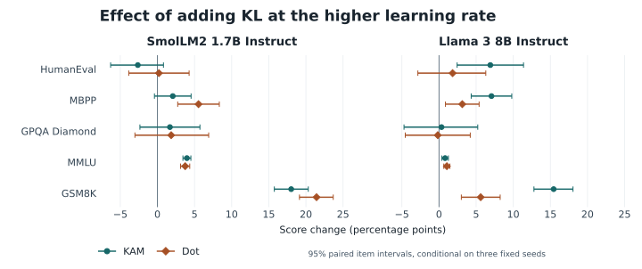

# Learning rate and KL factorial on SmolLM2 and Llama 3

The earlier [SmolLM2 study](GENERAL_BENCHMARKS_PRESERVATION.md) varied the learning rate without KL and added KL at the lower rate. This follow-up adds KL at the higher rate and replicates the full design on Meta Llama 3 8B Instruct. Llama comes from the [UF Research Computing model catalog](https://docs.rc.ufl.edu/quickstart/ai_models/). We used the university-hosted Hugging Face format checkpoint and recorded SHA-256 for its four weight shards and tokenizer. Weights are covered by the [Meta Llama 3 Community License](https://github.com/meta-llama/llama3/blob/main/LICENSE). No model weights are redistributed.

## HPG results

Scores are means across the same three seeds. KAM appears first in each paired cell.

### SmolLM2-1.7B-Instruct

Each adapter stack has 1,114,112 trainable parameters.

| Benchmark | Untouched | High LR KAM / dot | High LR + KL KAM / dot | Low LR KAM / dot | Low LR + KL KAM / dot |
| --- | ---: | ---: | ---: | ---: | ---: |
| HumanEval | 28.66% | 30.89% / 29.07% | 28.25% / 29.27% | 28.05% / 27.03% | 27.64% / 28.46% |
| MBPP | 38.00% | 36.87% / 32.33% | 38.93% / 37.87% | 37.20% / 33.67% | 38.13% / 37.07% |
| GPQA Diamond | 25.76% | 24.92% / 24.41% | 26.60% / 26.26% | 26.77% / 23.74% | 26.26% / 23.06% |
| MMLU | 42.50% | 38.45% / 39.16% | 42.43% / 42.90% | 42.50% / 36.51% | 42.54% / 42.09% |
| GSM8K | 31.77% | 12.31% / 6.92% | 30.33% / 28.35% | 30.00% / 3.59% | 30.50% / 27.29% |

| Benchmark | KL effect at high LR, KAM / dot (pp) | KL effect at low LR, KAM / dot (pp) | High minus low KL effect, KAM / dot (pp) |
| --- | ---: | ---: | ---: |
| HumanEval | -2.64 / +0.20 | -0.41 / +1.42 | -2.24 / -1.22 |
| MBPP | +2.07 / +5.53 | +0.93 / +3.40 | +1.13 / +2.13 |
| GPQA Diamond | +1.68 / +1.85 | -0.51 / -0.67 | +2.19 / +2.53 |
| MMLU | +3.97 / +3.74 | +0.05 / +5.58 | +3.93 / -1.83 |
| GSM8K | +18.02 / +21.43 | +0.51 / +23.70 | +17.51 / -2.27 |

| Recipe | Held-out KL, KAM / dot (nats/token) |
| --- | ---: |
| High LR | 0.14263 / 0.76966 |
| High LR + KL | 0.00937 / 0.01285 |
| Low LR | 0.00493 / 0.39922 |
| Low LR + KL | 0.00263 / 0.01176 |

| Training GPU | Seeds | Recipe | Fit time KAM / dot (s) | Throughput KAM / dot (k tokens/s) | Peak allocated KAM / dot (GiB) |
| --- | ---: | --- | ---: | ---: | ---: |
| NVIDIA B200 | 2 | High LR | 15.60 / 13.45 | 67.21 / 77.95 | 10.96 / 10.95 |
| NVIDIA B200 | 2 | High LR + KL | 21.71 / 19.71 | 48.31 / 53.20 | 11.74 / 11.73 |
| NVIDIA B200 | 2 | Low LR | 15.58 / 13.51 | 67.31 / 77.62 | 10.96 / 10.95 |
| NVIDIA B200 | 2 | Low LR + KL | 21.89 / 19.69 | 47.90 / 53.26 | 11.74 / 11.73 |
| RTX PRO 6000 | 1 | High LR | 33.14 / 31.52 | 31.64 / 33.27 | 10.96 / 10.95 |
| RTX PRO 6000 | 1 | High LR + KL | 48.59 / 47.06 | 21.58 / 22.28 | 11.74 / 11.73 |
| RTX PRO 6000 | 1 | Low LR | 33.35 / 31.73 | 31.44 / 33.05 | 10.96 / 10.95 |
| RTX PRO 6000 | 1 | Low LR + KL | 48.37 / 47.12 | 21.68 / 22.25 | 11.74 / 11.73 |

### Llama 3 8B Instruct

Each adapter stack has 2,162,688 trainable parameters.

| Benchmark | Untouched | High LR KAM / dot | High LR + KL KAM / dot | Low LR KAM / dot | Low LR + KL KAM / dot |
| --- | ---: | ---: | ---: | ---: | ---: |
| HumanEval | 47.56% | 44.11% / 47.97% | 51.02% / 49.80% | 49.59% / 48.58% | 49.59% / 50.00% |
| MBPP | 49.20% | 41.67% / 46.13% | 48.73% / 49.27% | 49.20% / 46.93% | 48.80% / 48.27% |
| GPQA Diamond | 29.80% | 28.28% / 29.63% | 28.62% / 29.46% | 28.28% / 27.61% | 28.79% / 28.45% |
| MMLU | 61.19% | 60.42% / 60.03% | 61.24% / 61.09% | 61.25% / 59.83% | 61.31% / 61.15% |
| GSM8K | 62.55% | 48.98% / 57.47% | 64.42% / 63.08% | 74.35% / 52.82% | 62.75% / 65.30% |

| Benchmark | KL effect at high LR, KAM / dot (pp) | KL effect at low LR, KAM / dot (pp) | High minus low KL effect, KAM / dot (pp) |
| --- | ---: | ---: | ---: |
| HumanEval | +6.91 / +1.83 | +0.00 / +1.42 | +6.91 / +0.41 |
| MBPP | +7.07 / +3.13 | -0.40 / +1.33 | +7.47 / +1.80 |
| GPQA Diamond | +0.34 / -0.17 | +0.51 / +0.84 | -0.17 / -1.01 |
| MMLU | +0.82 / +1.06 | +0.05 / +1.33 | +0.77 / -0.27 |
| GSM8K | +15.44 / +5.61 | -11.60 / +12.48 | +27.04 / -6.87 |

| Recipe | Held-out KL, KAM / dot (nats/token) |
| --- | ---: |
| High LR | 0.92765 / 1.10618 |
| High LR + KL | 0.01807 / 0.02013 |
| Low LR | 0.20947 / 0.99408 |
| Low LR + KL | 0.01222 / 0.01893 |

| Training GPU | Seeds | Recipe | Fit time KAM / dot (s) | Throughput KAM / dot (k tokens/s) | Peak allocated KAM / dot (GiB) |
| --- | ---: | --- | ---: | ---: | ---: |
| RTX PRO 6000 | 3 | High LR | 108.20 / 106.52 | 9.69 / 9.84 | 33.07 / 33.07 |
| RTX PRO 6000 | 3 | High LR + KL | 160.18 / 157.75 | 6.55 / 6.65 | 35.10 / 35.10 |
| RTX PRO 6000 | 3 | Low LR | 108.75 / 106.85 | 9.64 / 9.81 | 33.07 / 33.07 |
| RTX PRO 6000 | 3 | Low LR + KL | 160.76 / 158.21 | 6.52 / 6.63 | 35.10 / 35.10 |

Fit time includes both validation evaluations and excludes scheduler wait and initial model load. Throughput uses training-token count. Times and memory are medians within a hardware group.

The archives contain per-seed counts, paired item intervals, per-item outcomes and the recorded validation KL.

The original SmolLM2 cells are unchanged. Its B200 and RTX hardware groups use different seeds and sample sizes.

**SmolLM2-1.7B-Instruct** · [numerical summary](../../results/general_benchmarks_factorial/smollm2-summary.json) · [per-item archive](../../results/general_benchmarks_factorial/smollm2-outcomes.json.gz) · [model fingerprints](../../results/general_benchmarks_factorial/smollm2-model-sha256.txt) · [data manifest](../../results/general_benchmarks_factorial/smollm2-token-manifest.json) · [scheduler receipts](../../results/general_benchmarks_factorial/smollm2-scheduler.tsv)

**Llama 3 8B Instruct** · [numerical summary](../../results/general_benchmarks_factorial/llama3-summary.json) · [per-item archive](../../results/general_benchmarks_factorial/llama3-outcomes.json.gz) · [model fingerprints](../../results/general_benchmarks_factorial/llama3-model-sha256.txt) · [data manifest](../../results/general_benchmarks_factorial/llama3-token-manifest.json) · [scheduler receipts](../../results/general_benchmarks_factorial/llama3-scheduler.tsv)

## Design

| Recipe | Peak learning rate | Forward KL weight |
| --- | ---: | ---: |
| High rate | 0.0008 | 0 |
| Lower rate | 0.00008 | 0 |
| Lower rate + KL | 0.00008 | 4 |
| High rate + KL | 0.0008 | 4 |

Both architectures add exactly matched trainable parameter counts within a backbone. Each backbone remains frozen, and the adapters start with zero output projections. The three seeds are 731201, 731211, and 731221, with identical training exposure across that backbone's eight conditions within each seed. Each fit uses 256 updates and 1,048,576 subword tokens, with the same source mixture and sampling weights as the earlier study. The frozen backbone is the KL teacher. KL is computed on one quarter of positions per batch, rotating the positions by update.

The 18 existing SmolLM2 fits and untouched reference are reused. Only six fits are new for SmolLM2. All 24 Llama fits and its untouched reference are new. The Llama replication retokenizes the source corpus with its own tokenizer and applies its native chat template. Total subword exposure is held fixed, while the exact text windows differ across backbones. Comparisons of KAM versus dot and recipe effects are paired within a backbone.

The benchmark source files, task wording, formatter, and decoding limits follow the earlier [preservation protocol](GENERAL_BENCHMARKS_PRESERVATION.md). HumanEval and MBPP use unit-test pass@1 on 164 and 500 items. GPQA Diamond and MMLU use multiple-choice accuracy on 198 and 14,042 items. GSM8K uses strict marked numeric exact match on 1,319 items. All prompts are zero-shot, and MBPP includes the first public example assertion. Coding is graded offline in the same isolated runtime with common indentation removed uniformly. All five evaluations ran on RTX PRO 6000.

Results summarize three training seeds and use an item bootstrap conditional on those seeds. The interaction is the KL effect at high rate minus the KL effect at low rate. The study measures scores and item retention relative to the untouched checkpoint without a predefined noninferiority margin or adjustment for multiple comparisons.

## Interpretation

On SmolLM2, high-rate KL raised strict GSM8K from 12.31% to 30.33% for KAM and from 6.92% to 28.35% for dot. Both finished below the untouched 31.77%. MMLU recovered by 3.97 and 3.74 points respectively. HumanEval's high-rate KL effect was uncertain in both arms. These four fits for the first two seeds used B200, matching their existing controls. The third seed used RTX PRO 6000 for every recipe and arm.

On Llama at the high learning rate, KL improved KAM by 6.91 points on HumanEval (95% paired item interval +2.44 to +11.38), 7.07 on MBPP (+4.33 to +9.80), and 15.44 on strict GSM8K (+12.79 to +18.04). At the lower rate, it changed KAM by 0.00, −0.40, and −11.60 points on those tasks. The high-rate MBPP improvement accompanied a drop from 34.7 to 1.3 syntax errors per 500 programs on average. On HumanEval, syntax errors rose from 28.7 to 33.3 per 164 while failed tests fell from 63 to 47. The aggregate coding scores therefore cover different failure patterns.

Low-rate KAM increased Llama's strict GSM8K exact match from 62.55% to 74.35%. The requested number marker parsed on 98.23% of completions, up from 78.32% for untouched Llama. Under low-rate KL, KAM retained about 770 of the untouched model's 825 correct items per seed and newly answered about 58 items correctly. Low-rate KAM without KL retained about 732 and newly answered about 248. The strict score depends on both reaching the answer and using the required marker. The terminal-number audit tests that explanation separately.

For Llama with high-rate KL, KAM and dot were within 1.34 points of each other on all five benchmarks. Held-out next-token KL dropped roughly 50-fold for both architectures, while the median fit took about 48% longer and peak allocated GPU memory grew by about 2.0 GiB. The result measures preservation under this training mixture and decoding protocol at a fixed token budget.

High-rate KL increased MMLU and strict GSM8K in all four architecture–backbone combinations. The magnitude depended on the backbone, and the coding response depended on both task and backbone. At the lower rate, KAM's GSM8K response to KL was +0.51 points on SmolLM2 and −11.60 on Llama. The paired observations at the tested rates and KL weight support choosing a recipe by backbone and target metric. [Format and decoding checks, held-out perplexity, and GPU efficiency](GENERAL_BENCHMARKS_DIAGNOSTICS.md)

## Reproduce

Use the [registered models and task indices](../../scripts/kam_adapter_preservation.py), the [training](../../slurm/kam_adapter_preservation_train.sbatch), [evaluation](../../slurm/kam_adapter_preservation_eval.sbatch), and [code-grading](../../slurm/kam_adapter_preservation_grade.sbatch) arrays with KAM_FACTORIAL=1. Indices 0–17 reproduce the original three recipes. Indices 18–23 run high-rate + KL. Index 24 evaluates the untouched checkpoint. The [Llama preparation job](../../slurm/kam_adapter_llama_prepare.sbatch) fingerprints its hosted weights and retokenizes the frozen source. Use the [summarizer](../../scripts/summarize_kam_adapter_preservation.py) with the factorial flag and the model identifier to regenerate either complete result.

The [figure script](../../scripts/plot_kam_factorial_effects.py) takes the SmolLM2 and Llama summaries in that order and writes the effect plot.
