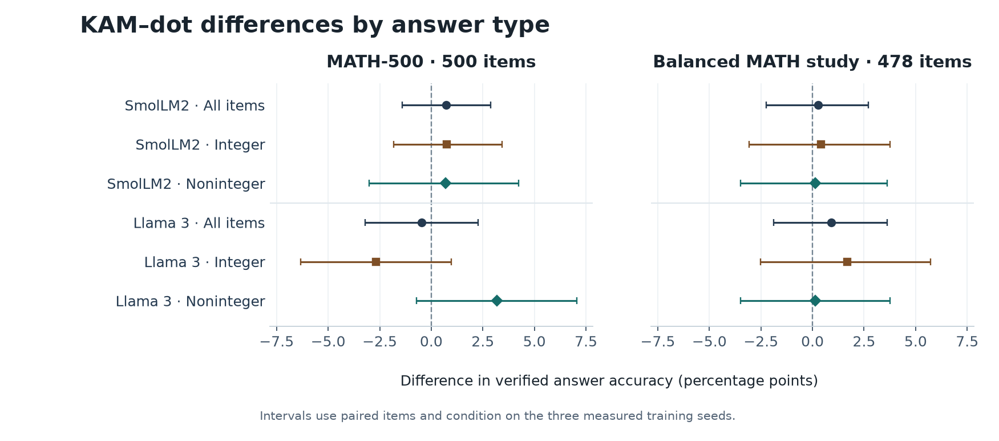

# Replicating math answer-type effects on disjoint MATH questions

The neutral-prompt [MATH-500 evaluation](FULL_MATH500.md) found a small full-set KAM–dot difference on Llama. Dot led on the 311 integer-answer items in all three seeds, and KAM led on the 189 noninteger-answer items in all three. Standardizing the original comparison to a common subject-and-difficulty distribution gave KAM–dot differences of −4.11 points on integer answers and +2.71 on noninteger answers. That exploratory difference of +6.82 points motivated the frozen follow-up. [Llama standardization](../../results/general_benchmarks_math_types/llama3-math500-standardized.json) · [SmolLM2 standardization](../../results/general_benchmarks_math_types/smollm2-math500-standardized.json)

## Cohort and comparison

From the original MATH test IDs in the PRM800K release outside MATH-500, a locked script selected 239 integer/noninteger pairs from all 35 subject-and-difficulty cells. Each pair has the same subject and level. Before selection, we collapsed one duplicate source ID with identical question and answer, excluded six exact overlaps or duplicates, and excluded four source answers that failed the frozen symbolic gold check. The selected fixture has zero exact normalized prompt matches to the adapter-training sources. The published fixture records IDs and digests. The two studies share the MATH benchmark family, and the items are disjoint. [Pinned source split](https://github.com/openai/prm800k/blob/7ecc794703b2877f63226f2477a49b34f9b25163/prm800k/math_splits/train.jsonl) · [Fixture manifest](../../results/general_benchmarks_math_types/fixture-manifest.json) · [Gold audit](../../results/general_benchmarks_math_types/gold-audit.json) · [Training-source audit](../../results/general_benchmarks_math_types/source-overlap.json)

Both fitted arms use the prior selected KL weights, SmolLM2 4 and Llama 3 0.5, with three matched seeds per backbone and an untouched reference. Evaluation uses the same neutral prompt, greedy decoding, EOS or 1,024 tokens, and the pinned Math-Verify configuration. All 14 checkpoints ran on HiPerGator RTX PRO 6000 GPUs. Full outputs recorded zero timeouts. Three SmolLM2 comparisons timed out on the 384-token prefix. The registered primary endpoint is the Llama KAM–dot gap on noninteger answers minus its gap on integer answers. [Locked plan](RESEARCH_PLAN.md#locked-replication-of-answer-type-differences)

## Paired results

| Backbone and slice | Untouched | KAM | Dot | KAM minus dot (95% interval) |
| --- | ---: | ---: | ---: | ---: |
| SmolLM2, all 478 | 26.57% | 25.73% | 25.45% | +0.28 [−2.23, +2.72] pp |
| SmolLM2, 239 integer | 24.27% | 22.45% | 22.04% | +0.42 [−3.07, +3.77] pp |
| SmolLM2, 239 noninteger | 28.87% | 29.01% | 28.87% | +0.14 [−3.49, +3.63] pp |
| Llama 3, all 478 | 32.43% | 29.08% | 28.17% | +0.91 [−1.88, +3.63] pp |
| Llama 3, 239 integer | 30.13% | 29.85% | 28.17% | +1.67 [−2.51, +5.72] pp |
| Llama 3, 239 noninteger | 34.73% | 28.31% | 28.17% | +0.14 [−3.49, +3.77] pp |

The registered Llama interaction was **−1.53 points** [−6.83, +3.91], with seed differences of −3.77, −0.84, and 0.00. The corresponding SmolLM2 interaction was −0.28 [−5.16, +4.74]. The interaction intervals resample the 239 matched pairs conditional on the same three training seeds. The original answer-type pattern was specific to its cohort in these comparisons. The untouched Llama scored higher overall than either fitted arm on both cohorts. [SmolLM2 paired summary](../../results/general_benchmarks_math_types/smollm2-summary.json) · [Llama paired summary](../../results/general_benchmarks_math_types/llama3-summary.json)

### Retention on the balanced cohort

| Backbone | KAM gains / losses, mean counts | Dot gains / losses, mean counts | Correct answers lost in all six fits | New answers gained in all six fits |
| --- | ---: | ---: | ---: | ---: |
| SmolLM2 | 21.0 / 25.0 | 26.7 / 32.0 | 4 of 127 | 2 |
| Llama 3 | 30.7 / 46.7 | 35.0 / 55.3 | 14 of 155 | 3 |

For nine of Llama's 14 shared losses, all six outputs reached EOS and supplied an extractable answer. All four of SmolLM2's shared losses did so. The gain and loss counts replay from the numeric outcomes with the same analysis used for MATH-500. [SmolLM2 retention](../../results/general_benchmarks_math_types/smollm2-retention.json) · [Llama retention](../../results/general_benchmarks_math_types/llama3-retention.json)

## Reproduce

Rebuild the cohort using the [pinned preparation script](../../scripts/kam_math_answer_type_replication.py), run the [neutral generator](../../scripts/eval_kam_full_math500.py) with its replication flag, and grade with the [shared grader](../../scripts/grade_kam_full_math500.py) and fixture manifest. The [summarizer](../../scripts/summarize_kam_full_math500.py) checks identities and computes the registered interaction with the replication manifest. The original cohort adjustment uses common cell weights equal to the smaller of the observed integer and noninteger counts in each subject and level. [Standardization source](../../scripts/analyze_kam_math500_answer_type.py) · [Figure source](../../scripts/plot_kam_math_answer_types.py) · [SmolLM2 outcomes](../../results/general_benchmarks_math_types/smollm2-outcomes.json.gz) · [Llama outcomes](../../results/general_benchmarks_math_types/llama3-outcomes.json.gz) · [SmolLM2 receipt](../../results/general_benchmarks_math_types/smollm2-scheduler.tsv) · [Llama receipt](../../results/general_benchmarks_math_types/llama3-scheduler.tsv)
