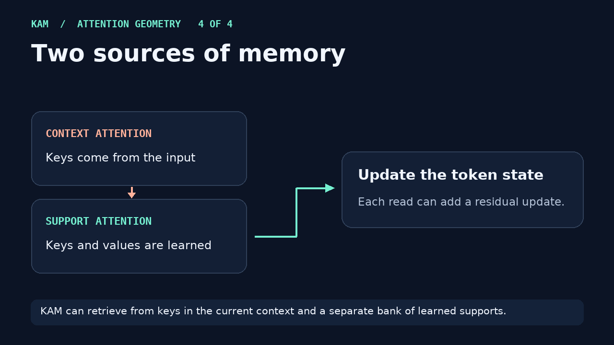

# How Kernel Adaptive Memory reads

[Try the geometry demo](https://www.raulv.dev/KAM/radial.html#geometry-lab) · [Watch the narrated explainer](https://www.raulv.dev/KAM/radial.html#explainer)

## A learned geometry

For a query (q) and key (k), a KAM head assigns a radial score using a positive diagonal metric (m) and bandwidth (sigma).

$$
s(q,k) = -\frac{1}{2\sigma^2}\sum_i m_i(q_i-k_i)^2.
$$

Softmax turns these scores into weights for the values. A higher metric weight makes a coordinate matter more. Shrinking the bandwidth concentrates the read among nearby keys. The two-dimensional demo holds the keys fixed so you can see both effects directly. The implementation can normalize queries and keys and includes dot-product and cosine controls. [Attention code](../../kam/attention.py)

Expanding the square gives an inner product with the learned metric, a term for the key’s weighted norm, and a term that depends only on the query. Softmax cancels that last term. A constant query coordinate and one extra key coordinate let the inner-product form use scaled dot-product attention in the full-context, relative-bias-free experiment. [Kernel experiment](../../reports/nonlinear_retrieval_natural/BITEMPORAL_MODEL.md#flashattention-for-the-radial-decoder)

## Current context and learned supports

Causal context attention reads projected keys and values from the current sequence. Persistent support attention reads an additional bank of learned keys and values. A combined block applies the context update before the support read. The model can also expose support weights as route features. [Block code](../../kam/model.py)

The natural question-answering experiments test separate retrieval heads over a fixed text encoder. The revision demo shows the exact policy used to validate stored records when their identity and release times are supplied. [Research results](RESULTS.md) · [Revision lookup demo](https://www.raulv.dev/KAM/revision.html#revision-lab)

## Regenerate the illustrations

Run `python scripts/render_kam_explainer.py --output docs/demo/media` from the repository root with Pillow, Matplotlib, and FFmpeg installed. Add `--narrate` on macOS to produce the narration with the system Samantha voice. Open `docs/demo/index.html` in a browser for the local demos.
