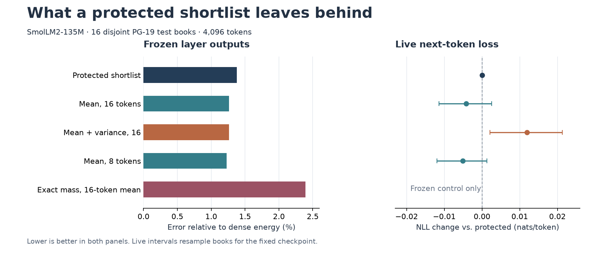

# Can block summaries recover what a shortlist discards?

Adding coarse summaries for omitted blocks reduced projected attention-output error by 8–11% on frozen SmolLM2 activations. In a live forward pass, the two mean-summary policies recovered fewer than 5% of the protected shortlist's excess next-token loss, with intervals that included zero. Estimating more omitted attention mass with a diagonal variance term increased live loss.

## What the summary approximates

For a group of keys with scores $s_i$ and values $v_i$, its true conditional value is $E[e^s v]/E[e^s]$, where the expectation gives each key equal weight. The conditional value equals $E[v]+\operatorname{Cov}(e^s,v)/E[e^s]$. Replacing the group by its mean value discards the covariance term. Fixing the group mass leaves that value error in place.

Reserve the same eight 64-token blocks as the protected shortlist. Keep the causal current and previous blocks and preserve block zero. Rank the other blocks by the maximum of four mean-key scores at the first query in each 32-token tile. Retained keys use exact dot-product scores. For each fully visible omitted group, add its mean value with unnormalized weight $n e^{q^\top \bar k/\sqrt d}$. For the variance arm, multiply the group weight by $1+\widehat{\sigma}^2/2$, where $\widehat{\sigma}^2$ uses the diagonal of the key covariance. All arms combine the group weights with the exact retained partition. The group mean score gives a lower bound on the true group partition by Jensen's inequality. The diagonal adjustment is an approximation.

## Matched inputs

We pinned base SmolLM2-135M and used the same sixteen 4,096-token windows in the frozen and live comparisons. The books came from the official PG-19 test split and excluded the 76 book IDs used or reserved by the earlier PG-19 reader panels. A fixed hash selected the books and window offsets. The projected-output audit used every layer and query head at 56 positions per window, all at tile starts. A float64 fixture confirmed the summary is exact when all keys in each group coincide. On the real prompts, the sampled dense output agreed with reference CPU SDPA within 0.000021 before the output projection.

For the live comparison, the policies changed attention in all 30 layers and computed new downstream activations. On an Apple M5 GPU, the FP32 model scored the same final 512 tokens of each book window. The first eight causal blocks used exact attention. The live implementation passed output checks against the sampled reference on all four sparse policies. The CPU reconstruction and live GPU studies use the same weights and token IDs. These runs measure model loss and omit a dedicated latency benchmark. [Pinned SmolLM2 weights](https://huggingface.co/HuggingFaceTB/SmolLM2-135M/tree/93efa2f097d58c2a74874c7e644dbc9b0cee75a2) · [Official PG-19](https://github.com/google-deepmind/pg19)

## Projected output and next-token loss

Normalized projected error is the sum of squared output errors across sampled queries and layers divided by dense output energy, first computed per book. The table averages across books. The exact-group-mass control uses the true omitted group partition with the same unweighted mean values on frozen states. Its result measures the error of those values when group mass itself is exact.

| Attention read | Frozen normalized projected error | Relative decrease vs. protected [95% interval] | Live perplexity | Live paired NLL change vs. protected [95% interval] |
| --- | ---: | ---: | ---: | ---: |
| Full dense | Reference | — | 13.5805 | −0.10901 [−0.13477, −0.08574] |
| Protected shortlist | 1.3764% | Reference | 15.1447 | Reference |
| Omitted means, 16 tokens | 1.2625% | 8.28% [7.57, 8.97] | 15.0812 | −0.00420 [−0.01141, +0.00253] |
| Omitted means + diagonal variance, 16 tokens | 1.2621% | 8.31% [6.89, 9.74] | 15.3263 | +0.01192 [+0.00209, +0.02128] |
| Omitted means, 8 tokens | 1.2290% | 10.71% [9.93, 11.51] | 15.0671 | −0.00514 [−0.01198, +0.00128] |
| Exact group mass, 16-token mean values | 2.3920% | −73.79% [−86.00, −62.51] | — | — |

The two primary 16-token arms improved frozen error on all 16 books but fell short of the prespecified 10% average reduction. The secondary eight-token means cleared that point threshold. Giving the 16-token mean values exact mass increased frozen error on every book. The diagonal arm reduced mean absolute retained-mass error from 14.50 to 11.34 points, but raised live loss. That combination argues for improving the omitted value approximation before spending more on its weight.

The best live point estimate recovered 4.7% of the protected shortlist's excess NLL. Full dense retained a 0.104 NLL lead on that comparison. The paired intervals resample books conditional on this single pretrained checkpoint. [Why mass and output fidelity can differ](ATTENTION_MASS_AND_RECONSTRUCTION.md)



## Reproduce

Use PyTorch 2.10.0 and Transformers 4.57.6. Place the pinned config, tokenizer files and safetensors in a local model directory. Obtain the book files listed in the source manifest from the official public PG-19 test bucket and keep their original filenames. The scripts verify the source bytes and choose the windows without downloading or publishing book text.

```bash
python scripts/audit_kam_omitted_attention.py MODEL BOOK_SOURCES BOOK_DIRECTORY OUTPUT_JSON
python scripts/eval_kam_omitted_attention.py MODEL BOOK_SOURCES BOOK_DIRECTORY OUTPUT_JSON --device mps
```

[Source manifest](../../results/general_benchmarks_pretrained_sparse_local/books.json) · [Frozen layer results](../../results/general_benchmarks_pretrained_sparse_local/output-audit.json) · [Live per-book losses](../../results/general_benchmarks_pretrained_sparse_local/live.json)
