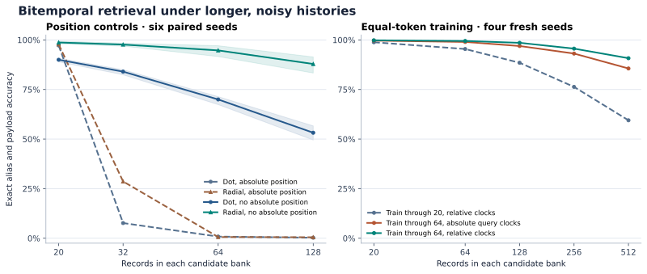

# KAM architecture under controlled revision noise

When records already carry explicit temporal fields, absolute position can become a shortcut. Removing the sequence index while keeping the record’s time fields let the radial KAM decoder generalize far beyond the history lengths used in fitting. The result held across matched fresh seeds and counterfactual payload replacement. A wider training schedule with the same number of tokens substantially extended this gain.

## Exact evaluation task

A query specifies an alias, workspace, effective-date limit, and knowledge-time limit. A correct update must first resolve the applicable alias binding and then retrieve the fact for that entity. Each record has separate effective and recorded dates. Within a key, valid records are ordered by effective date first and recorded date second. A vectorized oracle and an independent scalar oracle verify that irrelevant records, homonyms, future-effective entries, late arrivals, and older values preserve the original correct pair.

Payloads are independently assigned. In a second test input the only requested fact changes to a different payload ID, while its identity and dates stay fixed. Correctness on both versions is stronger evidence of using the supplied memory than exact match on the original alone. The representation contains categorical record fields and relative numerical times. The test measures implementation properties on structured histories. [Fixture and pointer implementation](../../scripts/run_kam_bitemporal_noise.py) · [KAM decoder experiment](../../scripts/run_kam_bitemporal_decoder.py)

## One-pass pair selection versus conditioned sequential retrieval

Two small heads had the same dimensions and inputs. They were fit on equal clean and mixed banks using either a joint loss over all alias–fact pairs or separate losses with the target alias during fitting. The sequential inference control used its own selected alias. Reported exact joint accuracy averaged eight independently generated paired seeds with 2,048 test queries per seed.

| Noise and records per bank | Sequential | One-pass pair | Sequential with gold alias |
| --- | ---: | ---: | ---: |
| Clean, 12 | 91.0% | 95.1% | 96.0% |
| Irrelevant, 32 | 91.0% | 95.1% | 96.0% |
| Future-effective, 32 | 70.1% | 84.2% | 83.7% |
| Same workspace, older valid states, 32 | 74.3% | 86.4% | 87.6% |
| Mixed, 64 | 66.4% | 82.0% | 82.5% |
| Mixed, 128 | 53.5% | 73.6% | 74.1% |

The exact time-and-identity oracle scored 100% on each condition. A fit with explicit information on both clocks still made inadmissible selections under distribution shift. On a fixed seed at 128 records per bank, eligibility masking raised exact joint matches from 1,479 to 1,792 of 2,048 and removed 330 inadmissible selections. It still missed some eligible but superseded records. [Eight-seed study](../../results/nonlinear_retrieval_natural/bitemporal_noise_v1/summary.json) · [Eligibility mask and parity audit](../../results/nonlinear_retrieval_natural/bitemporal_factorization_v1/l4.json)

The eight-seed generator had older effective dates for stale records. It offered no guarantee about multiple corrections at the same effective date. In a separate six-seed paired study, both baseline heads received 0% joint accuracy at depth 32 when there were earlier corrections with that same date. Adding correction examples at fixed fitting budget raised the one-pass head to 58.5% and the sequential head to 34.4%. On the mixture of earlier, late, and the other distractor types, the one-pass head rose from 0% to 62.4% at depth 32 and 40.6% at depth 128. It lost 11.3 points under the original mixed condition at depth 128. This is a shift in what the heads learn, with a substantial trade-off under a mixture of revision conventions. The exact two-clock rule remains the reference. [Six-seed correction study](../../results/nonlinear_retrieval_natural/bitemporal_corrections_v1/summary.json)

## Position and scoring geometry

The two-layer KAM sequence models used the same categorical inputs, training data, target heads and 13,516,800-token budget. Shared tensors were copied from a common initialization per seed. The comparison includes dot scoring, cosine scoring at its original fixed temperature, a higher fixed cosine scale, learned isotropic scale, learned diagonal radial scoring, and optional persistent support branches. The six confirmation seeds were independent of the two pilot seeds.

| Model | Mixed 20 | Mixed 32 | Mixed 64 | Mixed 128 |
| --- | ---: | ---: | ---: | ---: |
| Dot with absolute position | 97.2% | 7.7% | 0.8% | 0.3% |
| Radial with absolute position | 97.8% | 28.6% | 0.6% | 0.5% |
| Learned-temperature cosine with absolute position | 97.3% | 27.1% | 0.7% | 0.4% |
| Dot without absolute position | 90.0% | 84.0% | 70.0% | 53.2% |
| Radial without absolute position | 98.7% | 97.7% | 94.7% | 87.9% |
| Radial without either absolute or relative position parameters | 98.6% | 97.6% | 94.0% | 87.0% |

With absolute positions, adding unrelated distractors alone dropped radial joint accuracy to 22.2% at depth 32. Forcing only the final query to keep the largest training position raised it to 50.9%. Keeping the trained index for one token is a diagnostic intervention. Removing the absolute index during learning performed better. The relative-lag parameters made little difference in the tested no-absolute-position models. A scaled cosine control explains part of the in-distribution scoring difference, and learned isotropic scale performs close to the radial arm while both have absolute positions. Persistent supports supplied little recovery under the long out-of-distribution condition and raised training time. [Six-seed confirmation](../../results/nonlinear_retrieval_natural/bitemporal_decoder_confirm_v2/summary.json)

## Token-matched curriculum and clock origin

The four fresh curriculum seeds used 3,200 updates and exactly 13,516,800 input tokens per run. The short schedule alternated 12- and 20-record banks. The wide schedule used 12, 20, 32 and 64 records per bank with corresponding batch sizes of 166, 104, 65 and 33. This holds input token count fixed. It permits differences in the number of training episodes and attention cost.

On L4, the radial model with relative clocks had median synchronized training-loop time of 14.69 seconds under the short schedule and 14.65 seconds under the wide schedule. Those times exclude startup, bank construction, and held-out evaluation. The best no-absolute dot wide condition took 9.65 seconds under the same token budget. Its accuracy was lower on the procedural long-history task.

| Radial model and schedule | Mixed 64 | Mixed 128 | Mixed 512 | Mixed 512 after clock shift |
| --- | ---: | ---: | ---: | ---: |
| With absolute position, wide | 91.9% | 4.0% | 0.05% | 0.15% |
| No absolute position, short | 94.9% | 87.9% | 56.8% | 45.0% |
| No absolute position, wide | 99.0% | 96.9% | 85.6% | 77.9% |
| No absolute position and relative clocks, short | 95.4% | 88.5% | 59.5% | 59.5% |
| No absolute position and relative clocks, wide | **99.5%** | **98.5%** | **90.8%** | **90.8%** |

The relative-clock condition omits the two redundant absolute query date scalars while retaining each record’s offsets relative to the query. Shifting both clocks by 120 ticks then leaves its entire input tensor exactly unchanged. With the wide relative-clock schedule at depth 512, a second independent order gave 91.0% joint accuracy and chronological arrival order gave 91.1%. Predictions agreed for 98.4% of cases under the order reshuffle. These are empirical robustness controls for the task. Causal attention can still depend on input order. [Four-seed curriculum and interventions](../../results/nonlinear_retrieval_natural/bitemporal_curriculum_v1/summary.json)

## Transfer to actual revision sequences

Projected the real vintage archive into the same typed representation. The archive provides observation times, publication times, and values. Each episode randomly reassigns address and workbook-cell symbols. The queried series and observation are supplied as a typed address via the alias bank. The decoder selects that address and a cell symbol, which is mapped back to the archived value. This measures revision choice after type assignment. It leaves natural aliases, unknown identities, and absent records to the separate text routing study.

All conditions used identical depth and batch schedules and 13,516,800 training tokens per run. Four fresh paired seeds used either ordinary procedural data, procedural same-effective corrections, or revision patterns from 348 earlier workbook groups. The 160 held-out later groups gave 320 answerable questions, two independent symbol reassignments per question and seed, and both 16- and 48-record conditions. No training observation overlapped the later test groups. The nominal-consumption series was withheld from archive training. An independent exact policy validated all targets. Inspect the seed range because several predictions share the same underlying workbook cell.

| Training source | Dot at 16 / 48 | Radial at 16 / 48 |
| --- | ---: | ---: |
| Ordinary procedural | 0.0% / 0.0% | 0.0% / 0.0% |
| Procedural with same-effective corrections | 0.0% / 0.0% | 0.0% / 0.0% |
| Earlier archive groups | **95.1% / 98.3%** | 87.6% / 87.7% |
| Earlier archive groups, nominal-consumption test only | 95.0% / 98.8% | 87.7% / 85.8% |

Cells report exact address and exact record jointly, averaged across the four seeds. The archive-trained dot model at depth 48 ranged from 97.5% to 98.8% across seeds, and the radial model ranged from 86.2% to 88.3%. Near-zero numeric exact agreement for the procedural arms gives the same interpretation. Dot scoring led on the archive, reversing the ordering from the long procedural task. The comparison holds model budgets fixed and permits the sources to differ in revision timing, eligible records, and alias-to-fact context. [Archive transfer and evidence](../../results/nonlinear_retrieval_natural/bitemporal_archive_v1/summary.json)

### Match the shape of revisions in generated data

Every target in the first archive panel lay at both the effective and publication boundary. At depth 48, the median workbook pool included 26 versions of the requested address at the same effective date, with 24 future revisions. The correction-aware generator had medians of 12 same-effective records and 6 future same-effective revisions. Its targets were always strictly before both limits. [Input distribution audit](../../results/nonlinear_retrieval_natural/bitemporal_archive_v1/design-audit.json)

On the original 160 archive groups, changing the time offsets while preserving the exact cell moved the ordinary radial model from 0% to 7.7% at depth 48. Adding both exact time boundaries to procedural correction training raised the radial model to 31.8% on the original inputs and the dot model to 3.9%. This four-seed diagnostic shows sensitivity to clock offsets and a substantial remaining transfer gap. [Boundary substitutions](../../results/nonlinear_retrieval_natural/bitemporal_dual_boundary_v1/summary.json)

A follow-up generated histories with a cluster of versions for the same observation, earlier and future releases, and distinct payload symbols. It matched the training budget and alias generator against a baseline that included examples on both clock boundaries. The archive-trained arm used the same earlier groups as before. Evaluation used 32 new qualifying observation groups from 2023–24, eight per series, with no earlier fit or test group overlap. Three new paired Blackwell seeds each saw 64 answerable questions with two fresh recodings per depth. The generator parameters were chosen after diagnosing the earlier cohort. The procedural arm used generated records for fitting.

| Training input | Dot at 16 / 48 | Radial at 16 / 48 |
| --- | ---: | ---: |
| Procedural corrections and both boundaries | 3.6% / 2.1% | 16.1% / 20.1% |
| Procedural same-observation release clusters | 82.8% / 81.0% | **83.3% / 85.7%** |
| Earlier real archive groups | 93.2% / 87.8% | 82.3% / 83.6% |

These are paired exact address-and-record averages. At depth 48, every seed using the release-cluster generator exceeded every matched geometry seed using only boundary coverage. The generator changes several properties jointly. The fresh sample supports follow-up across independent revision archives. [Fresh release-cluster results](../../results/nonlinear_retrieval_natural/bitemporal_archive_topology_v1/summary.json)

A three-seed factorial returned to the original 160 groups to assess which parts of the generator mattered. It independently spread the effective dates of same-address variants, moved most future releases to the past with the same number of variants, and allowed duplicate wrong payload symbols. All conditions kept the true target code distinct and retained the same-address cluster. At depth 48, joint accuracy across the eight conditions ranged from 87.0% to 88.6%. The average effect of sharing an effective date was +1.1 points, with all three paired-seed effects between +0.9 and +1.4. Effects of high future share and unique distractor symbols were each under 0.3 points in magnitude. The common changes still include same-address clustering and the clock ranges and distributions of competing addresses. This follow-up narrows the candidates for what explains transfer while keeping independent archive validation as the next step. [Full training factor audit](../../results/nonlinear_retrieval_natural/bitemporal_archive_factors_v1/summary.json)

## Exact pair scoring cost

For the procedural selector's additive alias and fact scores with a nonnegative same-entity bonus, the best pair can be found with an entity reduction and a pass over one fact row. The final row pass preserves the exhaustive FP32 tie rule. The method agreed with exhaustive selection on 12,336 explicit stress cases per device, every audited held-out pair selection in the timing run, and the tested batch and depth configurations.

| GPU, at 1,024 records per bank | Batch | Exhaustive selection | Grouped selection |
| --- | ---: | ---: | ---: |
| L4 | 1 | 0.048 ms | 0.077 ms |
| L4 | 64 | 7.468 ms | 0.081 ms |
| RTX PRO 6000 Blackwell | 1 | 0.023 ms | 0.061 ms |
| RTX PRO 6000 Blackwell | 64 | 1.331 ms | 0.061 ms |

The grouped implementation was slower at single-query batch sizes and faster on the large batched grids. These measurements time only pair selection over resident scores. The exact reduction applies while the score retains this additive structure. The natural-text context pair head has general pair interactions and needs a different reduction. [L4 timing and parity](../../results/nonlinear_retrieval_natural/bitemporal_factorization_v1/l4.json) · [Blackwell timing and parity](../../results/nonlinear_retrieval_natural/bitemporal_factorization_v1/rtx.json)

## FlashAttention for the radial decoder

For each attention head with metric vector `m` and bandwidth `sigma`, the post-softmax radial computation depends on the dot term `(q * m) @ k.T / sigma²` and the key-only term `−sum(m * k²) / (2 sigma²)`. The query-only term cancels. Appending a constant to each query and the key-only term to each key gives one causal dot-product attention operation at scale 1. Zero padding aligns the resulting heads to the kernel layout. The adapter applies to the variant with full causal context and no relative-lag bias. The model's core implementation stays as the reference. [PyTorch attention API](https://docs.pytorch.org/docs/2.8/generated/torch.nn.functional.scaled_dot_product_attention.html)

One learned checkpoint was tested on identical inputs on an L4 and an RTX PRO 6000 Blackwell. The augmented FP32 math backend reproduced all 1,536 joint predictions per GPU across depths 20, 128 and 512, with maximum full-model absolute logit error below 0.000081. The BF16 FlashAttention variant matched 501/512 joint predictions at depth 512 and achieved 462 correct versus 463 for eager FP32 on both GPUs. Eager BF16 itself matched 500/512 and achieved 462 correct. This separates the main precision change from the optimized kernel.

| GPU at depth 512 | Batch | Eager FP32 p50 | Eager BF16 p50 | Flash BF16 p50 | FP32 eager → Flash incremental allocation |
| --- | ---: | ---: | ---: | ---: | ---: |
| L4 | 1 | 1.359 ms | 1.298 ms | 0.952 ms | 70 MB → 4 MB |
| L4 | 64 | 157.666 ms | 145.216 ms | **8.578 ms** | 4,458 MB → 155 MB |
| RTX PRO 6000 Blackwell | 1 | 0.591 ms | 0.756 ms | 0.712 ms | 70 MB → 5 MB |
| RTX PRO 6000 Blackwell | 64 | 25.890 ms | 23.593 ms | **1.544 ms** | 4,458 MB → 155 MB |

The measurements cover the entire two-layer model forward with resident input tensors after warmup. They use 40 CUDA-event measurements per shape. The largest condition contains 1,025 sequence positions including the query. At the shortest depth, eager FP32 was faster than the BF16 FlashAttention variant at batch one on both devices. Benchmark artifacts include p95, peak allocation, and every comparison arm. [Learned probe checkpoint fit](../../results/nonlinear_retrieval_natural/bitemporal_sdpa_v1/fit.json) · [L4 runtime](../../results/nonlinear_retrieval_natural/bitemporal_sdpa_v1/l4.json) · [Blackwell runtime](../../results/nonlinear_retrieval_natural/bitemporal_sdpa_v1/rtx.json)

Fixed-shape CUDA graph replay reduced batch-one FlashAttention time at depth 512 from 0.926 to 0.266 ms on L4 and from 0.919 to 0.209 ms on the Blackwell replication. At depth 20 the captured FP32 forward reached 0.207 and 0.176 ms. Replaying after replacing the input with a disjoint batch reproduced the corresponding eager predictions bit-for-bit. Replay timings exclude graph capture, input copying and host I/O. At depth 512 and batch 64, computation dominated and capture changed median FlashAttention runtime by under 3% on either device. [L4 fixed-shape replay](../../results/nonlinear_retrieval_natural/bitemporal_graph_v1/l4.json) · [Blackwell fixed-shape replay](../../results/nonlinear_retrieval_natural/bitemporal_graph_v1/rtx.json)
