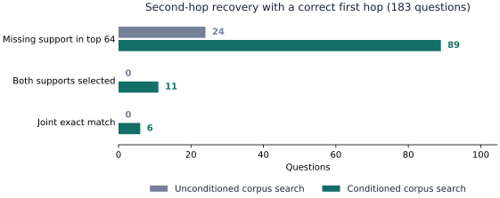

# Conditioned second-hop corpus search on frozen HotpotQA pools

Conditioned corpus search recovered both support documents on **11 of the 433 questions** whose frozen pool lacked evidence, yielding **6 joint exact matches**. On the full cohort it recovered 173 support pairs and 110 joint exact matches, compared with 178 and 116 for same-pool sequential and 452 and 285 for broad.

## Experiment

The 1,024 held-out HotpotQA bridge questions and their ordered 64-document dense pools come from the [sequential fallback study](SEQUENTIAL_FALLBACK.md). This follow-up reuses that cohort. It neither refits nor calibrates a model. Broad uses the archived frozen native sentence reranker's selected pair. Every sequential arm starts from the same learned first document selected inside the original pool.

The same-pool sequential arm appends the first document to the question, encodes it with the same E5 and query adapter, and averages the original and conditioned affinities before selecting the second article. The conditioned corpus arm applies the same scoring rule over the entire eligible Wikipedia index, excluding the fixed first article. The unconditioned corpus control uses the original adapted question and the same corpus and exclusion. The top candidate supplies the second article. The recorded top 64 show how often the search returned missing evidence below the winning article.

All arms use the same frozen FLAN-T5-small reader with a 192-token cap per evidence document. The sequential arms present the fixed first article before the selected second article. Joint exact match requires both annotated support documents along with a normalized exact answer. All comparisons are paired by question with 5,000 question-level bootstrap resamples for intervals.

## Results

Each cell gives **both supports recovered / joint exact match**.

| Frozen-pool cohort | Broad | Same-pool sequential | Unconditioned corpus | Conditioned corpus |
| --- | ---: | ---: | ---: | ---: |
| All 1,024 | **452 / 285** | 178 / 116 | 141 / 87 | 173 / 110 |
| Both supports present, 591 | **452 / 285** | 178 / 116 | 141 / 87 | 162 / 104 |
| At least one support missing, 433 | 0 / 0 | 0 / 0 | 0 / 0 | **11 / 6** |
| One missing and first hop correct, 183 | 0 / 0 | 0 / 0 | 0 / 0 | **11 / 6** |
| One missing and first hop wrong, 213 | 0 / 0 | 0 / 0 | 0 / 0 | 0 / 0 |
| Both supports missing, 37 | 0 / 0 | 0 / 0 | 0 / 0 | 0 / 0 |

Conditioning improved on unconditioned corpus search by **3.13 percentage points** for support (paired 95% interval **+1.37 to +4.88**) and **2.25 points** for joint EM (**+0.88 to +3.61**). Compared with same-pool sequential, conditioned corpus search gained 11 support recoveries and six joint matches on incomplete pools, and lost 16 and 12 on complete pools. Its net effects across all questions were **−0.49 points** for support (**−1.46 to +0.49**) and **−0.59 points** for joint EM (**−1.46 to +0.20**).

## Coverage and ranking

All gold articles were available in the full index. For 250 of the 433 incomplete pools, the fixed first hop was already wrong, so one new document could never complete the pair. In the other 183, conditioning put the missing article in the top 64 on **89** questions, up from **24** for unconditioned search. The correct article ranked first on just **11** of those 89. The other 78 cases expose headroom for a second-stage ranker. Across all 433 incomplete pools, conditioned search surfaced at least one missing article in its top 64 on **113** questions, compared with **51** for the unconditioned control.



The three-arm oracle across broad, same-pool sequential, and conditioned corpus reached **490 support recoveries and 306 joint exact matches**. The broad and same-pool oracle reached 479 and 300. The corpus arm added 11 and six exclusive successes, all from incomplete pools. The results support testing candidate expansion with reranking while retaining the original pool as evidence. A single fixed first article still limits recovery when a pool omits both supports or its first hop misses the available one.

HPG array **52946704** scored four shards of 256 questions on NVIDIA B200 GPUs using the index of **5,201,800 eligible articles**. Both baseline pairs and reader labels reproduced the prior run on every question. When the winning conditioned corpus article was also inside the original pool, it matched the same-pool second hop every time.

## Reproduce

The [HPG driver](../../slurm/nonlinear_retrieval_conditioned_corpus.sbatch) loads the original Wikipedia index, frozen adapter, and reader. It consumes the decompressed prior question fixture as `fixture.json`, the sealed `pools.json.gz`, and the prior `replay.json.gz` as `reference.json.gz`. Batched FP32 dot products scan the allowed rows in blocks and retain the top 64 after excluding the first article. The [paired replay and summary](../../results/nonlinear_retrieval_natural/conditioned_corpus_v1/) record all selected corpus row IDs and the top 64 for both corpus arms. The replay audits frozen pool hashes, prior pair parity, and consistency of reader outcomes for identical ordered evidence.

```bash
base=results/nonlinear_retrieval_natural
prior="$base/sequential_fallback_v1"
study="$base/conditioned_corpus_v1"
options=(--fixture "$prior/fixture.json.gz" --pools "$prior/pools.json.gz"
         --reference "$prior/replay.json.gz" --output /tmp/kam-conditioned-corpus.json)
OPENBLAS_NUM_THREADS=1 python scripts/analyze_kam_conditioned_corpus_search.py "$study/replay.json.gz" "${options[@]}"
diff -u "$study/summary.json" /tmp/kam-conditioned-corpus.json
```
