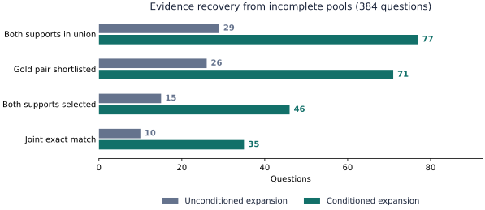

# Broad reranking after conditioned HotpotQA corpus expansion

On 1,024 fresh HotpotQA questions, broad reranking of the conditioned union improved complete support recovery from **481 to 511** and joint exact match from **308 to 333**. All net gains came from originally incomplete pools.

## Design

We held out 1,024 fresh HotpotQA bridge questions from the official training data. Their question IDs, normalized text, and gold titles are disjoint from 18 reserved fixtures, including the preceding conditioned corpus search cohort. An HPG pass froze their ordered top-64 dense pools before reranking. Both annotated supports are available in the index for every question.

Broad scores the original pool with the frozen native sentence reranker. The conditioned arm takes the first document from that same pool with the frozen sequential query adapter, then searches all eligible Wikipedia articles with the mean of the adapted original and first-document-conditioned queries. We append distinct hits from its top 64 after the original 64. The expanded reranker can select any pair in the union. An unconditioned control uses the original adapted query, the same corpus and top-64 budget, and the same exclusion of the first document.

Every arm uses the same two frozen shortlist heads, each proposing 16 pairs, the same fitted sentence reranker, and the same FLAN-T5-small reader. The shortlist and its score normalization are recomputed within each candidate set. Joint exact match requires both annotated support documents and a normalized exact answer. We classify pools as complete or incomplete using the original 64 documents. Paired intervals resample whole questions 5,000 times.

## Results

Each cell gives **both supports selected / joint exact match**.

| Original frozen pool | Broad on original | Unconditioned union | Conditioned union |
| --- | ---: | ---: | ---: |
| All 1,024 | 481 / 308 | 479 / 307 | **511 / 333** |
| Complete, 640 | **481 / 308** | 464 / 297 | 465 / 298 |
| Incomplete, 384 | 0 / 0 | 15 / 10 | **46 / 35** |
| Incomplete with a correct conditioning document, 138 | 0 / 0 | 9 / 6 | **38 / 29** |
| Incomplete with a wrong conditioning document, 246 | 0 / 0 | 6 / 4 | **8 / 6** |
| Both supports absent, 37 | 0 / 0 | 0 / 0 | 0 / 0 |

Across the full cohort, conditioned expansion improved support by **2.93 percentage points** (paired 95% interval **+1.37 to +4.49**) and joint EM by **2.44 points** (**+1.17 to +3.81**). On incomplete pools, the improvements were **11.98** and **9.11** points. On complete pools, support fell by **2.50 points** (**−3.91 to −1.25**) and joint EM fell by **1.56 points** (**−2.66 to −0.63**). The conditioned union averaged 111.8 distinct articles, compared with 109.1 for the unconditioned union.

## Where recovery and regressions occurred

In the 384 incomplete pools, conditioning made both supports available on **77** questions, versus **29** without conditioning. The conditioned reranker shortlisted 71 of these pairs and chose 46. With a correct conditioning document it made 63 of 138 incomplete pools complete, versus 15 unconditioned. With a wrong conditioning document both expansion methods completed 14 of 246 pools. Neither expansion made any of the 37 original pools with two missing documents complete.



Of the 18 broad-only support successes lost under conditioned expansion, 13 chose a pair containing an added article. Only one lost the gold pair from the shortlist. Most of these regressions occurred at final pair scoring. The two-arm oracle reached **529 support recoveries and 344 joint exact matches**, compared with 511 and 333 from always reranking the conditioned union. The oracle measures remaining choice headroom, and the complete-pool labels are used only for evaluation.

## Reproduce

HPG array **52947507** froze four shards on NVIDIA B200 GPUs. Array **52948224** reranked the three arms on four NVIDIA L4 GPUs. The [Slurm driver](../../slurm/nonlinear_retrieval_conditioned_union.sbatch) uses the frozen Wikipedia index, checkpoints, and archived native sentence reranker fit. The [fixture, sealed pools, provenance, and replay](../../results/nonlinear_retrieval_natural/conditioned_union_v1/) include the ordered original and added IDs. The replay checks each ordered original-pool hash, candidate membership, coverage, and identical reader labels for identical ordered evidence.

```bash
base=results/nonlinear_retrieval_natural
study="$base/conditioned_union_v1"
options=(--fixture "$study/fixture.json.gz" --pools "$study/pools.json.gz"
         --fitted "$base/native_sentence_refit_v1/fitted.json" --output /tmp/kam-conditioned-union.json)
OPENBLAS_NUM_THREADS=1 python scripts/analyze_kam_conditioned_union.py "$study/replay.json.gz" "${options[@]}"
diff -u "$study/summary.json" /tmp/kam-conditioned-union.json
```
