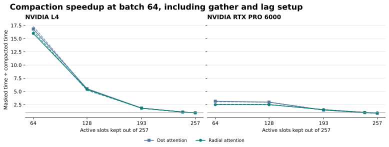

# Position-preserving compaction for the temporal decoder

An attention mask can exclude keys without reducing tensor size. Physical compaction removes those positions from the tensors. For the full-causal decoder with relative-lag bias and no absolute positional embedding, it can preserve the same computation over the active tokens.

## Method

Keep active slots in their original order and carry each token’s original position. If two compacted tokens have indices 4 and 5 but original positions 8 and 13, the relative-lag lookup still uses 5. All active reads see the same earlier active keys, values and lag biases. The same argument applies after each residual block. This preserves the query’s computation up to floating-point reduction order. Per-example original positions make the lag tensor larger than the broadcast bias used by the masked implementation.

Test the two-layer, width-64 temporal decoder with dot or radial scoring, random FP32 inputs and nonzero relative bias tables. Measure isolated synchronized model forwards with 97 or 257 initial slots, batch sizes 1 and 64, and active fractions from 25% to 100%. Keep the final query in every case. The comparison uses the existing eager model. The compacted path has a ready-input arm and an arm that includes gathering the active tokens and computing original lags from supplied sorted positions.

## GPU results

All address and payload argmaxes matched. The maximum absolute logit difference was less than 0.000001 across both GPU families. For the batch-64 and 257-slot condition, the table shows synchronized medians in milliseconds. The compacted timing includes gather and relative-lag preparation.

| GPU and head | Active slots | Masked full | Compacted |
| --- | ---: | ---: | ---: |
| L4 dot | 242 | 10.93 | 10.00 |
| L4 dot | 128 | 10.92 | 1.98 |
| L4 radial | 242 | 14.91 | 13.38 |
| L4 radial | 128 | 14.76 | 2.74 |
| RTX PRO 6000 dot | 242 | 1.22 | 1.23 |
| RTX PRO 6000 dot | 128 | 1.22 | 0.41 |
| RTX PRO 6000 radial | 242 | 1.64 | 1.58 |
| RTX PRO 6000 radial | 128 | 1.65 | 0.66 |

The 257-slot radial path ran about 5.4× faster on L4 and 2.5× on RTX when half the slots were retained. Single-query latency was approximately flat across the retained fractions. At short depth or near-full retention, the per-example lag representation sometimes offset the benefits of shorter tensors. The benchmark starts with resident input tensors and known active positions. A full serving comparison needs candidate eligibility, sorting, collation of variable lengths, and representative traffic.



The solid lines use 24 measured forwards per cell. The dashed lines use an independent 72-forward timing run with the same inputs. At 128 active slots the second radial runs took 14.87 to 2.84 ms on L4 and 1.70 to 0.67 ms on RTX, retaining the 5.2× and 2.5× gains. The replication again preserved all argmaxes and stayed below 0.000001 absolute logit error.

## Reproduce

Run the [HPG driver](../../slurm/nonlinear_retrieval_compacted_context.sbatch) for two architectures on each GPU or use the benchmark directly.

```bash
python scripts/benchmark_kam_compacted_context.py --arm radial_without_absolute \
  --steps 24 --output /tmp/kam-compaction.json
```

[Per-shape timings and error bounds](../../results/nonlinear_retrieval_natural/compacted_context_v1/) · [Replication](../../results/nonlinear_retrieval_natural/compacted_context_v1/replication/)
