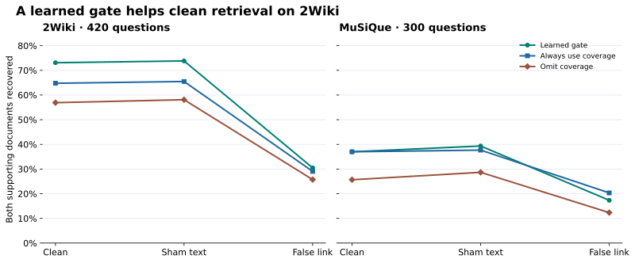

# Gating document coverage on fresh evidence pools

A learned query-level gate improved complete-evidence recovery on clean 2Wiki pools. False links still degraded both independent cohorts, and the gate lost to always using coverage on corrupted MuSiQue. The gate chooses between two existing pair heads. The results leave room for a scorer that directly verifies the proposed relation.

## Design

Fit the gate on earlier 2Wiki and MuSiQue cohorts totaling 1,004 questions. The frozen tests contain 420 additional 2Wiki validation questions and 300 MuSiQue questions reserved from its released labeled training collection. The MuSiQue source split designation belongs to the upstream benchmark. These 300 questions were held out from this gate’s training, and the text encoders and pair heads stayed frozen. The normalized supporting titles were disjoint across the gate’s fit and test. Prior MuSiQue evaluations were also reserved during test selection. Upstream pretraining exposure was uncontrolled.

Build each 64-candidate bank from two annotated supports, eight supplied distractors and 54 plausible passages from a shared donor bank of 8,192. For the noise test, edit one distractor selected by query affinity so it references a supporting title. The sham uses an invented reference with the same normalized token count. All supporting text stays unchanged and the test uses a reference template held back from fitting.

The primary logistic gate sees the predicted pairs’ title links, score margins and cross-head preferences, mean query affinities, shared documents, and the candidate graph density. It learns from cases in which exactly one head succeeds and balances variant weights within each fitting question. The clean-only fit uses the same features and penalty. The fixed link rule switches coverage off when the no-coverage head’s winning pair is linked. Gold labels define the fitting targets and the controlled edits. Test-time gate inputs come entirely from the candidates and predicted pairs.

| Test and perturbation | Always full | Always omit coverage | Fixed link rule | Gate, clean fit | Gate, paired fit | Oracle choice |
| --- | ---: | ---: | ---: | ---: | ---: | ---: |
| 2Wiki clean, 420 | 272 | 239 | 248 | 311 | 307 | 327 |
| 2Wiki sham, 420 | 275 | 244 | 249 | 314 | 310 | 333 |
| 2Wiki false link, 420 | 122 | 108 | 108 | 123 | 128 | 157 |
| MuSiQue clean, 300 | 111 | 77 | 83 | 117 | 111 | 122 |
| MuSiQue sham, 300 | 113 | 86 | 85 | 122 | 118 | 127 |
| MuSiQue false link, 300 | 61 | 37 | 37 | 46 | 52 | 65 |

Cells count questions with both supports recovered. The paired-fit gate gained **8.3 points** versus full on clean 2Wiki (paired 95% interval **+5.5 to +11.2**). Its gain was **1.4 points** with false links (−1.2 to +4.0). On false-link MuSiQue it lost **3.0 points** (−5.7 to −0.7). The oracle recovered 65/300 corrupted MuSiQue questions. Access to both existing heads therefore offered only four additional correct decisions beyond the full head on that test. Running the gate also requires scoring both heads. The study measures support selection from supplied pools and omits reader accuracy and serving latency. [Machine-readable results](../../results/nonlinear_retrieval_natural/coverage_gate_v1/summary.json)

Replay the gate with `python scripts/analyze_kam_coverage_gate.py results/nonlinear_retrieval_natural/coverage_gate_v1 --output /tmp/kam-gate.json`. The published shards contain numerical predictor features and exact evidence outcomes. The fixture and checkpoint hashes bind them to the scored input. [Data and split provenance](../../results/nonlinear_retrieval_natural/coverage_gate_v1/provenance.json) · [HPG job driver](../../slurm/nonlinear_retrieval_coverage_gate.sbatch)
