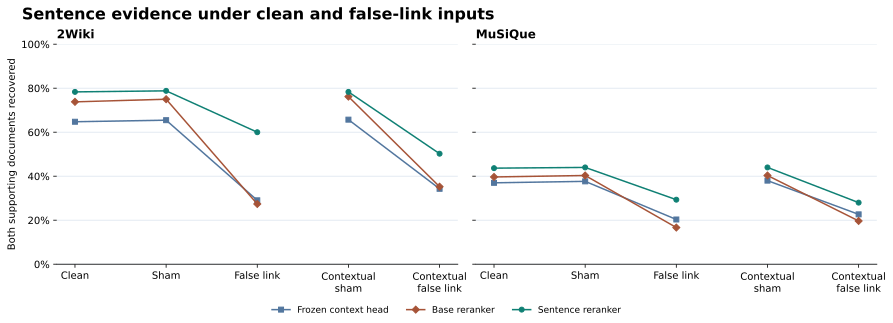

# Verifying document links with sentence evidence

The sentence reranker improved complete support recovery on supplied 2Wiki and MuSiQue pools under clean input and two false-link perturbations. It lost evidence and joint answer accuracy on separately retrieved HotpotQA pools, with the clearest losses on naturally linked support pairs.

## Method

The experiment reuses the [frozen 64-candidate pools and split](COVERAGE_GATE.md). Each pool contains both annotated supports, eight original distractors and 54 affinity-selected passages. An earlier 2Wiki cohort of 768 questions fits the new rerankers. The evaluation uses 420 separate 2Wiki validation and 300 MuSiQue questions reserved from the upstream labeled training release. The new reranker sees no MuSiQue fit cases. Both underlying pair heads and the E5 encoder stay frozen.

For each question and scenario, take the union of the top 16 pairs from the context-aware head and its no-coverage counterpart. Standardize each head’s scores across all 2,016 possible pairs before taking the shortlist. A ridge-penalized conditional softmax learns to rank this list. Training uses questions where the gold pair appears in the shortlist and weights a question’s usable perturbations to sum to one. The evaluation counts missing gold pairs as failures. The baseline reranker sees the pair-head scores, query-to-document affinities and title-link flag. The sentence variants add question-term overlap, cross-document coverage over individual sentences, and, for the semantic version, frozen sentence–query E5 similarities. Mention features look for the other document’s exact normalized title within a single sentence and measure the rest of that sentence’s question overlap. Each document contributes at most eight supplied sentences and 120 normalized tokens. The learned inputs use only the question and visible candidates.

The paired edits use the same nongold donor and gold-title target as the earlier gate study. The injected sentence names the title. The sham uses an invented reference with equal normalized token count, and both variants have identical gold support text. Training and test use distinct templates. A second stress test attaches the reference to an excerpt from the donor chosen for high lexical overlap with the question. That context-bearing format appears only at test time.

## Evidence recovery

| Held-out condition | Frozen context head | Base reranker | Sentence lexical | Sentence semantic | Semantic, clean fit | Shortlist oracle |
| --- | ---: | ---: | ---: | ---: | ---: | ---: |
| 2Wiki clean, 420 | 272 | 310 | 309 | 329 | 335 | 391 |
| 2Wiki sham, 420 | 275 | 315 | 317 | 331 | 331 | 392 |
| 2Wiki false link, 420 | 122 | 115 | 170 | 252 | 214 | 382 |
| 2Wiki contextual sham, 420 | 276 | 320 | 320 | 329 | 337 | 392 |
| 2Wiki contextual false link, 420 | 144 | 148 | 187 | 211 | 200 | 384 |
| MuSiQue clean, 300 | 111 | 119 | 117 | 131 | 133 | 220 |
| MuSiQue sham, 300 | 113 | 121 | 120 | 132 | 134 | 225 |
| MuSiQue false link, 300 | 61 | 50 | 63 | 88 | 69 | 200 |
| MuSiQue contextual sham, 300 | 114 | 121 | 120 | 132 | 133 | 228 |
| MuSiQue contextual false link, 300 | 68 | 59 | 68 | 84 | 73 | 206 |

For the paired-fit semantic reranker versus the frozen context head, the gain was **13.6 percentage points** on clean 2Wiki (paired 95% interval +9.3 to +18.1) and **31.0 points** with false links (+26.2 to +35.7). The corresponding MuSiQue gains were **6.7 points** (+3.0 to +10.7) and **9.0 points** (+4.7 to +13.3). Compared with the base reranker on false links, semantic features gained 32.6 points on 2Wiki (+27.9 to +37.4) and 12.7 on MuSiQue (+8.3 to +17.0). These intervals resample paired questions for a single fitted reranker.

The contextual intervention reduced the gains over the frozen context head to 16.0 points on 2Wiki (+11.0 to +21.0) and 5.3 on MuSiQue (+1.0 to +9.7). Compared with its own contextual sham, semantic reranking lost 28.1 points on 2Wiki and 16.0 on MuSiQue. The frozen context head lost 31.4 and 15.3 points. The contextual MuSiQue result therefore shows better absolute recovery with a similar degradation under the injected link.

The paired difference between these sham-to-link drops separates robustness from overall accuracy. For standard links, the verifier reduced the drop by 17.6 points on 2Wiki (95% paired interval +12.6 to +22.4) and 2.7 on MuSiQue (−2.3 to +7.7). For contextual links the changes were +3.3 (−1.7 to +8.1) and −0.7 (−5.3 to +4.0).



On clean questions whose shortlist contained the gold link and at least one linked distractor, the paired semantic reranker ranked the exact supporting link first on 132/151 in 2Wiki and 38/44 in MuSiQue. The frozen context scores gave 131/151 and 37/44 when restricted to the same linked pairs. This conditional diagnostic cannot detect gains on questions whose gold pair never entered the shortlist.

### Which sentence features matter?

In a follow-up ablation, retaining general sentence relevance while removing exact-title mention features changed clean recovery from 329 to 324 on 2Wiki and from 131 to 133 on MuSiQue. On false links it reduced recovery from 252 to 185 and from 88 to 63. Mention-local features alone recovered 202 and 76. Under the contextual false links, the corresponding counts were 188 and 68 for relevance alone, 209 and 77 for mention features alone, and 211 and 84 for both feature groups. Removing the local semantic margin, which compares the mention sentence’s affinity with the best sentence in its document, further reduced recovery. The full classifier uses complementary signals, particularly for the standard false-link format.

## Frozen answer reader

Use the same FLAN-T5-small reader with either the frozen context selector or the reranked pair, with the higher-affinity document shown first and an equal token budget. An exact answer is matched after normalization. Joint exact match also requires both annotated support documents. Each request’s selectors run on the same GPU. The 2Wiki shards ran on B200, and the MuSiQue shards ran on B200 or RTX.

| Held-out condition | Frozen head joint | Semantic, 16 per head | Semantic, 4 per head |
| --- | ---: | ---: | ---: |
| 2Wiki clean, 420 | 109 | 128 | 129 |
| 2Wiki sham, 420 | 108 | 130 | 129 |
| 2Wiki false link, 420 | 38 | 89 | 87 |
| MuSiQue clean, 300 | 51 | 62 | 63 |
| MuSiQue sham, 300 | 53 | 63 | 64 |
| MuSiQue false link, 300 | 28 | 40 | 39 |

On false links, joint exact match improved 12.1 points on 2Wiki (95% paired interval +9.0 to +15.5) and 4.0 points on MuSiQue (+0.7 to +7.3). Answer-only exact matches rose from 107 to 137 on 2Wiki and from 55 to 59 on MuSiQue. The reader study covers the clean, sham and standard false-link conditions. [Reader counts and paired intervals](../../results/nonlinear_retrieval_natural/sentence_verifier_v1/followthrough.json)

A local Apple M5 replication agreed on all 6,480 evidence decisions and on 6,478 of 6,480 answer exact-match decisions across methods and input variants. Both answer differences occurred on MuSiQue.

## Transfer to retrieved Wikipedia pools

Freeze the 2Wiki-trained reranker and apply it to the 768 held-out questions from the [HotpotQA supporting-link study](SUPPORT_LINKS.md). Use the original top-64 dense results from Wikipedia, including the 300 pools that lack at least one support. Freeze the full context head, encoder and reader, and reuse the previous dense vectors by row ID. A deterministic punctuation rule splits the stored Wikipedia excerpts into sentences. The underlying pair heads used HotpotQA for training. The new sentence policy was fit on 2Wiki, and these HotpotQA questions were held out from pair-head fitting. The two cohorts used for sentence fit and HotpotQA evaluation shared zero normalized questions and zero normalized supporting-document titles.

| HotpotQA stratum | Frozen head evidence / joint | Semantic, 16 per head | Semantic, 4 per head |
| --- | ---: | ---: | ---: |
| All 768 | 346 / 231 | 328 / 217 | 329 / 219 |
| Gold linked, 368 | 323 / 216 | 306 / 205 | 307 / 205 |
| Gold unlinked, 100 | 23 / 15 | 22 / 12 | 22 / 14 |
| One or more supports missing, 300 | 0 / 0 | 0 / 0 | 0 / 0 |

The reranker lost 1.8 percentage points in full-cohort joint exact match (paired 95% interval −3.4 to −0.3). On naturally linked questions the evidence decrease was 4.6 points (−7.6 to −1.6). For the 360 questions with both a gold link and at least one linked distractor, its complete support count fell from 315 to 298. All 768 frozen baseline decisions reproduced the previous evidence and answer-exact labels on HPG B200. These results show that resistance to injected references on supplied pools is an incomplete test of transfer to native retrieved pools. Keep the original context head as the reference for whole-Wikipedia retrieval. [HotpotQA counts and paired intervals](../../results/nonlinear_retrieval_natural/sentence_verifier_v1/followthrough.json)

## Serving cost

The learned reranker still scores both original pair heads. A replay that applies its unchanged weights to the union of four candidates per head reduces the average scored list from about 26 to 6 pairs. On the standard false-link perturbation recovery moves from 252 to 250 on 2Wiki and from 88 to 85 on MuSiQue. The four-pair setting is a retrospective operating-point diagnostic.

Profile 48 clean requests per source, selected by a fixed ID hash. The measured interval begins with the candidate shortlist and ends after constructing sentence-level features. Time isolated requests with a warm runtime. Compare recomputing sentence embeddings for each request with reading identical embeddings from a small device-resident cache. The cache stores 1,536 bytes per sentence in FP32 and is prepopulated for the profiled questions.

| HPG RTX PRO 6000, four pairs per head | Recompute p50 / p95 | Resident p50 / p95 |
| --- | ---: | ---: |
| 2Wiki | 5.49 / 7.83 ms | 0.175 / 0.260 ms |
| MuSiQue | 4.66 / 5.47 ms | 0.169 / 0.217 ms |

Cold and resident feature differences were at most 0.0000011. The local M5 replication yielded the same direction, with recompute medians of 26–35 ms and resident medians near 0.6 ms. These measurements quantify the cost of the extra sentence stage with its inputs ready. Corpus-scale sentence indexing and live cache hit rates remain open. [Timing samples and profiler summary](../../results/nonlinear_retrieval_natural/sentence_verifier_v1/followthrough.json)

A second RTX run kept sentence vectors in ordinary host memory and staged only the selected vectors through a reusable pinned buffer. Its four-pair medians were 0.158 ms on 2Wiki and 0.148 ms on MuSiQue, close to 0.161 and 0.152 ms for device-resident vectors on that run. The host timing includes lookup, staging, transfer, and feature construction from a prepopulated in-memory bank. Feature differences stayed within the same bound. This measures isolated cache hits on the 96-question profiling sample.

## Reproduce

The [HPG feature driver](../../slurm/nonlinear_retrieval_sentence_verifier.sbatch) extracts training and test features from the earlier coverage-gate fixtures and checkpoints. The 2Wiki and MuSiQue evidence comparisons used NVIDIA RTX PRO 6000 Blackwell GPUs. The [HotpotQA driver](../../slurm/nonlinear_retrieval_sentence_fullwiki.sbatch) uses the supporting-link fixture and original retrieval audit files. The replay contains numeric shortlist features, evaluation labels, and identifiers.

The replay uses Python 3.11 with SciPy 1.17.1 in CI.

```bash
study=results/nonlinear_retrieval_natural/sentence_verifier_v1
OPENBLAS_NUM_THREADS=1 python scripts/analyze_kam_sentence_verifier.py "$study/replay.json.gz" \
  --output /tmp/kam-sentence-verifier.json --write-policy /tmp/kam-sentence-policy.json
OPENBLAS_NUM_THREADS=1 python scripts/analyze_kam_verifier_followthrough.py "$study/followthrough_replay.json" \
  --output /tmp/kam-sentence-followthrough.json
```

[Replay summary](../../results/nonlinear_retrieval_natural/sentence_verifier_v1/summary.json)
