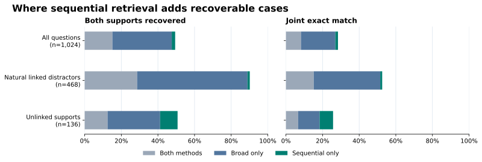

# Broad reranking versus learned sequential retrieval on sealed HotpotQA pools

The two-arm oracle adds 19 complete support recoveries and 15 joint exact matches over broad reranking. Unlinked questions account for most of those additional successes.

## Paired comparison

Reuse the 1,024 held-out questions and exact ordered top-64 Wikipedia pools from the [native routing study](NATIVE_ROUTING_GATE.md). The broad reranker contributes its archived selected pair for each question. The learned sequential retriever uses the existing frozen query adapter to select a first document, re-encodes the question with that document, and averages the original and conditioned document affinities to select the second. Both steps use the same 64 documents. The paired pass runs both selections through the same frozen FLAN-T5-small reader with the same per-document evidence budget.

The replay checks the ordered pool hash, the archived broad choice, and the selected support labels against the frozen fixture. The oracle counts whether either method succeeded on each question. Joint exact match requires both gold support documents and an exact normalized answer. Paired intervals use 5,000 resamples of whole questions. This evaluation fits no additional gate or retrieval model.

## Results

| Frozen-pool cohort | Broad support / joint EM | Sequential support / joint EM | Oracle support / joint EM | Oracle gain over broad |
| --- | ---: | ---: | ---: | ---: |
| All 1,024 | 487 / 276 | 174 / 99 | 506 / 291 | +19 / +15 |
| Both gold documents present, 619 | 487 / 276 | 174 / 99 | 506 / 291 | +19 / +15 |
| Natural linked distractors, 468 | 416 / 241 | 140 / 76 | 422 / 246 | +6 / +5 |
| Unlinked gold pair, 136 | 56 / 25 | 30 / 19 | 69 / 35 | +13 / +10 |
| Gold document missing, 405 | 0 / 0 | 0 / 0 | 0 / 0 | 0 / 0 |



Across all questions, the oracle gain is **1.86 percentage points** for support recovery (95% paired interval **+1.07 to +2.73**) and **1.46 points** for joint exact match (**+0.78 to +2.25**). On unlinked questions the gains are **9.56 points** for support (**+5.15 to +14.71**) and **7.35 points** for joint exact match (**+2.94 to +11.76**). The unlinked subset supplies 13 of the 19 extra support successes and 10 of the 15 extra joint successes. The natural linked distractor subset requires both annotated supports, a title mention joining them, and at least one other linked pair in the original pool.

The methods chose different pairs on 811 questions. On those, broad alone recovered both supports on 332, and sequential alone did so on 19. Broad alone achieved joint exact match on 192, and sequential alone did so on 15. Among the 619 complete pools, the first sequential step chose a support on 408 questions. Both supports were returned on 174 of those 408. The sequential trajectory loses evidence at both steps.

All 1,024 pool hashes and archived broad choices matched exactly. Both methods used the same GPU and reader within each question. Three shards ran on B200 and one on RTX PRO 6000. Every broad answer-exact label reproduced the previous pass.

## Reproduce

The [HPG job driver](../../slurm/nonlinear_retrieval_frozen_sequential_oracle.sbatch) uses the frozen index, the decompressed question fixture, the sealed pool artifact, and the broad replay. The paired outcomes and summary are saved as [replay artifacts](../../results/nonlinear_retrieval_natural/frozen_sequential_oracle_v1/).

```bash
base=results/nonlinear_retrieval_natural
prior="$base/native_routing_gate_v1"
study="$base/frozen_sequential_oracle_v1"
OPENBLAS_NUM_THREADS=1 python scripts/analyze_kam_frozen_sequential_oracle.py "$study/replay.json.gz" \
  --fixture "$prior/fixture.json.gz" --pools "$prior/pools.json.gz" \
  --broad-replay "$prior/replay.json.gz" --output /tmp/kam-sequential-oracle.json
```
