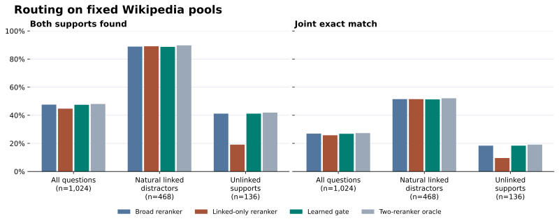

# Inference-visible routing between native Wikipedia rerankers

The learned gate matched broad reranking closely on a fresh holdout. Even a two-reranker oracle offered five additional support recoveries and four additional joint exact matches. The frozen rerankers agreed on almost every case with a naturally linked distractor.

## Protocol

Fit a gate on 1,536 HotpotQA questions and evaluate on 1,024 fresh questions from the labeled HotpotQA release. The gate fit, evaluation, and previous reranker cohorts are disjoint by ID, normalized question text, and normalized support title. The [broad and linked-only reranker weights](NATIVE_SENTENCE_REFIT.md) stay frozen. The frozen context scorer is an additional reference.

The HPG freeze pass retrieves 64 articles per query from the pinned Wikipedia index and saves their ordered row IDs. The GPU scoring pass reads those exact IDs to recover the passages and document vectors. The reader sees the selected pair with the more query-affine article first and uses the same evidence token limit for every arm. Reader requests are deduplicated for identical prompts. The replay checks every ranked pool hash and independently verifies support recovery from the stored selected pair and fixture labels.

The broad and linked-only rerankers score the same union of the top 16 pairs from each frozen context head. The gate sees their winning pairs' title-link flags, normalized score margins and cross-head preferences, whether the pairs share a document, pool link density, and their query affinity and sentence evidence. It uses a fixed L2-penalized logistic fit with a 0.5 threshold. The fitting rows are questions on which exactly one option recovered both supports. No answer text, gold link status, recalled support count, or reader result enters the gate's inference features or fit objective. Gold supports supply the fit labels and metrics.

Compare with always broad, always linked-only, frozen context, a rule that uses the specialist when broad nominates a linked pair, and a learned gate with only link flags and density. The oracle chooses the successful option separately for support and joint exact match. Both rerankers are evaluated before routing.

## Results

| Policy | All 1,024 | Natural linked distractor, 468 | Gold unlinked, 136 |
| --- | ---: | ---: | ---: |
| Frozen context | 442 / 256 | 401 / 233 | 26 / 13 |
| Always broad | 487 / 276 | 416 / 241 | 56 / 25 |
| Always linked-only | 458 / 264 | 417 / 241 | 26 / 13 |
| Observed-link rule | 487 / 275 | 416 / 240 | 56 / 25 |
| Link-only learned gate | 487 / 275 | 416 / 240 | 56 / 25 |
| Full learned gate | 486 / 275 | 415 / 240 | 56 / 25 |
| Two-reranker oracle | 492 / 280 | 420 / 244 | 57 / 26 |

Each cell gives complete support recovery and joint exact match. Joint exact match requires both annotated supports and the exact normalized answer. Of 1,024 ranked pools, 619 contain both supports. All policies record zero complete support and joint successes on the 405 pools with missing evidence. The linked challenge requires both gold documents, a title mention connecting them, and at least one other linked pair in the pool.



Relative to always broad, the gate moved both overall metrics by **−0.10 percentage points** (95% paired intervals **−0.39 to +0.20**). On the linked challenge it moved support recovery and joint exact match by **−0.21 points** (both intervals **−0.86 to +0.43**). Always linked-only gained a single support over broad there, with the same joint count. Broad recovered 30 more unlinked support pairs and 12 more joint answers than linked-only.

Only 74 of 1,536 fit rows supplied a distinct label for routing by complete supports. Broad won 53 and linked-only won 21. The rerankers agreed on 842 of 1,024 evaluation pairs, including 457 of 468 on the linked challenge. When the two choices differed, broad found both supports on 34 questions, linked-only on five, and the gate on 33. The gate took the specialist on 17 of those 182 decisions. The disagreement oracle found both supports on 39 and achieved joint exact match on 20, compared with 34 and 16 for always broad. These counts limit the gains available from learning a choice between these fixed heads on these pools.

Both passes ran on HPG NVIDIA B200 GPUs. All 2,560 ordered-pool hashes and all selected support labels passed the replay audit. All 1,024 test questions enter the reader comparison.

## Reproduce

The [HPG driver](../../slurm/nonlinear_retrieval_native_routing_gate.sbatch) runs separate freeze and score stages. Seal the ranked shards with `analyze_kam_native_routing_gate.py seal` before staging the score pass. The [published artifacts](../../results/nonlinear_retrieval_natural/native_routing_gate_v1/) include the sealed pools, split, numeric gate inputs, selected pairs, reader outcomes, and fit.

```bash
base=results/nonlinear_retrieval_natural
study="$base/native_routing_gate_v1"
OPENBLAS_NUM_THREADS=1 python scripts/analyze_kam_native_routing_gate.py analyze "$study/replay.json.gz" \
  --fixture "$study/fixture.json.gz" --pools "$study/pools.json.gz" \
  --fitted "$base/native_sentence_refit_v1/fitted.json" --output /tmp/kam-native-gate.json
```
