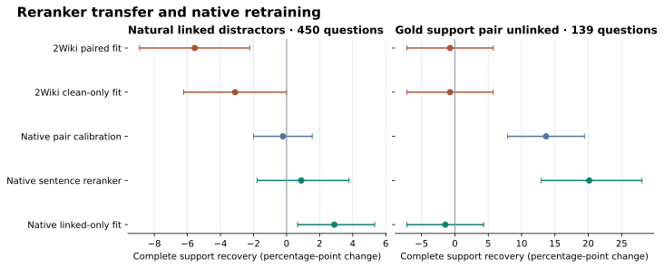

# Refitting the sentence reranker on native Wikipedia retrieval

A reranker trained on the same kind of Wikipedia pools used for evaluation recovered the loss of the transferred 2Wiki policy. Most of that recovery was available by recalibrating the frozen pair features. Additional sentence features helped more on unlinked support pairs than on the primary naturally linked challenge.

## Fit and evaluation

Freeze 1,536 fitting questions and 1,024 evaluation questions from the labeled HotpotQA training release. The split excludes questions and support titles reserved in 15 earlier whole-Wikipedia experiments. The new fit and test have no common IDs, normalized question text, or supporting titles. Three new test cases contain titles seen by the old 2Wiki fit. A sensitivity analysis removes those cases from its comparison.

Retrieve the top 64 articles for each question from the same pinned Wikipedia index using the frozen dense encoder. Keep the actual retrieved pools, including cases that lack one or both annotated supports. The experiment inserts no documents or cross-references. The primary stratum has both gold supports present, a normalized title mention linking the gold pair, and at least one other linked pair in the full retrieved pool. The title-mention scan uses the first 120 normalized tokens per article. The title rule measures observed references and serves as an operational label for this evaluation.

The context and no-coverage pair heads stay frozen. The reranker scores the union of their top 16 pairs. A ridge-penalized conditional softmax fits only on native training questions whose correct pair reaches that shortlist. Of the 1,536 fitting pools, 920 contain both supports and 863 yield eligible shortlists. The naturally linked training subset contains 688 questions and 687 usable shortlists. The transferred comparison uses the previous 2Wiki parameters and a clean-only refit using the same 2Wiki question cohort. Native ablations fit the same regularizer and training questions with pair features only, general sentence relevance, mention-local evidence, or their combination. The linked-focused model uses the linked subset for fitting, then applies its weights to every test question.

## Evidence recovery

| Scorer | All 1,024 | Linked with a distractor, 450 | Gold unlinked, 139 |
| --- | ---: | ---: | ---: |
| Frozen context | 427 | 388 | 26 |
| Transferred 2Wiki, paired fit | 401 | 363 | 25 |
| Transferred 2Wiki, clean-only fit | 412 | 374 | 25 |
| Native fit, pair features only | 445 | 387 | 45 |
| Native fit, general sentence relevance | 461 | 391 | 57 |
| Native fit, mention-local evidence | 450 | 391 | 46 |
| Native fit, all sentence features | 459 | 392 | 54 |
| Native fit, naturally linked training subset | 438 | 401 | 24 |

Cells count questions on which the selector found both annotated supports. Among 1,024 test questions, 602 pools contained both supports. The shortlist retains the gold pair on 571 of those 602, including 447 of the 450 primary cases. The other 422 pools give every selector zero complete-evidence successes. The remaining 13 linked-gold cases contain no other linked pair.



The old 2Wiki policy lost **5.6 percentage points** on the primary stratum relative to the frozen context scorer (paired 95% interval −8.9 to −2.2). It selected 86 wrong linked pairs versus 61 for the frozen scorer. Of those, 78 and 55 respectively shared one correct support. Switching the 2Wiki fit to clean-only recovered 11 cases, a gain of **2.4 points** (+0.7 to +4.2) on the same questions. The native semantic fit recovered another 18 over the clean-only transfer, **4.0 points** (+0.9 to +7.1). The transfer failure persists after excluding the three questions whose titles overlap the earlier 2Wiki fit.

On the primary cohort, the native full sentence fit gained **0.9 points** over frozen context (−1.8 to +3.8) and **1.1 points** over native pair recalibration (−1.6 to +3.8). The paired comparisons therefore resolve the difference between training pools more clearly than the incremental benefit of sentence evidence on this subset. Across all questions the native full fit gained **3.1 points** over frozen context (+1.6 to +4.8), with unlinked evidence accounting for 28 of its 32 extra recoveries. The linked-only fit gained **2.9 points** on the primary stratum (+0.7 to +5.3) and recovered two fewer unlinked pairs than frozen context. The linked-only result supports fitting for that narrower target and holds the gold link status out of serving inputs.

An exploratory weight swap kept the transferred model and replaced one feature block at a time with its native counterpart. Both models were first expressed on raw feature scales and anchored to the weight of the frozen context logit. On the primary stratum the transferred count of 363 rose to 365 with the pair-feature block, 369 with general sentence relevance, and 380 with the mention-local block. The full native model reached 392. This identifies mention-local calibration as the most sensitive single block in the transfer. The swap measures a conditional change to fixed logits on the same shortlists. Feature interactions remain possible.

Paired intervals resample test questions with all arms held together. The fits are fixed for this experiment, and the feature comparisons are separate ablations.

## Frozen reader

Use the same FLAN-T5-small reader, fixed evidence token budget, and higher-affinity document first in each selected pair. The B200 reader pass used a different GPU family and query batching from the RTX feature pass. It reproduced the exact ordered-pool hash on 1,009 of 1,024 cases. Every compared selector also reproduced its evidence decision on those cases. The reader table reports the 1,009 exact matches and excludes the 15 differing hashes before evaluating answers. The evidence table above still uses all 1,024 cases. The two execution changes were applied together, so their effects on retrieval order remain unresolved.

| Scorer | Joint exact, all 1,009 | Joint exact, linked with a distractor, 444 | Joint exact, unlinked, 137 |
| --- | ---: | ---: | ---: |
| Frozen context | 249 | 226 | 12 |
| Transferred 2Wiki | 233 | 209 | 13 |
| Native pair recalibration | 264 | 228 | 25 |
| Native full sentence fit | 266 | 228 | 27 |
| Native linked-only fit | 258 | 234 | 13 |

Joint exact match requires both gold supports and an exact normalized answer. The native full fit gained 1.7 points overall (95% paired interval +0.4 to +3.0). On the paired linked reader subset, the native full fit gained 0.5 points (−1.8 to +2.7), and the linked-only fit gained 1.8 points (0.0 to +3.6). The evidence improvement from linked-only fitting warrants confirmation with a new split and a fixed candidate-pool artifact.

## Reproduce

Use the [HPG driver](../../slurm/nonlinear_retrieval_native_sentence_refit.sbatch) with the frozen index, checkpoints, and decompressed question fixture. The [cohort audit and source hashes](../../results/nonlinear_retrieval_natural/native_sentence_refit_v1/provenance.json) identify the exact split. HPG RTX GPUs retrieved the pools and extracted sentence features across eight shards. The 16-feature fits use SciPy on CPU. The driver’s `reader-portability` mode produced the four B200 reader shards.

```bash
base=results/nonlinear_retrieval_natural
new="$base/native_sentence_refit_v1"
old="$base/sentence_verifier_v1"
OPENBLAS_NUM_THREADS=1 python scripts/analyze_kam_native_sentence_refit.py "$new/replay.json.gz" \
  --cohort-audit "$new/provenance.json" --old-policy "$old/policy.json" \
  --old-fit-replay "$old/replay.json.gz" --output /tmp/kam-native-refit.json
```

[Complete counts and paired intervals](../../results/nonlinear_retrieval_natural/native_sentence_refit_v1/summary.json)
