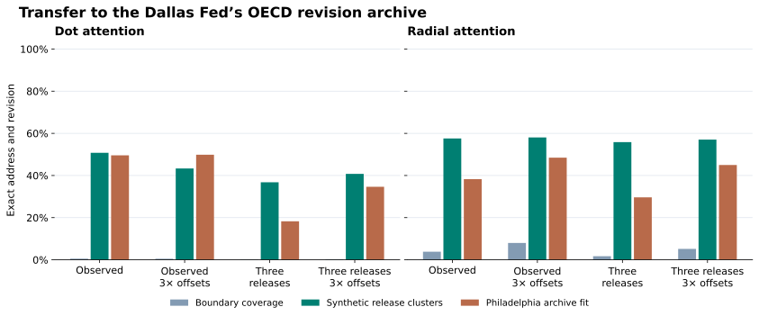

# Revision transfer to the Dallas Fed’s OECD archive

## Design

The four real GDP workbooks contain 2,584 numeric cells. The experiment uses 292 country-quarter groups with at least four archived releases and a qualifying changed value across consecutive available snapshots. The observations in the cohort span 1963–97. Their source publication dates span May 1965 to November 1998. Canada contributes 137 groups, France 61, Italy 79, and Portugal 15. [Archive documentation](https://www.dallasfed.org/research/international/oecd) · [Workbook URLs and byte hashes](../../results/nonlinear_retrieval_natural/oecd_revisions_v1/provenance.json)

For each group, two questions target different published values and one falls before the first available release. An independent SQLite lookup compares exact release dates and verifies all 584 answerable and 292 unavailable labels. The decoder evaluation uses the 584 answerable cases. Each source has at most one publication per quarter, so the decoder can use quarter indices without merging distinct releases. The evaluation supplies typed identities and randomly reassigns numeric outcomes to symbols per episode, as in the prior Philadelphia Fed study.

The three training sources are procedural revisions with coverage at both clock boundaries, procedural histories that model clusters of releases, and early Philadelphia Fed archive groups. Dot and radial KAM share token budgets of 13,516,800 per run, with four paired seeds and two fresh symbol assignments per question. The Dallas archive contributes no fitting data.

The observed panels use real records at depths 16 and 48, with a median of nine releases for the queried observation and a maximum of eleven. The thinner condition retains the two target releases and one additional release, and replaces other releases with near-dated real records from other addresses. A second intervention independently triples all relative publication-clock offsets at evaluation. It holds record identities and payloads fixed and preserves oracle eligibility and ordering. Thin panels also change the distribution of distractors, so they test a concrete shift in pool composition.

## Results

All 24 fits ran on HPG NVIDIA L4 GPUs. Each cell reports joint exact recovery of the queried address and target record across 4,672 question, recoding, and seed combinations. The observed 16-candidate column shows the depth check. The remaining columns use 48 candidates.

| Decoder and training data | Observed, 16 | Observed, 48 | Clock ×3 | Three same-address releases | Both interventions |
| --- | ---: | ---: | ---: | ---: | ---: |
| Dot, procedural boundaries | 4.4% | 0.5% | 0.5% | 0.1% | 0.2% |
| Dot, procedural release clusters | 80.4% | 50.8% | 43.3% | 36.8% | 40.8% |
| Dot, Philadelphia archive | 91.1% | 49.6% | 49.9% | 18.3% | 34.7% |
| Radial, procedural boundaries | 18.0% | 3.8% | 8.0% | 1.7% | 5.2% |
| Radial, procedural release clusters | 67.0% | 57.6% | 58.0% | 55.8% | 57.0% |
| Radial, Philadelphia archive | 66.4% | 38.3% | 48.5% | 29.6% | 45.0% |



At depth 48 on observed records, procedural release clusters improved radial recovery by 53.7 percentage points (95% paired bootstrap interval 50.0 to 57.6) and dot recovery by 50.2 points (46.8 to 53.9) over procedural boundary training. For the cluster-trained radial model, tripling clock offsets moved recovery by +0.5 points (−0.5 to +1.4), and thinning moved it by −1.8 points (−5.0 to +1.5). The Philadelphia-trained radial model gained 10.2 points (6.0 to 14.9) under clock scaling and lost 8.6 points (−11.6 to −5.6) under thinning. The resampling preserves question-level pairing and draws fit seeds and observation quarters as crossed blocks.

The depth-16 ordering shows why the architecture comparison depends on workload. On observed records with procedural release clusters, dot leads at 16 candidates and radial leads at 48. This study supplies typed addresses and excludes unavailable questions from model evaluation. It supports transfer of a release-cluster curriculum for typed lookup. The effect of changing same-address cluster size in isolation remains open because thinning also changes the distractors. [Counts, country breakdowns, and paired estimates](../../results/nonlinear_retrieval_natural/oecd_revisions_v1/summary.json)

## Reproduce

Install `xlrd==2.0.2` to read the four original XLS files. Download the workbook URLs listed in `provenance.json` and match their hashes. Build the Philadelphia training fixture using the [archive reproduction instructions](../../docs/research/REPRODUCE_DATASET_STUDIES.md#recreate-real-revision-lookup), then run this preparation command.

```bash
python scripts/prepare_kam_oecd_revisions.py \
  --source-directory /path/to/dallas-workbooks \
  --training-fixture /path/to/fed-vintage-fixture.json \
  --fixture-prefix /path/to/oecd --output /path/to/oecd-catalog.json
```

The [HPG job driver](../../slurm/nonlinear_retrieval_oecd_revisions.sbatch) evaluates all 24 runs with the shared fixtures. The compact replay holds only the fields the analyzer needs.

```bash
study=results/nonlinear_retrieval_natural/oecd_revisions_v1
python scripts/analyze_kam_oecd_revisions.py "$study/replay.json.gz" \
  --provenance "$study/provenance.json" --output /tmp/kam-oecd-summary.json
diff -u "$study/summary.json" /tmp/kam-oecd-summary.json
```
