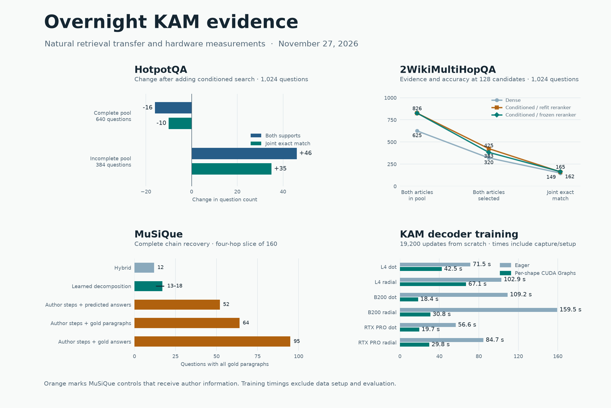
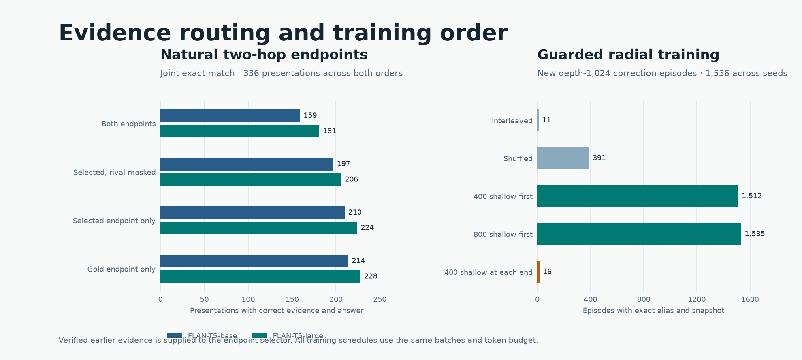
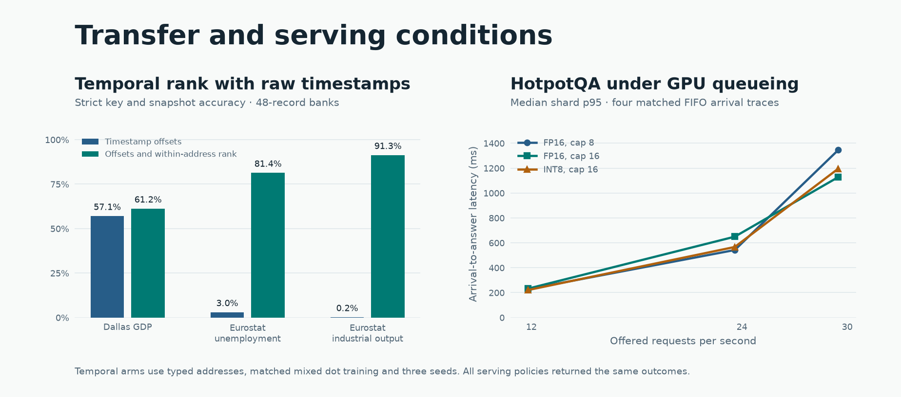

# KAM overnight research handoff

8:00 AM Eastern, November 27, 2026

See the [benchmark scorecard](../../docs/research/BENCHMARKS.md) for answer exact match, token F1 where available, and results across the evaluated datasets.

Conditioned expansion raised HotpotQA joint exact match from **308 to 333** on 1,024 fresh questions. Incomplete pools gained 35 joint answers and complete pools lost 10. A separate pair-controlled MuSiQue study found that earlier evidence can guide hard endpoint routing on natural questions. In revision memory, trusted clocks and within-address rank mattered more than adding a static learned support bank. Training order changed the guarded radial decoder's fresh deep correction recovery from **11 to 1,535 of 1,536** at the same token and update budget. On L4, the fused FP32 path reduced representative guarded radial batch time from **39.28 to 1.79 ms**, with every tested hard decision preserved on all three GPUs.

## HotpotQA

The primary comparison used 1,024 fresh bridge questions and the same frozen initial top 64. The old search adapter supplied the conditioned top 64, and the same pair scorer and reader processed both original and expanded pools. Joint EM requires both annotated supporting documents and an exact normalized answer.

| Original pool | Questions | Broad support / joint EM | Conditioned-union support / joint EM |
| --- | ---: | ---: | ---: |
| Complete | 640 | 481 / 308 | 465 / 298 |
| Incomplete | 384 | 0 / 0 | 46 / 35 |
| All | 1,024 | 481 / 308 | 511 / 333 |

Conditioned expansion gained 2.44 percentage points of joint EM overall, with a paired interval of +1.17 to +3.81. Among the original incomplete pools, it exposed both supporting documents on 77 questions and selected both on 46. The already-complete cohort lost 10 joint successes. Across three archived matched cohorts, expansion moved joint exact match from 926 to 1,030 out of 3,072. All 108 cases with both gold documents missing from the initial pools remained without both supports under that policy. A separate locked inference-visible replacement guard improved 297 to 325 joint outcomes on its 1,024-case panel, while unguarded union reached 341. Most of the guard's losses came from turning down newly recoverable incomplete cases. [Frozen candidate and reader comparison](CONDITIONED_UNION.md) · [Replications](EXPANSION_REPLICATIONS.md) · [Locked guard](EXPANSION_REPLACEMENT_GUARD.md)

## Transfer to other corpora

**2WikiMultiHopQA.** At 128 candidates, conditioned search raised complete article coverage from 625 to 826 of 1,024 and joint EM from 149 to 165 with the same frozen HotpotQA pair scorer. A title-disjoint fit on native 2Wiki raised selected gold pairs from 383 to 425 on the same lists. Joint EM moved from 165 to 162. Only 15 of the 86 cases whose gold pair was recovered exclusively by the refit were answered correctly from the native leads. The same reader answered 28 when given the annotations. Switching to FLAN-T5-base yielded 17 of those cases on the retrieved prompts and 33 with annotated sentences. At the fixed retrieved evidence, the larger reader did not improve the overall joint result. [Frozen reranking](NATIVE_TWOWIKI_RERANK.md) · [Title-disjoint refit](NATIVE_TWOWIKI_REFIT.md) · [Fixed-prompt reader scaling](NATIVE_TWOWIKI_READER_SCALE.md)

**MuSiQue.** On a native bank of 101,748 paragraphs, three separately trained decomposers recovered complete support on 261–266 of 576 questions, versus 203 for hybrid at the same 128-candidate budget. Four-hop recovery was 13–18 of 160 versus 12 for hybrid. Using author subquestions, a frozen reader's intermediate guesses raised four-hop support from 13 to 52, and true intermediate answers reached 95. The learned route received only the raw question at test time. The author controls used privileged decomposition and sometimes gold values. These comparisons hold candidate capacity fixed. [Independent paragraph bank](NATIVE_MUSIQUE.md) · [Learned decomposer](MUSIQUE_LEARNED_DECOMPOSITION.md) · [Intermediate-answer control](MUSIQUE_BINDINGS.md)

The final four-paragraph budget exposed a different bottleneck. A learned independent reranker reached 26–27 joint exact matches, with all paired intervals spanning zero. Distinct assignment of paragraphs to generated subqueries reached 38–42, versus 22–25 for the original learned path. The paired differences were +2.26 to +3.47 percentage points. Four-hop joint EM remained zero. On 140 fresh two-hop questions with disjoint required titles, assignment improved joint exact matches from 12–14 to 21–24. Greedy and global assignment agreed on all joint decisions. Atomic dependency tokens improved valid plan syntax, with little change in four-hop support. Scaling the learned decomposer from FLAN-T5-small to base raised full candidate coverage from 264–266 to 284–289 of 576 across three matched seeds. The four-hop counts rose from 16–21 to 25–29, with all paired intervals crossing zero. [Four-budget selector](MUSIQUE_EVIDENCE_SELECTOR.md) · [Distinct assignment](MUSIQUE_SUBQUERY_ASSIGNMENT.md) · [Fresh replication](MUSIQUE_ASSIGNMENT_REPLICATION.md) · [Atomic references](MUSIQUE_ATOMIC_REFERENCES.md) · [Decomposer scale](MUSIQUE_DECOMPOSER_SCALE.md)

At four hops with author templates, correcting only the first intermediate binding raised complete candidate pools from 52 to 75. Correcting only the third raised joint candidate-plus-final-subanswer recovery from 7 to 21. Replacing base with a larger general reader at all intermediate steps moved those counts to 40 and 6. The oracle and model-size interventions isolate different sources of error from the final four-paragraph reader metric. [Single binding](MUSIQUE_SINGLE_BINDING.md) · [Reader sizing](MUSIQUE_BINDING_READERS.md)

**Independent prose.** On 384 MultiHop-RAG news questions with annotated articles supplied, one sentence-centered window increased joint exact outcomes from 16 to 31, with 241 from annotated facts. On 74 binary QASPER questions from 65 papers, annotated paragraphs raised correct answers from 34 with same-paper sham to 51. Dense top two reached 47 answers but only 15 joint matches. [News](NEWS_ARTICLE_WINDOWS.md) · [Scholarly evidence](QASPER_BINARY.md)

Across the external tests, candidate coverage and final hard selection were distinct bottlenecks. On the four-hop native panel, the larger learned plans yielded 25–29 complete pools but only 0–2 joint matches under the fixed four-paragraph readout. A same-pool oracle reached 11–14. The late span alternative left all four-hop joint outcomes unchanged at 5/160 in a separate author-template experiment. Earlier branching raised complete four-hop pools from 52 to 57–58, with four to five final joint matches and 15–16 under the frozen gold-only reader. The newly recovered pools gave no additional successes with that gold-readout control. On the same four gold paragraphs at matched token budget, the original question gave 48 exact answers, versus 29 with a predicted last-step binding and 35 with gold intermediate values. [Four-paragraph scaling](MUSIQUE_SCALE_READOUT.md) · [Supervised span binding](MUSIQUE_SPAN_BINDINGS.md) · [Late alternative](MUSIQUE_LATE_BINDING_BRANCH.md) · [Early alternatives and gold readout](MUSIQUE_FIRST_BINDING_BRANCH.md) · [Fixed evidence composition](MUSIQUE_FIXED_COMPOSITION.md)

At the same original question and evidence IDs, increasing each reader window from 96 to 192 tokens improved all-gold exact answers from 59 to 73 for base and from 76 to 91 for large. On the actual selected paragraphs, joint exact counts stayed five and eight respectively, with only nine examples containing all four gold IDs. The large reader reached the same 91 exact answers using just the final gold paragraph, tied with four passages and with 78 shared successes. The final evidence position uses author annotations. Final-answer exactness can therefore be high even when three required paragraphs are absent. [Reader capacity and passage controls](MUSIQUE_READER_WINDOWS.md)

On the 160 four-hop gold cases, the large reader recovered 98 from the author-labeled terminal body alone, one from the previous three paragraphs, and zero from the question alone. A literal answer alias occurred in the visible terminal body for 153. Replacing a well-matched terminal answer span on 60 filtered cases eliminated all original exact answers across both readers, which often emitted the substituted value. This controls the reader's dependence on terminal text. [Terminal evidence and answer substitution](MUSIQUE_TERMINAL_EVIDENCE.md)

A new cohort pairs two plausible endpoints for 168 held-out two-hop questions in 84 title-disjoint pairs across 35 relation templates. Reversing endpoint order gives 336 presentations. Frozen E5 selected 252 correct endpoints from the question and 328 with the verified earlier paragraph. With equal-length cross-paired earlier evidence, it reached 44. The large reader with both endpoints and correct earlier evidence answered 181 exactly. Conditioned hard selection and reading the chosen endpoint alone reached 224 joint outcomes [paired gain +5.65 to +19.37 points]. The selection filters yielded one eligible four-hop pair. On the same 168 questions in one order, retrieving the earlier paragraph from the full native corpus gave 109 exact endpoint-and-answer pairs, compared with 72 from original-question routing and 112 with the verified earlier paragraph. The full annotated chain was recovered on 93 of the 109. Final endpoints were still fixed. At width eight, routing and generating from one endpoint saved 224.35 ms at the paired median on L4 with the large reader, including E5 query encoding. This warm timing assumes preloaded endpoint embeddings and supplied earlier evidence. [Matched endpoints, timing and open earlier retrieval](MUSIQUE_ENDPOINT_ROUTING.md)

When both MuSiQue hops searched the full native corpus at a fixed 128-candidate budget, the dense direct, same-pool sequential, and conditioned corpus routes selected both annotated passages on 8, 25, and 60 of 168. With a shared second-passage-only readout, their joint exact counts were 6, 17, and 43. Conditioned corpus retrieval gained 15.48 points over same-pool sequential [5.33, 24.44]. It brought both annotated passages into 128 candidate pools. Of the 68 complete pools without both selected, 57 already had an annotated anchor and missed the second passage. Eleven used a nonannotated anchor. These questions are filtered for clear bindings and matched endpoint relations. Exploratory reranking with an explicit title-link preference lifted the frozen route from 43 to 52 joint matches and from 60 to 70 selected pairs. That rule needs a fresh cohort with naturally linked distractors. [Fully open MuSiQue retrieval](MUSIQUE_ENDPOINT_ROUTING.md#searching-for-both-evidence-passages) · [Frozen second-passage reranking](MUSIQUE_ENDPOINT_ROUTING.md#reranking-the-frozen-second-passage-choices)

**BRIGHT.** Hybrid BM25 and E5 reached nDCG@10 of 15.79% on economics and 17.79% on earth science at the same output depth of 64. Frozen Wikipedia plans alone stayed below hybrid. Keeping the lexical component and allocating half the dense weight to plans raised earth science nDCG by up to 1.34 points, alongside a 1.02-point gain from a simple observed anchor. Economics gains were uncertain. Adding correctly assigned passage views improved hybrid nDCG@10 in all four paired domains, from 15.79% to 19.05% in economics, 17.79% to 23.01% in earth science, 10.61% to 15.01% in psychology and 12.19% to 13.48% in sustainable living. All 12 length-matched shuffle comparisons favored true windows. Source material beyond the head cap accounted for much of the observed gain. Restricted shortlist access recovered most top-10 quality and less recall at 64. [Planner transfer](BRIGHT_FROZEN_TRANSFER.md) · [Passage views and exact ranking](BRIGHT_PASSAGE_WINDOWS.md)

**BABILong.** A chronological typed replay verified all 1,200 official answers. At 64k tokens with eight retrieved windows, the object-location joint count moved from 1/100 for dense E5 to 41/100 when the same ranker admitted rule-matching events. Preceding-location recovery stayed at 3/86. A typed object/actor index recovered both sides of every executable QA2 and QA3 episode in that panel, reading at most two and four windows respectively after it indexed all recognized events. In a simulated provenance test, placing valid quoted events after the authoritative trace reduced object-location exact accuracy from 800 to 527 of 800. A trusted source flag recovered all 3,088 paired outcomes at either placement across four tasks. [Executable sequence and provenance](BABILONG_REPLAY.md)

## Temporal memory

The duration experiments derived or audited executable event addresses in authored schedule data. Verified matched swaps allowed answer changes without changing the multiset of durations. Normalizing duration and position jointly raised exact recovery on both sides of authored swaps from 51.27% to 62.92%, with a typed anchor and elapsed time supplied. Under simulated 30-minute censoring on 35% of event durations, the answer rule depended on how the query time was generated. The event-sampled rule gave 47.16% correct on both authored variants at 80% retained coverage, versus 44.21% for interval midpoint. Full-coverage pair accuracy was 42.91% versus 42.37%, with all per-seed paired intervals including zero. [Finite schedule audit](TEMPORAL_DATASETS.md) · [Normalized coordinates](DURATION_COORDINATES.md) · [Interval-censored duration addresses](DURATION_UNCERTAINTY.md)

**LongMemEval-M.** Dense retrieval recovered all required sessions on 350/470 answerable questions in the full history, versus 423 with a nested 64-session history. Three Wikipedia-trained decomposers reduced full-history recovery to 334–342. Keeping the dense prefix avoided the largest losses but gave no consistent gain over deepening dense retrieval at equal capacity. With a fixed short reader, 20 dense-ranked turns yielded 28 normalized exact answers and 23 joint matches. Full-history marked turns yielded 121 and 116. Adding conversation dates with the same retained turn text changed dense exact matches to 31 and reduced recognized abstention on 30 unknown cases from 15 to seven. At the same 512-token budget and with the same turns, a query-aligned window raised joint EM from 23 to 36. Longer prefixes had little or negative benefit. The reader scores are lexical diagnostics. [Medium history](LONGMEMEVAL_M.md) · [Transfer](LONGMEMEVAL_TRANSFER.md) · [Reader controls](LONGMEMEVAL_READER.md) · [Fixed context budgets](LONGMEMEVAL_READER_BUDGET.md)

At a fixed 1,024-token query window, moving from FLAN-T5-base to large raised overall joint exact from 25 to 52 out of 470 at about 3.1× the reader time. Both reached eight of 127 temporal joint matches. Adding literal dates raised the large reader to 58 overall, and chronological order reached 55. The two settings with dates retained the same eight temporal successes. [Fixed-window scale](LONGMEMEVAL_READER_SIZE.md) · [Fixed-turn chronology](LONGMEMEVAL_TIMELINE_ORDER.md)

**TIME-Lite.** On 496 independent multiple-choice items, supplying dense windows raised base news from 84 to 140 of 210 and base dialogue from 63 to 85 of 220. Sorting the same dense windows by date increased base dialogue to 92 and large news from 124 to 130. Masking or rotating the publication and session date headers brought no uniform change. Large took 3.27× as long to score the same dense news prompts and answered 16 fewer correctly. [Fixed evidence and choice order](TIME_LITE_CONTEXT.md)

**Revision clocks and lifelog counts.** On same-effective-date corrections, both geometries stayed near one percent at 1,024 records under the matched long curriculum. With the update budget fixed, half correction and half archive-shaped training with signed-log radial reached 79.82% on depth-48 synthetic corrections and 81.25% on earlier archived release groups. The same geometry and clock reached 65.43% and about 0.05% after correction-only training, or 0% and 83.80% after archive-shaped training. The mixed model reached 30.53% at synthetic depth 512. In the separately typed TimelineQA count fixture, eight wrong-month records with displayed dates edited into the requested month reduced dense top-eight full evidence from 278 to 97 of 288 positive cases. The authoritative month guard kept 286 in both arms. Literal counting with trusted dates preserved all 380 answers, including zero-count cases. [Revision correction stress](TEMPORAL_CORRECTION_CURRICULUM.md) · [Clock encoding](TEMPORAL_CLOCK_ENCODING.md) · [Executable TimelineQA counts](TIMELINEQA_COUNTS.md)

A relative signed log normalized by each episode's mean nonzero offset raised mixed radial accuracy on the held-out Dallas vintage lookup from 42.44% to 57.56%. It preserved all 3,504 outcomes after tripling publication units. A robust median preserved strict accuracy after one wrong-address or future date was inflated. The same mixed mean-normalized model achieved 2.31% on the independently audited Eurostat unemployment vintages at depth 48. All 3,456 outcomes repeated across three different publication coordinate scales. Numerical value agreement was 35.45% there because the value can repeat at different snapshots. Report exact snapshot and numerical agreement separately. [Relative and robust normalization](TEMPORAL_RELATIVE_CLOCK.md) · [Eurostat transfer](EUROSTAT_VINTAGES.md)

The Eurostat failure depended on release phase. Moving only the target address's publication clocks to make its latest eligible release land at cutoff raised mixed radial from 2.31% to 78.85%. Eligible snapshots and every nuisance record stayed fixed. Real between-release dates proved trainable through synthetic cutoff jitter, which raised archive-shaped dot unemployment from 9.64% to 61.69% and industrial production from 5.41% to 93.06%. The same intervention lowered Dallas from 54.88% to 50.20%. None of the 12 mixtures recovered its release-day baseline. On a later 2025 panel comprising only two calendar quarters, archive-shaped dot with half jitter reached 82.87% in unemployment and 81.94% in industry, versus 7.87% and 19.91% before jitter. [Cutoff intervention](EUROSTAT_VINTAGES.md#cutoff-phase-intervention) · [Off-release training](RELEASE_PHASE_TRAINING.md)

Ranking within each typed address removed the shortcut without using the gold query address. Replacing publication time by rank raised mixed radial Eurostat unemployment from 2.31% to 78.70%, alongside a Dallas loss. Adding rank **alongside** the date fields improved mixed dot Dallas, both original Eurostat panels, both later panels, and depth-512 synthetic corrections, which moved from 30.92% to 99.02%. A shuffled same-count rank gave a much smaller result. Both exact temporal ordering and source identity were supplied as structured features. An exact two-stage join recovered all 22,560 archive decisions at two depths across three seeds and two recodings. With only publication weeks and the same exact address and full history, 290/576 unemployment snapshots and 556/576 industrial snapshots were uniquely determined. The corresponding numeric values remained unique on 497 and 569. [Calendar precision](REVISION_CLOCK_RESOLUTION.md) In an archive-shaped fit, changing only payload selection to an exact lookup at the learned key recovered most remaining Eurostat errors. [Rank features and exact joins](ADDRESS_LOCAL_CLOCK.md)

With available-only clock normalization held fixed, rank and hard chronological visibility worked better together on the official between-release cutoffs. Adding a hard guard to ranked dot moved unemployment from 45.75% to 80.03% and industry from 60.33% to 91.20%, with similar Dallas accuracy. Rank alone and rank with a guard reached 97.33% and 95.96% at depth 1,024 in correction stress. Guard alone reached 18.49%. [Matched hard-clock factorial](TYPED_CLOCK_GUARD.md)

A separate text benchmark used 27,332 official vintage cells with both indicators represented in the same six countries. On 864 held-out authored questions, direct E5 selected 114 exact releases and 443 future releases. Taking the country and indicator from the top document and applying a parsed month and exact cutoff recovered all 864. Date and month filtering alone reached 339. Calibrating unknown and ambiguous metric gates separately rejected their held-out templates and declined 216 answerable paraphrases. A matched role-swap benchmark using the same words in every pair recovered all 432 changed addresses by routing the marked request, versus 220 when routing the full message with the correct date. The tests cover a controlled request and date grammar and two metrics. [Text-to-release routing](EUROSTAT_TEXT_ROUTING.md) · [Same-word request scope](EUROSTAT_QUERY_SCOPE.md)

Equal-capacity spherical query/key branches isolated a narrower learned geometry effect. Switching the residual activation from identity to SiLU raised strict industry lookup from 0.52% to 48.38% and unemployment from 0.98% to 11.05%, with both below one percent at depth-512 corrections. Plain dot reached 30.92% on those corrections. The larger clock-rank gains came from exposing ordering explicitly. [Temporal residual Q/K controls](TEMPORAL_QK_PROJECTION.md)

Holding total tokens and updates fixed, the mixed radial model fell from 21.09% at procedural correction depth 1,024 with short histories to 1.30% with cyclic long exposure. Delaying long examples for 800 steps while preserving every batch improved it to 7.23%. The longer curriculum also changes the overall archive-shaped fraction, while the delayed versus cyclic comparison isolates schedule order. [Equal budget and exposure order](TEMPORAL_LONG_EXPOSURE.md)

On 864 requests with unseen cue families and countries, an unrestricted forced E5 prototype chose the right clause 648 times. Masking the statistical lookup sentence while preserving surrounding request language raised forced recovery to 864. A calibrated relative gap refused every ambiguity when the two same-role clauses shared identical cue wording. With mixed cues, the frozen policy answered 432 and refused all 432 ambiguous examples. A trained score answered 720 while accepting 130 two-request cases. The clauses were already segmented and the masked lookup had an explicit month and cutoff. The real interface would need to recover both before applying these policies. [Scope and calibration](EUROSTAT_SCOPE_CALIBRATION.md)

Calendar priors improve some date ambiguities. A prior learned from 2021–22 recovered 115/115 otherwise ambiguous unemployment snapshots on the original 2024–25 week-bucket test. At the same threshold, daily offset variants reached 938/1,058 accepted, a loss in precision. Training the abstention threshold on 2023 daily variants reached 773/788 on the original daily test. Stronger quarter-level calibration retained 573/578. The same calendar changes were less reliable on industrial production. These priors assign probabilities inside the exact feasible set and leave deterministic uniqueness as a separate claim. [Historical calendar priors](REVISION_CALENDAR_PRIOR.md)

Treat input admission and output validation as separate steps. On the original unemployment panel, using the start of each publication week admitted a same-address future record on 1,290 of 3,456 repeated queries. Conservative week-end admission exposed none, yet the unconstrained dot classifier emitted four codes associated with future records. Masking outputs to the eligible alias and workspace removed all observed future outputs under exact-day or conservative week-end metadata. Week-end dot reached 2,756 exact with the mask, compared with 2,727 unrestricted. The mask can enforce available-record membership, while coarse dates still limit exact snapshot resolution. [Chronological output feasibility](COARSENED_CLOCK_READOUT.md)

## Architectural and systems efficiency

On a capable radial checkpoint, running short updates in eager FP32 and the long update in balanced Flash BF16 took 5.03 seconds for 1,200 updates, compared with 16.03 seconds for eager FP32 on L4. At the 512-record test depth, joint accuracy changed by −0.26 percentage points and extra peak allocation fell from 588 to 182 MB. On B200 the corresponding update times were 6.37 and 6.48 seconds. Those numbers isolate the precision policy on each GPU.

For a separate matched 768-update workload, deterministic CUDA Graph capture reduced the L4 selective loop from 4.00 to 2.78 seconds. Every weight, AdamW moment, final loss, and held-out decision matched in eager and captured execution over three seeds. On B200, the same fixed loop went from 5.78 to 1.20 seconds. Per-shape capture with shuffled depths and a changing rate matched the eager state on both devices, including a reduction from 5.47 to 1.22 seconds on B200. Across 19,200 updates from scratch, B200 radial went from 159.38 to 30.04 seconds before setup and L4 radial from 102.84 to 66.57. When both geometries used capture, the B200 24-second checkpoint reached 79.30% for radial and 47.27% for dot on the 1,024-record holdout. The L4 60-second checkpoint reached 83.20% and 51.17%. On RTX, eager radial including setup took 84.73 seconds and captured took 29.78. At 24 seconds, RTX radial reached 85.55% and dot 48.44%. Dot held the early lead on all three devices. At the first equal-token and equal-update checkpoint, short-first radial beat interleaving by 7.81 points on B200 and 2.74 on L4, with no reliable final difference. [Short-first crossover](CAPTURED_CURRICULUM_ORDER.md) · [Selective dispatch](RADIAL_DISPATCH.md) · [CUDA Graph fidelity](RADIAL_TRAINING_GRAPH.md) · [Shuffled per-shape capture](RADIAL_SHAPE_GRAPHS.md) · [Full optimizer replay](RADIAL_CURRICULUM_CAPTURE.md) · [Captured wall-clock comparison](RADIAL_CAPTURED_WALLCLOCK.md)

A one-byte rank cache and CUDA Graphs preserved the entire optimizer trajectory on the rank-augmented decoder. In the same 3,200-update mixed experiment, B200 dot fell from 19.41 to 3.03 seconds including setup, with the same inputs and numeric outcomes. RTX and L4 also improved. This cache reuses ranks across repeated training histories. [Exact rank cache crossover](RANK_FEATURE_CACHE.md)

The exact-bitset relation features preserved archived outputs. In a sustained B200 serving replay, collecting before readiness removed the observed full-generation GC pauses, with p99 moving from 159.91 to 153.75 ms across about a thousand requests per mode. The freeze variant had a similar result. [Relation features](UNION_RELATION_FEATURES.md) · [Readiness replay](LIVE_GC_SUSTAINED.md)

At the same 60-second training budget on L4, radial reached 56.64% joint accuracy on held-out 1,024-record procedural histories and optimized dot reached 40.63%. At 25 seconds the order was reversed. Dot processed more updates throughout. This measures learning progress with matched initial parameters and the same stream prefix, including the effect of the chosen constant post-warmup learning rate. At 19,200 equal updates, cosine decay from a shared saved state raised long-held-out dot accuracy from 44.14% to 50.91% and radial from 75.91% to 79.69%. [Matched wall clock](RADIAL_CURRICULUM_WALLCLOCK.md) · [Matched rate fork](RADIAL_CURRICULUM_RATE.md)

In matched warm HotpotQA serving, initial full half-precision scan with FP32 rescoring cut 16.13 ms at the paired median when followed by fused conditioned search. Fusing the second hop preserved 332 of 333 archive joint matches at probe 256. Shortlist-only normalization preserved all decisions and saved 1.45 ms. A separate E5 sentence precision replay reached 71.48 ms p50 versus 93.59 ms with FP32, preserving all 192 conditioned pairs. On 800 requests separate from the precision pilot, FP16 sentence weights raised single-request throughput from 10.61 to 14.53 requests/s. At batch eight it reached 19.83 requests/s with no support or exactness flag changes. Three ordered pairs changed. Sharing the initial matrix multiply in a separate eight-request replay reduced group service from 423.38 to 315.66 ms and raised throughput from 18.82 to 24.87 requests/s. All decision records matched within that replay. B200 replicated exact shared-scan decisions on the same 800, with throughput rising from 25.36 to 26.40 requests/s. Reader-only BF16 on L4 reduced whole-batch p50 but lost four joint successes, so keep FP32 as the reference. Exact caching reduced prompt preparation by 2.68–3.29 ms and showed limited end-to-end throughput benefit. Rerank preparation and scoring remained the larger costs. [Search quality and latency](FULLWIKI_COARSE.md) · [First-hop and text preparation](FULLWIKI_REQUEST_OPTIMIZATION.md) · [Sentence precision and throughput](FULLWIKI_SENTENCE_THROUGHPUT.md)

Reusing exact reranker document features raised L4 throughput from 25.27 to 27.67 requests per second and B200 from 28.95 to 32.60, preserving features, prompts and every decision in both comparisons. Batching conditioned posting search preserved all B200 outcomes and saved 2.09 ms in that stage, while its batch-latency interval included zero. A separate preloaded width sweep reached 30.08 at width 16 and 30.38 at width 32, with the same support and answer flags and a higher transient allocation at width 32. The INT8 initial pass roughly halved its own index storage and saved 4.32 ms per batch at the paired median while preserving all 800 final outcomes. It preserved all 1,024 initial sets and top titles on L4, RTX and B200 with FP32 shortlist rescoring. In actual in-process arrivals, a cap of 16 improved p95 at approximately 29.5 requests per second (1,345 to 1,128 ms), while a cap of eight gave lower tails at the intermediate load. [Exact feature reuse](FULLWIKI_FEATURE_REUSE.md) · [Width and INT8](FULLWIKI_L4_THROUGHPUT.md) · [Queue-inclusive replay](FULLWIKI_QUEUE_WIDTH.md)

Stable clock compaction at heterogeneous depth 1,024 and width four reduced eager FP32 time from 38.72 to 5.35 ms with length buckets on L4, from 7.04 to 1.28 ms with batch-max crop on RTX PRO 6000, and from 3.61 to 1.68 ms on B200 with the same batch-max crop. Paired FP32 choices survived all three comparisons. Terminal-row-only attention halved L4 FP32 elapsed time at depth 1,024 and preserved all measured decisions, while terminal hard top-one selection cost 2.71 Dallas joint percentage points. Uncut BF16 Flash was already about 1.5 ms on L4 and its cropped variants could change hard decisions. A calibrated BF16-first FP32 fallback restored all 19,680 FP32 decisions, but reran most queries and was slower than all-FP32 in every timed synthetic depth. [Physical compaction](PACKED_CLOCK_INFERENCE.md) · [Terminal readout](FINAL_ROW_ATTENTION.md) · [BF16 fallback](PRECISION_MARGIN_FALLBACK.md)

After fitting both the hard clock guard and rank, physical cropping and terminal-row readout combined on L4. At synthetic depth 1,024, an eager FP32 radial batch of four went from 41.58 to 5.65 ms under standard rejection and from 41.64 to 5.43 ms with mixed future distractors. Equivalent paired dot batches fell from 27.43 to 3.94 and from 27.39 to 3.95 ms. Each terminal layout preserved all 2,304 paired decisions, with small logit differences. Extra live allocation in the mixed-future radial bucket arm fell from 1,103.3 to 69.9 MB. Timing includes clock preparation and synchronization. This is a GPU compute replay of typed tensors. [Hard-admission compaction and terminal readout](TYPED_GUARD_CROPPING.md)

The memory-efficient FP32 SDPA backend used the same guarded, rank-augmented models on L4, RTX PRO 6000, and B200. Across all three layouts it preserved every measured decision on each device. On timed mixed-future radial depth-1,024 batches of four, L4 went from 39.28 to 1.79 ms with batch-max crop, RTX from 7.37 to 1.40 ms, and B200 from 4.08 to 1.98 ms with the padded fused layout. Extra allocations for the radial batch-max path fell from 1,102.3 to 19.7 MB. These are preloaded timing studies. Captured fused training reduced L4 radial time from 29.22 to 11.19 seconds including setup. On RTX, capturing the eager operator was faster than capturing the fused path. Capture reproduced weights and AdamW moments within each training operator. Switching between FP32 operators caused some training drift. [Matched inference](GUARDED_FP32_SDPA.md) · [Training kernels](GUARDED_SDPA_TRAINING.md)

The guarded long curriculum isolated a radial snapshot-selection failure. Both kernels recovered every alias on 1,536 deep correction episodes but only 11 joint snapshots. Keeping all examples and exact per-depth order while preloading 800 shallow updates restored 1,532 at comparable 11.2-second wall time. Starting with all 1,600 shallow updates also recovered synthetic corrections and reduced the Dallas count from 1,789 to 172 of 3,504 relative to the partial shallow start. With a deterministic remainder and an independently generated deep panel, 400 early shallow updates reached 1,512 and 800 reached 1,535 of 1,536. Reserving another 400 shallow updates for the end after a 400-step start reached 16. The source archive and deep synthetic objectives respond differently to the same training sequence. [Guarded curriculum order](GUARDED_CURRICULUM_ORDER.md)

The static support-bank variant and a near-equal-size pointwise residual both changed typed lookup outcomes by modest amounts. The radial bank beat the pointwise arm on both original Eurostat indicators, and the pairwise intervals against context-only included zero. Removing the bank at inference cost one dot and two radial joint outcomes on 1,536 deep corrections. Frozen top-one routing cost 10 and 42. This test used explicit local address order and trained the bank with softmax. [Persistent support controls](GUARDED_SUPPORT_BANK.md)

Packed integer dates produced identical guarded inputs on 22,560 archive comparisons per device. On the timed L4 deep batches, address-local rank preparation fell from 0.357 to 0.276 ms and the complete fused radial read fell from 1.805 to 1.782 ms. B200 completed the same parity audit and showed a similarly small full-path gain. Packed rank requires precise bounded integer ticks. [Packed clock preparation](INTEGER_CLOCK_RANK.md)

## Research priorities

1. **Native evidence selection.** Keep conditioned search as the recovery reference. On HotpotQA, measure how candidate and pair errors separate on initially complete and incomplete pools. On MuSiQue, the fully open conditioned route exposed both passages on 128 of 168 and selected both on 60. Reproduce the pair-selection gap on a broader fresh cohort with author annotations reserved for evaluation.
2. **Faithful answers.** Report annotated support recovery with joint exact match. Compare terminal-only and all-evidence readout at fixed selections. Extend the short natural endpoint challenge with independent four-hop sources in which earlier evidence disambiguates viable endpoints.
3. **Revision interfaces.** Preserve typed source identity, query scope, and date granularity as separate inputs. Apply conservative admissibility to incomplete date metadata and validate output membership. Use exact uniqueness and separately calibrated guessing to communicate snapshot confidence. Evaluate parser transfer under natural ambiguity.
4. **Training and serving.** Keep dot and radial comparisons tied to the same order, wall-clock budget, and candidate access. Use the shallow-warmup radial result as a matched reference. Select FP32 kernel and shape per GPU, and measure arrival-to-answer tails separately from preloaded kernels when deploying.

## Verification

The numerical records retain per-case outcomes, input fingerprints, reader or model revisions, and GPU measurements. Report links lead to the specific candidate and training audits. The checked late-window subset of 87 successful HPG shards across 27 explicitly listed arrays consumed 6,801 allocated GPU-seconds, about 1.89 GPU-hours. Earlier experiments and unsuccessful attempts are outside that count. [Selected HPG accounting](../../results/nonlinear_retrieval_natural/overnight_2026-11-27/late_window_accounting.psv)

The primary HotpotQA summary and all three report figures reproduced byte for byte from the archived inputs. The local Python 3.11 regression run passed 150 tests and skipped four. Fourteen additional behavioral-atlas tests passed separately on Python 3.12. A broader Python 3.12 check reported 162 passes, four skips and two failures. One required an unavailable PyArrow package. The other reproduced an inherited CPU routing tie issue with PyTorch 2.15.0. A matched 2,016-row CPU replay with bitwise identical support keys selected noncanonical IDs on 195 rows under PyTorch 2.15.0 and zero under 2.10.0. FP64 still split the equal scores on 60 of the 2.15.0 rows. Explicit elementwise multiplication and reduction reproduced all ties in the tested shapes. The pinned HPG parity results above use PyTorch 2.8. [Figure script](../../scripts/plot_kam_overnight_evidence.py) · [CPU tie replay and accounting](../../results/nonlinear_retrieval_natural/overnight_2026-11-27/) · [Duplicate-key diagnostic](../../scripts/audit_kam_support_ties.py)

All HPG arrays cited for the final comparisons completed.
