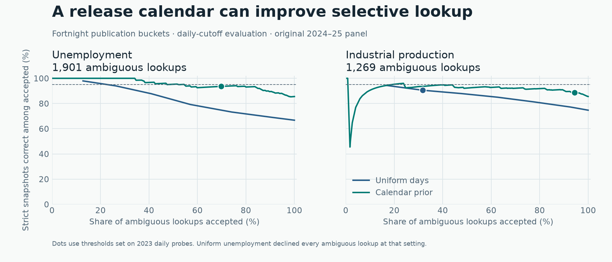

# Release calendars under coarsened revision dates

A publication calendar learned from earlier Eurostat release dates improved ranked guesses for some ambiguous revision queries. On the original 2024–25 unemployment panel with only week buckets, it found all 115 ambiguous snapshots. Using the same threshold on daily perturbations yielded 938 correct among 1,058 accepted ambiguous lookups. A strict reconstruction guarantee still requires a unique feasible snapshot under the known metadata.

## Matched observations and date prior

The typed address and its complete archive history are supplied. The published days are hidden behind week, fortnight or calendar-month buckets. A separate test also exposes within-bucket order. No timing information is read from the record ID. Each day's weight comes from unique release days between 2021 and 2022, with a smoothed rate per weekday or per weekday and day-of-month. The two indicators fit separately, using 48 and 78 unique release days. The uniform control gives every day the same weight.

Within a bucket, the model assigns a set of distinct release days probability proportional to the product of its day weights. If there are \(m\) releases in the cutoff bucket, the weight for \(k\) visible releases multiplies the \(k\)th elementary symmetric polynomial of the earlier day weights by the \((m-k)\)th polynomial of the later day weights. When order is absent, each eligible identity within the winning bucket gets equal mass. When order is supplied, the count determines which record wins. The analytical support matches the earlier feasibility audit, and 120 small weighted cases match exhaustive enumeration. Ties between equally weighted identities use opaque hashes.

Confidence thresholds maximize accepted ambiguous cases while targeting 95% exact snapshot precision on 2023 calibration. The development dates and prior are frozen before test. Authored tests include 234 original and 72 later-observation lookups per indicator. An additional daily probe takes up to seven days on either side of each prescribed cutoff, keeping probes within the original cutoff calendar year. This yields 3,402 original test and 1,068 later test lookups per indicator. Nearby cutoffs often share releases, so these counts describe the tested archive histories. The alternative daily threshold uses 2023 daily rather than authored lookups. A stricter variant must reach the same empirical precision in each 2023 quarter where it accepts cases.

## Snapshot precision and coverage

Each cell is **correct / accepted** on ambiguous lookups only. Rows use date buckets without order. Unique snapshots are admitted independently under every policy.

| Indicator and fixed test probe | Ambiguous | Uniform, authored calibration | Calendar, authored calibration | Calendar, daily calibration | Calendar, per-quarter daily calibration |
| --- | ---: | ---: | ---: | ---: | ---: |
| Unemployment, week, authored | 115 | 60 / 60 | 115 / 115 | — | — |
| Unemployment, fortnight, authored | 150 | 65 / 70 | 115 / 120 | — | — |
| Unemployment, week, daily | 1,073 | 643 / 713 | 938 / 1,058 | 773 / 788 | 573 / 578 |
| Unemployment, fortnight, daily | 1,901 | 683 / 778 | 1,416 / 1,511 | 1,241 / 1,326 | 400 / 400 |
| Unemployment, month, daily | 3,268 | 377 / 442 | 1,189 / 1,309 | 1,227 / 1,377 | 1,127 / 1,227 |
| Industry, week, daily | 443 | 156 / 168 | 210 / 248 | 280 / 333 | 275 / 323 |
| Industry, fortnight, daily | 1,269 | 948 / 1,269 | 1,080 / 1,232 | 1,062 / 1,198 | 774 / 839 |

On the later-observation daily week probe, daily calibrated unemployment reached 193/193 among 297 ambiguous cases, and daily calibrated industry reached 29/31 of 54. A calendar prior helps more on some indicators and can worsen exactness or precision elsewhere. On the original authored industry week panel, forced uniform choice happened to get 14/14 and the calendar choice got 2/14. Grouped calibration improves some coverage and error trade-offs. The 95% development target still fails on several held-out comparisons. Treat rule-based uniqueness as an exact statement and use calendar probabilities for empirical risk and coverage.

[Per-quarter counts and question-level outcomes](../../results/nonlinear_retrieval_natural/revision_calendar_prior_v1/) · [Weighted reconstruction and enumeration](../../scripts/audit_kam_revision_calendar_prior.py) · [Feasible snapshots without calendar assumptions](REVISION_CLOCK_RESOLUTION.md)
