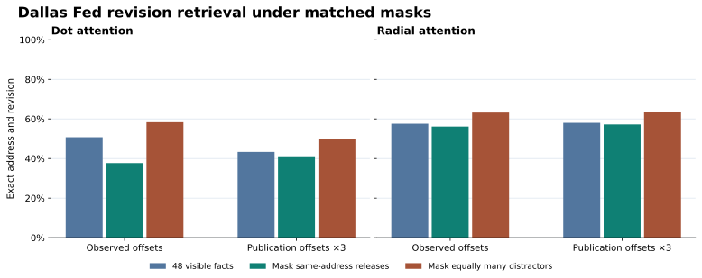

# Controlling revision clusters and checking unavailable cutoffs

The [Dallas Fed transfer study](OECD_REVISIONS.md) replaced same-address releases with records from other addresses. The new mask experiment keeps the underlying records, positions and payload assignments fixed and independently controls the number of visible same-address releases. A separate transfer test asks whether confidence identifies unsupported cutoffs under an exact availability oracle.

## Matched revision masking

Use the same 292 observation groups as the earlier Dallas Fed study, 584 answerable queries, two symbol recodings, and four matched fits per architecture. Each fit receives 13,516,800 training tokens from the same procedural release-cluster curriculum. Each test retains the 48 original fact slots and 48 alias slots. The query remains at the end, so visible records keep their relative positions and relative-lag biases.

- **Observed** exposes all 48 fact keys.
- **Three releases** preserves both of the group's target releases and the remaining same-address release closest to the cutoff. It masks the other same-address keys at every context layer and keeps all distractors visible.
- **Equal-count distractor mask** preserves the entire same-address history and masks the same number of distractor keys. The recoded fact order gives a reproducible random order for choosing those distractors.

Every query is checked with an independent maximum over eligible same-address releases. Tripling the publication offsets also preserves the eligibility and order of all candidates. The 48-slot comparison therefore keeps gold labels and position indices across interventions. At 16 candidates, some observations had too few distractors to support an equal-count control. The matched contrast uses the complete 48-slot cohort.

### Masking results

The eight fits ran on NVIDIA L4. The original unmasked predictions are reproduced at 48 candidates. Both masking arms retain 40–47 facts, with a median of 42. Each cell reports exact joint recovery over 4,672 query, recoding and seed combinations.

| Decoder and release clock | All facts | Three releases | Equal-count distractor mask |
| --- | ---: | ---: | ---: |
| Dot, observed offsets | 50.8% | 37.7% | 58.3% |
| Dot, offsets ×3 | 43.3% | 41.1% | 50.1% |
| Radial, observed offsets | 57.6% | 56.2% | 63.2% |
| Radial, offsets ×3 | 58.0% | 57.2% | 63.4% |



At the observed clock scale, masking same-address releases cost dot **13.1 percentage points** (95% paired interval −16.4 to −9.3) and radial **1.4 points** (−2.6 to −0.6) relative to their unmasked scores. Removing equally many distractors instead gained 7.6 points for dot (+6.3 to +8.9) and 5.7 for radial (+4.6 to +6.8). At matched active fact counts, masking same-address releases performed 20.7 points worse than masking distractors for dot and 7.1 worse for radial. Tripling publication offsets narrowed the dot contrast by 11.7 points (+8.9 to +14.5) and the radial contrast by 0.9 points (+0.1 to +2.1). These paired bootstrap intervals resample fit seeds and observation quarters as crossed blocks. The intervention measures the information these histories provide to this trained decoder. It also changes which release boundaries are visible. [Mask results and exploratory cluster bins](../../results/nonlinear_retrieval_natural/oecd_masks_v1/summary.json)

## Unavailable cutoff transfer

Train on procedural histories as above. Calibrate each checkpoint separately on 160 held-out Philadelphia Fed observation groups, then transfer unchanged thresholds to all 292 Dallas Fed groups. A paired case uses the same encoded address, records, positions, and payload codes, with the earlier answerable cutoff or the archived unavailable cutoff for that observation. Only fact release clocks move relative to the cutoff. Alias entries remain fixed because the identity is supplied. An independent eligibility calculation verifies every target and confirms that no same-address release is eligible on the unavailable cases.

Two confidence thresholds, maximum softmax probability and top-two logit margin over the payload vocabulary, target 90% answerable acceptance on the Philadelphia calibration set. Neither threshold is tuned on Dallas. A structured acceptance check instead permits an emitted record only when the emitted address is correct and the record comes from that address at or before the cutoff. This uses timestamps and the supplied typed identity. It is an exact eligibility certificate for the emitted record and can accept an earlier eligible release.

### Abstention results

The eight confidence fits ran on NVIDIA B200. Each Dallas condition has 2,336 answerable and 2,336 unavailable decisions per architecture. The main comparison uses the observed publication offsets.

| Decoder and policy | Answerable accepted | Unavailable accepted | Correct and accepted among answerable |
| --- | ---: | ---: | ---: |
| Dot, always emit | 100% | 100% | 51.5% |
| Dot, maximum probability | 68.3% | 40.3% | 43.6% |
| Dot, logit margin | 68.3% | 41.4% | 43.3% |
| Dot, exact eligibility check | 51.5% | 0% | 51.5% |
| Radial, always emit | 100% | 100% | 60.1% |
| Radial, maximum probability | 83.9% | 86.8% | 56.2% |
| Radial, logit margin | 84.2% | 88.6% | 56.5% |
| Radial, exact eligibility check | 60.1% | 0% | 60.1% |

Raw maximum probability ranked availability with mean per-fit AUROC of 0.684 for dot and 0.464 for radial under the observed clocks. With tripled offsets, radial AUROC rose to 0.726, yet the unchanged threshold still accepted 47.7% of unavailable cases. The structured check rejected every unavailable prediction and retained every exact success by construction. The result motivates carrying eligibility through the interface where identities and clocks are known, and testing availability separately from learned alias resolution. [Calibration and transfer results](../../results/nonlinear_retrieval_natural/oecd_abstention_v1/summary.json)

## Reproduce

Use the [Dallas fixture instructions](OECD_REVISIONS.md#reproduce) and [Philadelphia fixture instructions](../../docs/research/REPRODUCE_DATASET_STUDIES.md#recreate-real-revision-lookup). The [mask driver](../../slurm/nonlinear_retrieval_oecd_masks.sbatch) and [abstention driver](../../slurm/nonlinear_retrieval_oecd_abstention.sbatch) run the eight paired training configurations. The compact replay contains numeric predictions and run metadata.

```bash
results=results/nonlinear_retrieval_natural
python scripts/analyze_kam_oecd_masks.py "$results/oecd_masks_v1/replay.json.gz" \
  --provenance "$results/oecd_revisions_v1/provenance.json" --output /tmp/kam-masks.json
python scripts/analyze_kam_archive_abstention.py "$results/oecd_abstention_v1/replay.json.gz" \
  --output /tmp/kam-abstention.json
```
