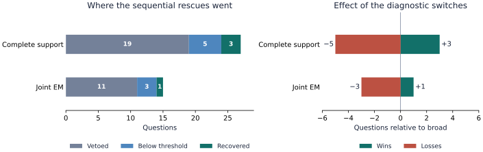

# Conservative sequential fallback on fresh HotpotQA pools

The calibrated fallback stayed with broad reranking on all 1,024 held-out questions. Broad recovered both support documents on **452 questions** and reached **285 joint exact matches**. The test reproduced sequential retrieval's oracle headroom, with **27 extra support recoveries** and **15 extra joint exact matches** available to a perfect selector. The tested pre-hop features and conservative link veto did not turn that headroom into gains.

## Design

The fixture contains 4,096 fresh HotpotQA bridge questions sampled from the official training data. Each question has two distinct annotated support titles. Question IDs, normalized question text, and gold support titles are disjoint within the fixture and against 17 reserved fixtures and the prior native-index questions. The earlier HotpotQA text source was checked for ID and normalized-text overlap. Each question has a sealed, ordered top-64 dense Wikipedia pool. The experts and reader stayed frozen throughout. The pooled corpus is shared across questions.

We split 3,072 development questions by a seeded hash of the question ID into 2,048 gate-fitting questions and 1,024 threshold-calibration questions. Another 1,024 questions form the held-out test. Broad uses the existing native sentence reranker. Learned sequential takes the top initial document, re-encodes the question with its text, then blends the original and conditioned affinities to pick the second document. Both methods choose from the same ordered pool and use the same frozen FLAN-T5-small reader with the same per-document token budget. Joint EM requires both gold documents and a normalized exact answer.

The gate only uses the broad pair's title link, link density in the full pool and among the top eight initial candidates, broad shortlist score margins, broad pair document affinities, sentence similarity and mention margins, the first-hop margin and its agreement with broad, and the number of query terms. Three L2-logistic fits rank unlinked gold pairs in complete fitting pools, sequential-only support wins among fitting disagreements, and sequential-only joint wins among fitting disagreements. The fallback score is half the sum of the three logits. Only 59 of 684 support disagreements and 37 of 439 joint disagreements favored sequential during fitting.

The conservative policy vetoes switches when the **selected broad pair** has a title link. On calibration, candidate thresholds target at most 1%, 2%, or 5% of all questions. A threshold must switch at least five questions, add at least two net joint exact matches, and preserve support recovery. Among qualifying thresholds, the rule prioritizes joint EM, then support, then fewer switches. The same absolute threshold applies to test queries. The 5% calibration threshold is also reported as a diagnostic regardless of whether it qualifies.

| Calibration switch budget | Switches | Support Δ | Joint EM Δ |
| --- | ---: | ---: | ---: |
| 1% | 10 | 0 | 0 |
| 2% | 20 | −1 | 0 |
| 5% | 51 | −1 | 0 |

## Held-out results

Each cell contains **complete support recoveries / joint exact matches**. A natural linked distractor pool contains both gold supports with a title mention joining them and at least one other linked pair.

| Cohort | Broad | Sequential | Conservative fallback | 5% calibration threshold | Two-arm oracle |
| --- | ---: | ---: | ---: | ---: | ---: |
| All 1,024 | **452 / 285** | 178 / 116 | **452 / 285** | 451 / 283 | 479 / 300 |
| Both gold documents present, 591 | 452 / 285 | 178 / 116 | 452 / 285 | 451 / 283 | 479 / 300 |
| Gold pair unlinked, 150 | 56 / 33 | 45 / 20 | 56 / 33 | 55 / 31 | 75 / 41 |
| Natural linked distractors, 426 | 381 / 241 | 130 / 93 | 381 / 241 | 381 / 241 | 389 / 248 |
| Broad pair visibly unlinked, 365 | 56 / 33 | 34 / 16 | 56 / 33 | 55 / 31 | 64 / 37 |

The 5% calibration threshold switched 68 test questions (6.6%). Twenty-one had both gold documents in the pool, and all 21 had unlinked gold pairs. The switches produced three support wins and four losses, and one joint exact win and three losses. Across all questions the paired 95% bootstrap intervals were **−0.59 to +0.39 percentage points** for support and **−0.59 to +0.20** for joint EM, using 5,000 question resamples. Switching whenever broad's selected pair was unlinked switched 365 questions and fell to 430 support recoveries and 268 joint exact matches overall.



On complete test pools, the fitted link classifier ranked gold-unlinked cases with **0.919 AUROC** (150 positives in 591). Within the 150 gold-unlinked pools, the combined switch score achieved **0.540 AUROC** for sequential-only support wins (19 positives) and **0.551** for sequential-only joint wins (8 positives). Among the 365 cases allowed by the broad-link veto, the corresponding AUROCs were 0.728 and 0.750, based on 8 and 4 positives. The veto excluded 19 of 27 overall support rescues and 11 of 15 overall joint rescues. Within the gold-unlinked subset it excluded 12 of 19 support rescues and 5 of 8 joint rescues. A title link in broad's predicted pair can belong to a distractor, even when the gold documents are unlinked.

The tested gate is effective at detecting unlinked gold pairs and much weaker at predicting which sequential trajectory will help. The 433 pools missing a gold document also cap both frozen retrievers. No ranking rule over these 64 articles can recover a document absent from its pool. This evaluation measures decision quality and switch frequency. It did not benchmark serving latency.

## Reproduce

HPG array **52942336** froze the pools on B200 and RTX PRO 6000 GPUs. Array **52942616** scored the paired runs in eight RTX PRO 6000 Blackwell shards with 512 questions each. The [Slurm driver](../../slurm/nonlinear_retrieval_sequential_fallback.sbatch), [fresh fixture, sealed pools, and paired replay](../../results/nonlinear_retrieval_natural/sequential_fallback_v1/), and [cohort provenance](../../results/nonlinear_retrieval_natural/sequential_fallback_v1/provenance.json) record the inputs. The replay verifies every pool hash, feature schema, and pair support label before fitting or scoring the gate.

```bash
base=results/nonlinear_retrieval_natural
study="$base/sequential_fallback_v1"
options=(--fixture "$study/fixture.json.gz" --pools "$study/pools.json.gz"
         --fitted "$base/native_sentence_refit_v1/fitted.json" --output /tmp/kam-sequential-fallback.json)
OPENBLAS_NUM_THREADS=1 python scripts/analyze_kam_sequential_fallback.py "$study/replay.json.gz" "${options[@]}"
diff -u "$study/summary.json" /tmp/kam-sequential-fallback.json
```
